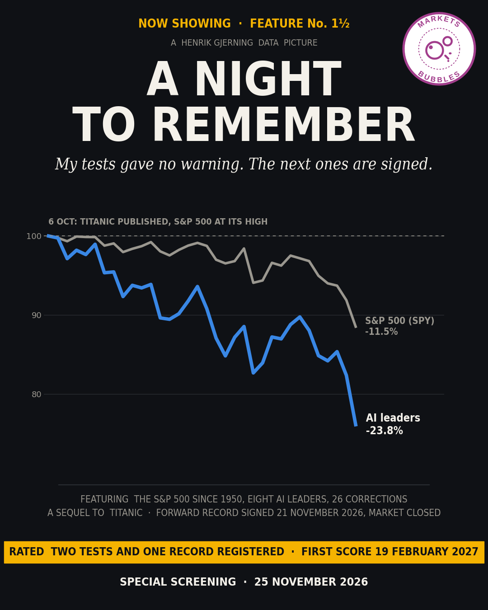
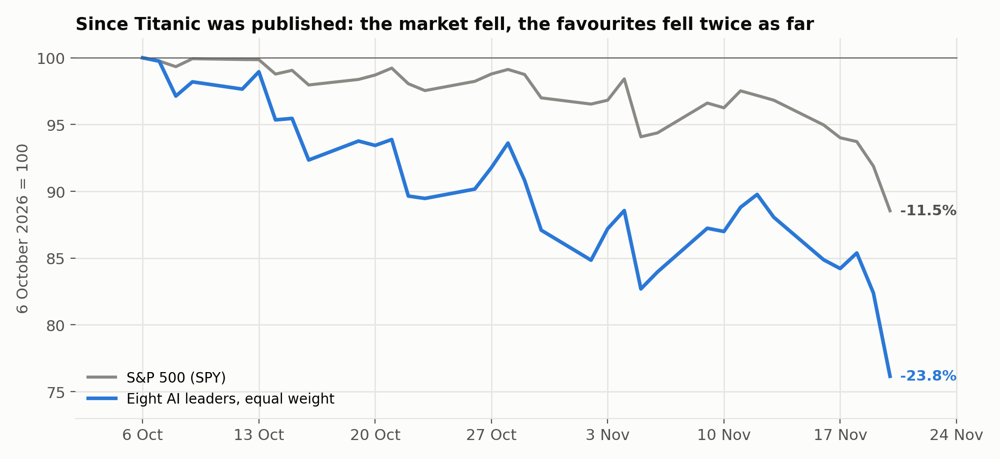
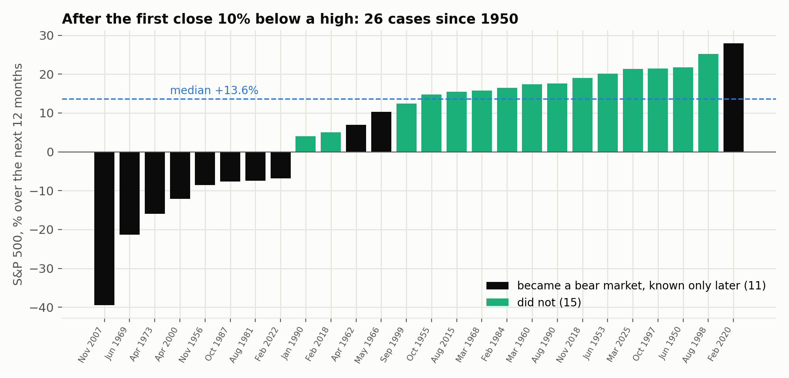
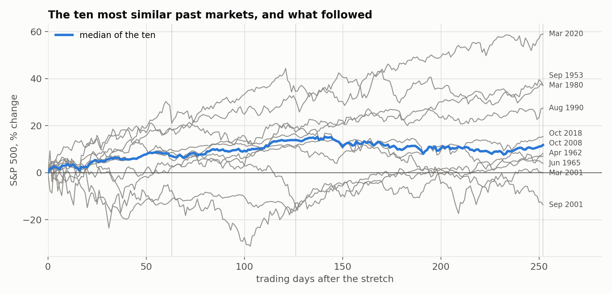

# A Night to Remember: what my pre-registered tests missed

### On 6 October I published three signed tests of the AI boom. The S&P 500 closed at its high that same day. Six weeks later the favourites had lost a quarter. This is the dated record of what I had tested, why none of it gave a warning, and what is signed now.

*Henrik Gjerning · Rude Investment Consulting · November 2026 · Project 10, article A68 · Now Showing No. 1½, sequel to No. 1 Titanic · prices to the close of 20 November 2026 · update box to the close of 24 November 2026*

> **Update, 25 November 2026: what happened after I signed.** This article was written on prices to Friday 20 November, and nothing below this box has been changed. On Monday 23 November Nvidia's board reinstated the chief executive who had resigned on 12 November. Nvidia rose 31.5% that day and the S&P 500 4.7%, its best day since 9 April 2025. At the close of Tuesday 24 November the index stood at 7,201.09, 7.9% below the high of 6 October and no longer 10% down. The basket of eight is 20.4% below 6 October (it was 23.8% on Friday) and Nvidia 35.1% (it was 47.5%). My tests did not see this coming either: nothing I had signed says anything about a single day. Three things for the reader. The count in section 4 starts from the first close 10% below a high, which was Friday; in 5 of the 26 earlier cases that day was also the low, so a rebound from it is one of the ordinary outcomes. The forward record in section 5 was signed, and committed in public, before Monday's open and starts from Friday's close: after 2 trading days the S&P 500 is 4.2% above it, against the +4.9% the analog forecast needs at three months, and the basket is +5.4% against +4.2% for SPY. That is 2 trading days of a year, and I read nothing into it. And the line in section 6 that a rally may settle nothing was written before this one.

<!-- box -->

> **The teaser asked.** 1) Did my own tests see it coming? 2) What were they built to see, and over what horizon? 3) What usually follows the first 10% fall? *Answers at the end, before the limits.*

<!-- box -->

> **In one paragraph.** This article has one subject: what a set of tests, signed and dated before a market fall, was worth when the fall came. On 6 October 2026 I published Titanic, three pre-registered tests of the AI boom. The S&P 500 closed at its high that same day, which is luck and not a forecast. By 20 November the index was 11.6% lower and a basket of eight AI leaders had lost 23.8%. I had four sets of tests on record before 20 November. None gave a warning, and the one finding that passed cannot be read yet. The reason is the same for all four: they describe odds over 12 to 24 months, and this fall took 33 trading days. What I can offer instead is a count and a commitment. Of 26 earlier 10% falls since 1950, 11 became bear markets. And a forward record was signed on Saturday 21 November, with the market closed; its first number is scored on 19 February 2027.

<!-- box -->

> **Statistics box.** No test in this article looks backward for a signal that "would have warned"; with the answer known, such a test always finds one. **On record before 20 November:** Titanic, 3 trials, 1 passed (C1-3: 48.0% against 38.3%, z 9.6, signed 25 September 2026; a check of 14 October found most of that gap disappears against equally volatile stocks). Raise the Titanic, signed and run 14 October 2026: 21 trials on analog forecasts, 3 passed their gate (one return test across 16 countries, two volatility tests); checks made after the run show none beat a simple average as a forecast. The Devil Wears Prada, signed and run 27 October 2026: 2 trials on investment fashions, 0 passed. The 200-day alarm in Last Man Standing, signed 22 October 2026: 2 trials, 0 passed. Only Titanic is published; the trial ledgers of the others are published with this article. **Descriptive, not gated:** 26 falls of 10% in the S&P 500 since 1950 (closing prices, price index, highs counted from 1950), with the count repeated at other thresholds. **Registered now:** FR-AI-1, signed 21 November 2026 12:11 CET, two scored lines and one record; line 2 was run once, at 12:19, after signature. The programme ledger stands at 305 trials run, 328 counted for the multiple-testing corrections (22 November 2026). Not investment advice.

*Figure 1. The eight AI leaders (equal weight on 6 October, held without rebalancing) and the S&P 500 tracker SPY since Titanic was published on 6 October 2026. Index 100 on that day.*

---

## 1. Six weeks

Titanic went out on Tuesday 6 October. The S&P 500 closed that day at 7,818.93 and has not closed higher since. I did not call a top. The article said the price path was not explosive, and the date is luck.

Three things then happened. On 12 November the chief executive of Nvidia resigned. On 19 November the largest IPO on record listed, and fell the next day. On Friday 20 November the S&P 500 closed at 6,910.39, 11.6% below its high, the first close more than 10% down.

The eight names did worse than the market. From 6 October to 20 November the equal-weight basket lost 23.8% and SPY lost 11.5%. The basket was already 17.3% down on 5 November, a week before the resignation. The eight were fixed in Titanic's registration on 25 September, before any of this.

| Name | 6 Oct to 20 Nov 2026 |
|---|---:|
| Nvidia | −47.5% |
| AMD | −34.7% |
| Oracle | −29.8% |
| Meta | −24.1% |
| Alphabet | −23.7% |
| Broadcom | −19.0% |
| Microsoft | −8.3% |
| Amazon | −3.7% |

This article does not explain the fall and takes no view on the companies or the people. Two disclosures. I hold positions in AI-related stocks, which may include companies named in this article. And the article was drafted with Claude, an AI model made by Anthropic, the company whose IPO is mentioned above.

## 2. The record: what was signed, and when

Everything in this table was written down, signed and dated before 20 November. Only Titanic was signed before the index peaked; by 14 October the basket was already 4.6% down and by 27 October 8.2%.

| Signed | Test | What it found | Read on 21 November |
|---|---|---|---|
| 25 Sep | Titanic: is the AI price path explosive? | No. Both trials failed (basket p 0.062) | Gave no warning |
| 25 Sep | Titanic: are stocks crash-prone after doubling? | Yes: 48.0% against 38.3% within 24 months | Cannot be read yet |
| 25 Sep | Titanic: is it expensive? (reported, not gated) | Yes: not 2000-expensive on earnings, as expensive on free cash flow | Unchanged |
| 14 Oct | Raise the Titanic: do the most similar past markets forecast the next 12 months? (21 trials, monthly data) | 3 passed their gate, none beat a simple average as a forecast. For US large caps the analog forecast was worse than the historical average | No signal |
| 22 Oct | Last Man Standing: does a 200-day moving-average alarm come before half the fall? (15 earlier crashes) | In 6 of 15, against 30% by chance; not distinguishable | No signal |
| 27 Oct | The Devil Wears Prada: do themes lose after they are in fashion, and gain while attention is rising? (18 themes, 36 funds) | Neither. Loud themes: 4.4% behind over 24 months, p 0.21. Rising themes: 4.1% behind over 12 months, the opposite of the hypothesis | No sell signal |

So the answer to "did my tests see it coming" is no. Two other records are open. No. 2 Groundhog Day registered a forecast for the S&P 500 from 3 November 2026 to 16 March 2027: +4.72%, with an 80% range of −8.93% to +18.20%. On 20 November the index stood 8.7% below the 3 November close, at the bottom of that range. It is not re-forecast here. No. 3 The Magnificent Seven showed the top ten stocks rising from 21% to 39% of the index and found no evidence that concentration bites. That verdict is unchanged, and less comfortable.

## 3. Why none of them could see it, and what I learned

**The explosiveness test measures the shape of a rise, not its end.** It asks whether a price is rising faster than its own history, month by month. It found no such phase in the basket in 2023 to 2026. It did report Nvidia as explosive twice in 2024 and 2025, and the S&P 500 itself above its 95% line from April 2026, which I called "a flicker, not a pass". *What I learned:* my first version said that under this definition "there is no evidence of an active" bubble, which is easy to read as "safe". After external review I narrowed it on 8 October to "no evidence of explosiveness under one definition". A bubble test should be published with what it cannot say.

**The doubling test gives odds over two years, and most of it is volatility.** The one trial that passed said that stocks which had doubled in two years were more likely to fall 40% within the next two. It is tempting to point at Nvidia, down 47.5% in six weeks. But Nvidia had not doubled: it was up 83% over two years when Titanic was written. The three names that had doubled at the end of September (AMD, Alphabet and Broadcom) have fallen 34.7%, 23.7% and 19.0%. None has fallen 40%, and the horizon is 24 months. A check added on 14 October compared stocks after a run-up with equally volatile stocks in the same month: the gap fell from 19 points to 4 and was not significant (t 0.69). *What I learned:* the finding says that volatile stocks fall hard more often, which is an argument about the size of a position and not about timing. And my own labels misled me: on 30 October, on the point-in-time list of the 1,500 largest US stocks, only one of the eight leaders, AMD, had doubled over two years (Titanic counted three at the end of September, on a different panel). Nvidia was up 47% over that period and Oracle was down 23%. The "AI leaders" and the "stocks that doubled" are mostly different stocks.

**The analog tests compare today with the past, and the past did not agree with itself.** On 14 October I tested whether the most similar past markets forecast the next 12 months, in 21 variants on monthly data. For US large caps from 1950 to 2024 the analog forecast was worse than the plain historical average (out-of-sample R² −0.21). The three that passed their gate did not survive a comparison with a simple average. *What I learned:* similar-looking markets were followed by very different years, so the average of a few neighbours is noisier than the average of all years.

**The fashion tests measure a state, not a turning point.** AI filled 3.97% of the New York Times articles I counted in 2026, about 20 times its level in the 1980s. My two tests of 18 investment themes, signed 24 days before the index's first 10% close, did not find that loud themes reliably lose afterwards. The AI theme funds were 5.9% ahead of developed markets two years after AI's own loud months, and 5.8% ahead after all months: loudness made no difference. *What I learned:* a theme can stay loud for years. Being in fashion was not a reason to sell, and I will not pretend now that it was.

**What the four have in common.** Each describes odds over 12 to 24 months. This fall took 33 trading days from the high and followed a resignation and a listing. None of my tests works at that horizon, and none was designed to. That is not proof that it could not be forecast; it is a statement about what I had tested. A test run today on whether some signal "would have warned us" would be hindsight, so none is run. What can be done honestly is the other direction: fix a rule today and let the future score it. That is section 5.

## 4. What I can say instead: the count

This section is descriptive. It counts; it tests nothing. The 26 cases are not 26 draws from one distribution: 1953, 1962, 1980, 2008 and 2020 had little in common beyond the size of the fall.

Since 1950 the S&P 500 had closed 10% below a previous high 26 times before this one. Measured from the first day it did so:

| | 3 months | 6 months | 12 months |
|---|---:|---:|---:|
| Median return | +2.5% | +5.7% | +13.6% |
| Share of cases up | 62% | 73% | 69% |
| Worst decile of cases, at or below | −5.5% | −9.0% | −14.0% |
| Best decile of cases, at or above | +11.4% | +19.0% | +21.6% |
| Median if it did not become a bear market (15 cases) | +6.1% | +12.6% | +17.4% |
| Median if it did (11 cases) | −2.1% | −3.6% | −7.7% |

- **11 of the 26 became bear markets**, a fall of 20% from the high on closing prices. That is 42%. The line is sharp: 4 more stopped between 18.9% and 19.9%.
- **In 21 of the 26 the first 10% day was not the low.** The median further fall after that day was 9.9%, and the median total fall was 19.6%.
- **This one was fast but not unusual.** It took 33 trading days from the high; the median is 48.5, and 10 of the 26 were as fast or faster.
- **Recovery takes time.** The median wait for a new high was 205 trading days from the first 10% day, about 10 months, and 291.5 trading days from the old high.

The median flatters. The mean return over the year after these 26 falls was +6.7%, against +9.3% for any 12-month stretch since 1950, and the share of cases up was 69% against 74%. The median (+13.6% against +10.5%) points the other way. With 26 cases neither difference means anything. What the table does say is that the outcome splits in two, and my tests cannot tell on the day which half this is.

**How much depends on my choices.** The threshold of 10%, the start in 1950 and closing prices are conventions, not theory: 10% is the market's own word for a correction, most daily histories of the index start in 1950, and the index did not pass its 1929 record until 1954. The same count with other choices:

| Fall counted from | Cases | Became bear markets | Median next 12 months | Mean next 12 months | Median further fall |
|---|---:|---:|---:|---:|---:|
| 8% below a high, since 1950 | 36 | 11 (31%) | +12.0% | +8.6% | −5.0% |
| 10% below a high, since 1950 (as above) | 26 | 11 (42%) | +13.6% | +6.7% | −9.9% |
| 12% below a high, since 1950 | 21 | 11 (52%) | +15.9% | +8.3% | −10.6% |
| 15% below a high, since 1950 | 15 | 11 (73%) | +14.7% | +10.0% | −13.2% |
| 10% below a record high, since 1928 | 26 | 12 (46%) | +11.4% | +5.3% | −10.3% |

The share that became bear markets rises with the threshold by construction: the deeper the starting point, the fewer shallow cases are left. The year that followed looks much the same across the rows: medians between +11.4% and +15.9%. Dividends are left out throughout; they would raise every row.

*Figure 2. The S&P 500's return over the 12 months after each first close 10% below a high, 1950 to 2025, labelled by the month of that close. Dark bars became bear markets, which was known only later.*

**Three earlier favourites.** Titanic compared the AI basket with the S&P 500 of 1929, the Nikkei of 1989 and the Nasdaq of 2000. All three were bubbles, which is why they are here: they show what the bad half looks like, not how likely it is. The table shows what followed the first day each closed as far below its peak as the AI basket now is below 6 October (23.8%; the falls were sharp, so the three were 28.6%, 28.0% and 25.3% down on that day).

| | That day | 3 months later | 6 months later | 12 months later | Lowest in the next 3 years |
|---|---|---:|---:|---:|---:|
| S&P 500, 1929 | 28 Oct 1929 | +0.2% | +3.6% | −25.5% | −80.7% |
| Nikkei 225, 1989 | 2 Apr 1990 | +15.8% | −27.8% | −6.2% | −48.9% |
| Nasdaq Composite, 2000 | 12 Apr 2000 | +10.7% | −15.9% | −48.0% | −70.4% |

Two of the three rose over the first three months, and all three were lower a year later. The rally depends on where the count starts. Measured instead from the day each was as far down as the S&P 500 is now (11.6%), none rallied: −20.5%, −1.2% and −13.0% after three months. An index 23.8% down is also a larger event than eight stocks 23.8% down. Three cases are an anecdote.

## 5. What is signed now

FR-AI-1 was signed on Saturday 21 November 2026 at 12:11 CET, after Friday's close and before Monday's open. It has three lines.

**Line 1, the fallen favourite (a record, not a test).** The eight-name basket, rebalanced monthly, against SPY from the close of 20 November 2026 to the close of 19 November 2027. I make no call. One observation cannot be tested, and I will report the two returns.

**Line 2, the chart everyone posts.** In a fall, people reach for the chart that lays today over 2008 or 2020, and I have used it myself. I registered a daily version of it so that it is scored in public: the last 60 daily closes of the S&P 500, the 10 most similar 60-day stretches since 1950, and the median of what followed. The ten stretches are in the appendix.

| | 3 months (19 Feb 2027) | 6 months (20 May 2027) | 12 months (19 Nov 2027) |
|---|---:|---:|---:|
| Analog forecast (median of the ten) | +7.1% | +13.9% | +11.8% |
| Lowest and highest of the ten | −11.4% to +21.0% | −16.4% to +34.6% | −13.7% to +59.0% |
| Baseline (median of any day since 1950) | +2.7% | +5.1% | +10.5% |
| The analogs score if the S&P 500 return is above | +4.9% | +9.5% | +11.1% |
| Share of all days since 1950 below that level | 64% | 69% | 52% |

I do not ask anyone to take the analog forecast seriously, and I do not. A monthly version of the idea lost to the average in my own test five weeks ago. The forecast moves with its settings: computed after the run and not scored, the 3-month figure runs from +2.9% (five nearest) to +18.0% (three nearest). After signing, and after I had seen the forecast, I wrote down that I expect the baseline to win at least two of the three; that is not a registered prediction, and the last row shows that history alone favours it. There are three scores and no pass mark. One outcome cannot confirm or refute a method, and the three horizons overlap, so this is one bet read three times.

**Line 3, the doubling finding, tested forward.** On 30 October 2026, 179 stocks in the US top 1,500 had doubled over two years; 1,254 had not; 67 had no two-year history and are left out. The list is point-in-time, so stocks that later die stay in. The hypothesis is that a larger share of the 179 will be 40% or more below their 30 October price at a month-end up to 31 October 2028 (one-sided test of two proportions, p below 0.05, standard errors clustered by sector). It is scored then, with an interim read on 30 October 2027.

Three weaknesses of line 3 belong beside it. The groups and starting prices are those of 30 October, three weeks before I signed, because that is the last month-end in my price file; the sell-off of those three weeks is inside the measurement. I had no prices after 30 October for the 1,433 stocks when I signed, but I knew the index was 8.7% lower and what the eight leaders had done. There is one start date, so the stocks share one market, and a pass is weaker than it looks. And because the earlier finding was mostly a volatility effect, the result will also be reported against equally volatile stocks.

## 6. What I take from it

- **None of my tests timed this, and none was built to.** They give odds over one to two years. Knowing that is worth more than a signal I found afterwards.
- **A signed "I did not see it" is rarer than a forecast.** Everything in section 2 can be checked against a dated file.
- **A correction is a fact, not a forecast.** 11 of 26 became bear markets and 15 did not. Expect either.
- **A rally in the next three months may settle nothing.** Two of three earlier favourites rallied first, and all three were lower a year on.
- **Be wary of the chart that lays today over 2008 or 2020.** A monthly version of it lost to the average in my test of 14 October, and the daily version changes with its settings.
- **Come back on 19 February 2027.** That is the first day a number in this article is scored.

<!-- box -->

> **The teaser's questions, answered.** 1) No. The explosiveness test gave no warning, the analog, alarm and fashion tests found no signal, and the crash-after-doubling finding cannot be read yet (section 2). 2) Odds over 12 to 24 months: the shape of a rise, the fate of stocks that doubled, the year after similar markets, the years after a theme is loud. This fall took 33 trading days (section 3). 3) 11 of 26 earlier cases became bear markets; the median return over the next year was +13.6% and the mean +6.7%; in the 11 the median was −7.7% (section 4).

## 7. Limits

- The record in section 2 is one episode. It neither confirms nor refutes Titanic's tests. The lessons in section 3 are my reading, not test results.
- Raise the Titanic, The Devil Wears Prada and Last Man Standing are signed and run but not yet published; only Titanic is.
- Section 4 uses 26 cases that are not independent, a price index without dividends, closing prices and highs counted from 1950. The three favourites are the three bubbles Titanic used, not a sample, and the result depends on the depth at which the count starts.
- The basket of eight was fixed on 25 September 2026 as that month's leaders. Another reasonable basket would give other numbers in section 1; the record in section 2 does not depend on it.
- The analog rule is one rule and the forecast is sensitive to its settings. It is not the rule tested on 14 October.
- The registration has four dated notes, all written after signature. Note 1 corrects two wording errors of mine in line 3 (the universe and the crash definition) and leaves out 67 stocks without history. Note 2 fixes details of line 2 that the signed text left open, before the run: closes and not returns, a price index, and the trading-day horizons. Note 3 records that I had not checked my own earlier analog test before proposing line 2, and my expectation. Note 4 adds the volatility-matched comparison and the treatment of delisted stocks to line 3. Line 3's start date precedes the signature by three weeks.
- The signing time rests on my own files and the conversation log in which I signed. The pre-registration was also committed to the public repository and pushed on 21 November 2026 at 14:02 CET, before the US open of 23 November: commit 2c4c2c3 (github.com/Hgjerning/now-showing/commit/2c4c2c36a453efab277bbb2692f297e5c83b543e).

*Not investment advice. I hold positions in AI-related stocks, which may include companies named in this article.*

## Appendix: the ten most similar stretches (line 2)

| Rank | Stretch ending | 3 months | 6 months | 12 months |
|---:|---|---:|---:|---:|
| 1 | 8 Oct 2008 | −7.6% | −13.0% | +8.2% |
| 2 | 12 Mar 2020 | +21.0% | +34.6% | +59.0% |
| 3 | 21 Sep 2001 | +18.0% | +17.2% | −13.7% |
| 4 | 30 Apr 1962 | −11.4% | −16.4% | +7.0% |
| 5 | 23 Aug 1990 | +2.9% | +19.1% | +27.4% |
| 6 | 16 Mar 2001 | +5.5% | −14.4% | −0.2% |
| 7 | 29 Oct 2018 | +2.4% | +10.5% | +15.4% |
| 8 | 27 Mar 1980 | +18.3% | +31.1% | +37.1% |
| 9 | 29 Jun 1965 | +9.7% | +11.4% | +4.0% |
| 10 | 16 Sep 1953 | +8.6% | +16.4% | +37.2% |

The rule was fixed before it was run: stretches end before 20 November 2025 and lie at least 120 trading days apart. The three nearest are October 2008, March 2020 and September 2001, days of panic, some of which were lows; the nearest of all was followed by a further fall of 13.0% over six months. With one setting changed (computed after the run, not scored), a 40-day pattern gives +3.1% at three months and daily returns in place of closes give +4.8%. The scoring days are calendar dates and fall a few trading days short of the 63, 126 and 252 the forecast uses.

*Figure 3. What the S&P 500 did over the 252 trading days after each of the ten most similar stretches. The thick line is the median.*

## References

- Greenwood, R., Shleifer, A. and You, Y. (2019). Bubbles for Fama. *Journal of Financial Economics* 131, 20–43.
- Phillips, P. C. B., Shi, S. and Yu, J. (2015). Testing for multiple bubbles. *International Economic Review* 56, 1043–1078.
- Gjerning, H. (2026). Titanic: every bubble was unsinkable. Is this one? Now Showing No. 1, 6 October 2026.
- Pre-registration FR-AI-1, signed 21 November 2026, with dated notes 1 to 4, the trial ledger and the independent stress test of 21 November 2026, in this article's folder. Trial ledgers, in `ledgers/` in this article's folder: Raise the Titanic (trials A52-1 to A52-21, 14 October 2026, not yet scheduled), The Devil Wears Prada (A62-1 and A62-2, 27 October 2026; No. 13, 29 December 2026) and Last Man Standing (A58-1 to A58-4b, of which the 200-day alarm is A58-4a and A58-4b, 22 October 2026; No. 47, 24 August 2027). The trial codes are the ones signed at the time; the feature numbers are today's.
