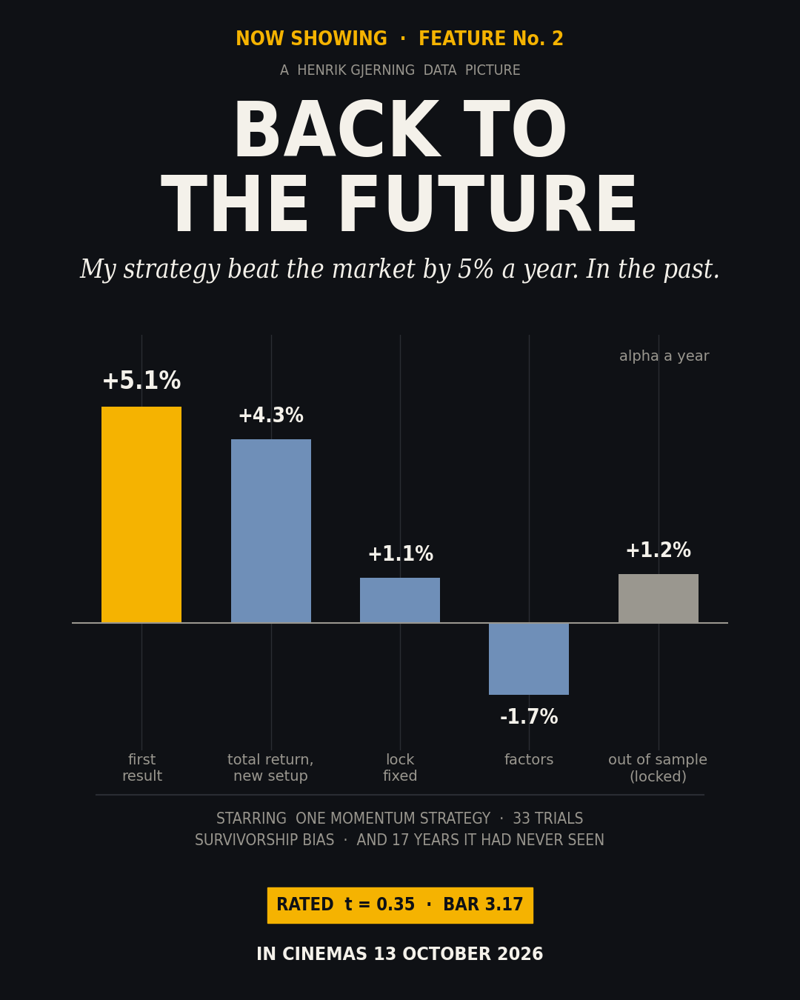
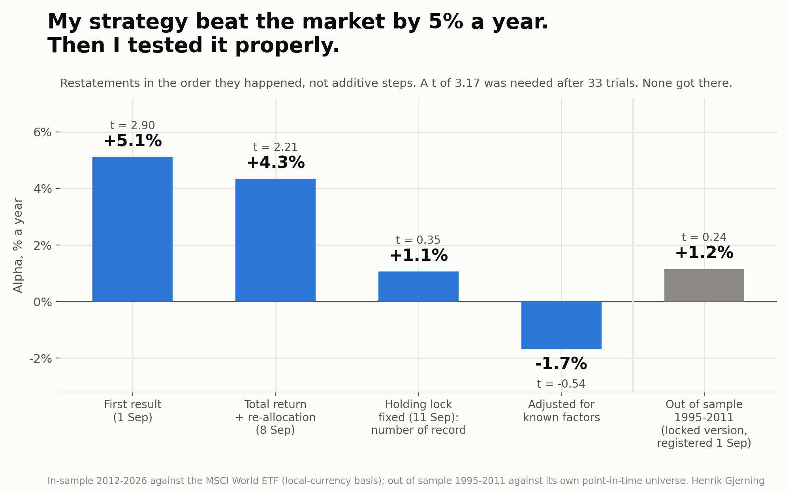
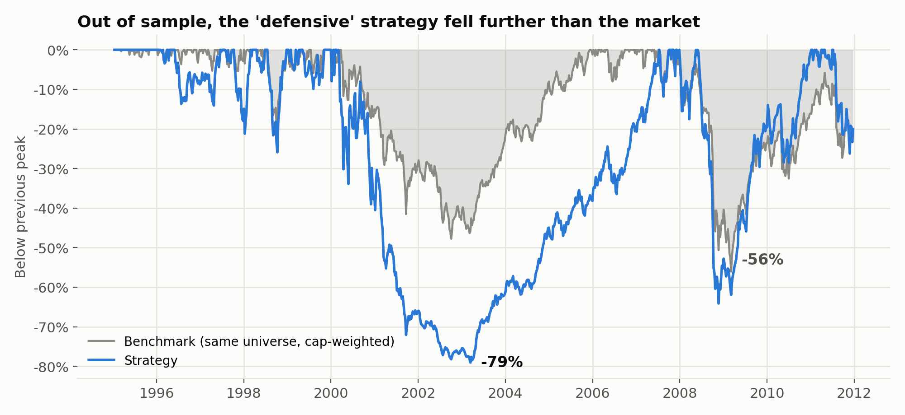
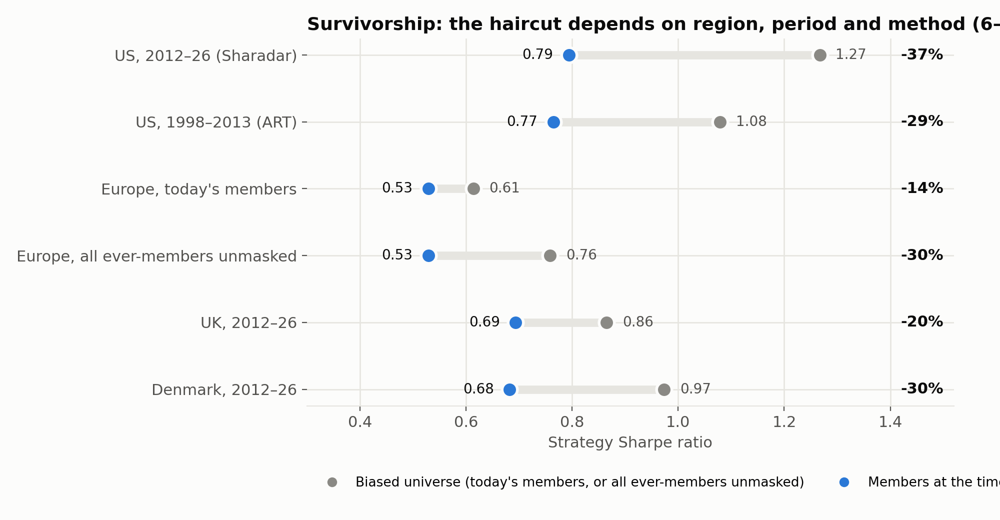
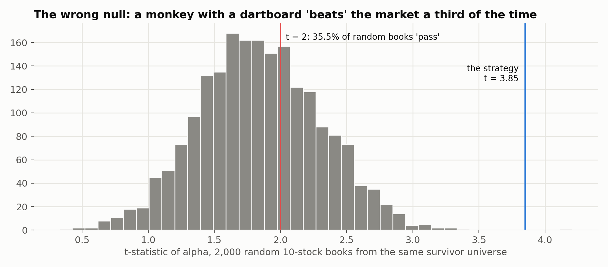
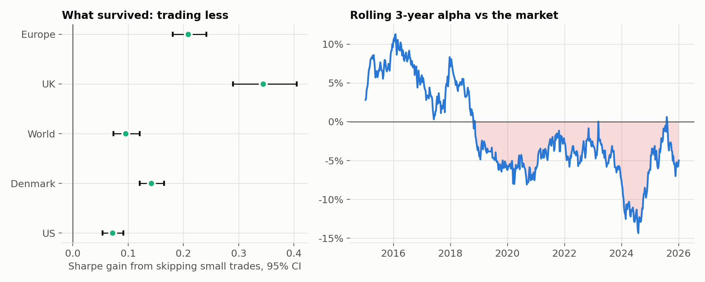

# Back to the Future: my strategy beat the market by 5% a year. In the past.

### One momentum strategy, two weeks of checking, and what was left



*Henrik Gjerning · Rude Investment Consulting · Project 10, Case 33 · version 3, 9 October 2026 (revised after an independent stress test; changes listed at the end)*

> **In one paragraph.** On 1 September 2026 a weekly momentum strategy I had built showed **+5.1% a year of alpha** against the MSCI World ETF (t 2.90). Two weeks of checking later its number of record is **+1.1% (t 0.35)**, with a Sharpe ratio below the benchmark's. Most of the fall came when I fixed a holding rule that had quietly frozen the book into buy-and-hold. A test I had registered in advance, on seventeen years of point-in-time data the strategy had never seen, found **no evidence of an edge** (+1.2% a year, t 0.24). It also ran into a **-79% drawdown** against the market's -56%. That test could not have confirmed even the original +5.1%, so it is a failure to find an edge, not proof that there is none. Each mistake is a common one, and together they made an ordinary strategy look exceptional. The only thing that held up was **trading less**.

**Statistics box.**

- **In-sample:** 764 weeks, 2012-01-20 to 2026-09-04. The book holds nothing until 2013-02-08, so its first 55 weeks return zero.
- **First result:** alpha +5.11% a year, t 2.90 (block bootstrap).
- **Number of record:** alpha +1.06% a year, 95% CI [-4.8%, +7.1%], t 0.35 (block bootstrap) / 0.33 (OLS); beta 0.85; Sharpe 0.663 vs 0.819.
  - From the first holding: +1.93%, t 0.58, Sharpe 0.689 vs 0.775.
  - After a later portfolio-weight fix (2 October; `data/record_updates.csv`): +0.86%, Sharpe 0.642 vs 0.814.
- **Out of sample** (registered 1 September, pass rule t > 2): 885 weeks, alpha +1.15%, t 0.24 (registered estimator) / 0.29 (OLS), **failed**. From the first holding: +3.33%, t 0.80 (OLS).
- **Trials:** 33, Bonferroni bar t 3.17.
- **Factor-adjusted alpha** (13 JKP themes): -1.69%, t -0.54.



---

## 1. The result that looked too good

The strategy is a long-only, weekly-rebalanced momentum book, built on the effect documented by Jegadeesh & Titman (1993).

- **Selection:** each week it ranks large-cap stocks in the US and Europe on eight price-only features (12- and 6-month momentum, trend, volatility, short-term reversal and a few more) and holds the ten best per region, weighted by inverse volatility.
- **Costs:** it pays a measured, realistic commission and prefers names it already holds, to save turnover.
- **Cash:** it keeps 15% in cash, which lowers its beta mechanically.

The first regression against the MSCI World ETF, over 2012–2026, gave +5.11% a year, t 2.90, and a Sharpe ratio of 0.945 against the benchmark's 0.695.

How sure was that t? Four reasonable estimators gave 2.34 to 2.91. Leaving out the first year, when the book held nothing, gives 3.49, a number flagged on 2 September and deliberately not acted on. All of these readings miss the project's multiple-testing bar (section 6).

## 2. The restatements

**Table 1. The strategy, restated in the order things were found**

| # | Date (2026) | Restatement | What changed | Alpha / yr | t (type) | Sharpe: strategy vs benchmark |
|---|---|---|---|---:|---|---|
| 1 | 09-01 | First result | Price-only closes for the non-US legs and the benchmark; four regions (US 35, DK 30, UK 20, EU 15); holding bonus 0.05 (absolute) | **+5.11%** | 2.90 (block bootstrap) | 0.945 vs 0.695 |
| 2 | 09-08 | Total return, new allocation | Dividends added to every leg and the benchmark. Between rows 1 and 2 the book was also re-allocated to 50/50 US/Europe (trial 32), and the holding bonus was re-parametrised to 8 standard deviations by a parameter sweep (trial 33) | **+4.34%** | 2.21 (block bootstrap) | 0.932 vs 0.819 |
| 3 | 09-11 | Holding lock fixed: **number of record** | The bonus of 8 had frozen the book into about 40 names held for years; reset to 4 on mechanics | **+1.06%** | 0.35 (block bootstrap) | 0.663 vs 0.819 |
| 4 | 09-12 | Factor-adjusted (13 JKP themes) | With the lock gone, the momentum loading is +0.51 (t 5.8) | **-1.69%** | -0.54 (OLS) | n/a |
| OOS | 09-01 | Out of sample, 1995–2011 | The 1 September rules (bonus 0.05, the original lock) on a point-in-time universe never used in development | **+1.15%** | 0.24 | 0.475 vs 0.540 |

*Rows are restatements, not additive components. Sources for every row are in `data/waterfall_sources.csv`.*

**What can and cannot be said about the fall from +5.11% to +1.06%.**

- **Rows 1 to 2:** this step bundles three changes (dividends, the re-allocation and the bonus re-parametrisation), and no weekly series exists to separate them. I therefore do not split it.
- **Rows 2 to 3:** this step is one change: the holding lock was undone. It took 3.3 points.
- **The first book was already locked.** At an absolute bonus of 0.05 it was described at the time as "ten stocks picked on 2013-02-08 and then held". The sweep's bonus of 8 re-created the same lock. So "the lock" is a single mistake that appears twice.

**Not on the path: currency.** The European legs were summed in their local currencies (EUR, SEK, DKK, CHF, PLN), as if hedged for free, while the benchmark is an unhedged USD fund. Measured on the row-2 book, the alpha in USD is +3.4% (t 1.36). It has not been re-measured on the corrected book. The number of record, +1.06%, is therefore still on the local-currency basis. **Lesson: a return has a currency. Say which one.**

> **The holding lock in numbers.**
>
> - **How it froze the book.** The bonus is measured in cross-sectional standard deviations of the score. At 8 standard deviations no newcomer can displace a holding: the best of about 400 candidates sits roughly 2.9 standard deviations above average.
> - **Where the 8 came from.** A joint parameter sweep, picked on in-sample Sharpe (trial 33).
> - **The fix.** The bonus went back to 4, chosen from trading mechanics alone: the holding life closest to the momentum signal's half-life of about 26 weeks. No performance number entered the choice.
>
> | European leg, 765 weeks | Bonus 8 (locked) | Bonus 4 (corrected) |
> |---|---:|---:|
> | Different names ever held | 36 | 126 |
> | Name changes per week | 0.06 | 0.32 |
> | Weeks with no change at all | 94% | 71% |
> | Average holding life | 168 weeks | 31 weeks |
>
> The US leg looked the same before the fix: 41 names, 95% of weeks without a change, 166 weeks per holding.

**Were the corrections chosen to hurt?** Each was decided on definitional or mechanical grounds, not by trying settings until the number moved. But all of them were found because a good result was being audited. Audits are rarely as thorough when a result disappoints, so the search itself is one-sided. Where a choice cuts the other way, such as the zero-return warm-up year, both versions are shown.

## 3. Out of sample: seventeen years the strategy had never seen

On 1 September, before looking, I registered one test.

- **The test:** the 1 September rules would run on a point-in-time database of European and American large caps, a period never used in development.
- **The window:** registered as 1994–2011. The stored data start in January 1995, and the book's first holding is in February 1996.
- **The pass rule:** t > 2.

**Table 2. The out-of-sample test**

| | All weeks (as registered) | From the first holding |
|---|---:|---:|
| Period, weeks | 1995-01-13 to 2011-12-23, 885 | 1996-02-09 to 2011-12-23, 829 |
| Alpha / yr | **+1.15%** [-8.1%, +10.6%], t 0.24 (registered) / 0.29 (OLS) | +3.33%, t 0.80 (OLS) |
| Sharpe: strategy vs benchmark | 0.475 vs 0.540 | 0.491 vs 0.462 |
| Beta to benchmark | 1.18 | 1.19 |
| CAGR: strategy vs benchmark | +9.6% vs +8.6% | |
| Maximum drawdown | **-79.1%** vs -56.1% | |
| Europe leg alone | +0.31%, t 0.05 | |
| America leg alone | +2.30%, t 0.34 | |

*Benchmark: cap-weighted return of the same point-in-time universe (top 600 Europe, top 500 America), equal-weighted across regions, as registered. It is not the MSCI World ETF.*



**What the test can and cannot say.**

- **It is the cleanest test here,** because no choice in it was made after the fact.
- **It found no evidence of an edge,** whichever way the warm-up year is treated.
- **It is weak.**
  - The alpha's standard error is about 4.8% a year, so the test had only about a 17% chance of passing even if the true alpha were the original +5.1%.
  - It would need a true alpha of about 14% a year to pass reliably.
  - Its interval includes +5.1%.
- **What it shows clearly is the risk.** 2012–2026 had no prolonged bear market like 2000–03 or 2008, and 1995–2011 had both. The locked book had looked defensive in-sample (drawdown -27% against -33%); here it lost 79% peak to trough.

Two more details matter.

1. **It tests the locked strategy,** the one that produced the +5.11%, not the corrected one. The corrected book has not been tested out of sample.
2. **Two harness fixes came before the verdict.**
   - The first run gave t 2.10, which would have passed. It was traced to a masking error (the book was flat in about a third of the weeks) and discarded.
   - A later data-cleaning fix moved the t from -0.30 to +0.24.


## 4. Survivorship, and a placebo

**Survivorship.** Backtesting on today's index members flatters any strategy that buys past winners, because the losers that left the index are missing (Brown et al., 1992). I measured how much the Sharpe ratio was flattered several ways. The size depends on region, period and method.

**Table 3. Sharpe haircut from using a survivor universe**

| Region | Comparison | Biased Sharpe | Point-in-time Sharpe | Haircut |
|---|---|---:|---:|---:|
| US | today's S&P 500 members vs members at the time, 2012–2026 (Sharadar) | 1.267 | 0.794 | 37% |
| US | same, 1998–2013 (ART archive) | 1.079 | 0.765 | 29% |
| Europe | today's STOXX 600 members vs members at the time, 2012–2026 | 0.614 | 0.529 | 14% |
| Europe | every name ever in the index, without the membership mask, vs with it | 0.758 | 0.529 | 30% |
| UK | today's members vs members at the time, 2012–2026 | 0.865 | 0.694 | 20% |
| Denmark | same; small universe, noisy | 0.973 | 0.683 | 30% |
| EU / UK / DK | today's members vs members at the time, 1998–2013 (ART archive) | | | 13% / 22% / 6% |

*The rows come from different versions of the strategy: US 2012–26 from 31 August, UK and Denmark from 9 September, Europe 2012–26 from 11 September, and the ART rows from an earlier archive study. Treat the table as a range of estimates, not one strategy measured several times. The European point-in-time universe is incomplete (26% of historical names lack prices), so the 2012–2026 European estimates are lower bounds.*



The haircut runs from about 6% to 37%. The book's European leg trades a fixed list of today's STOXX 600 names, so the 14% row is the one that applies to it, and the number of record is probably still somewhat optimistic.

**A placebo: random stocks, the strategy's own schedule.**

- **The setup:** replay the strategy's exact holding schedule (the same number of names, the same dates in and out) with randomly chosen stocks. Compare each portfolio's return with the equal-weighted universe it is drawn from. The test was run once, on 11 September, on the US leg.
- **On today's members:** the strategy looked extraordinary (z 4.92).
- **On the members at the time:** it sits at the 91st percentile (z 1.34, +2.0% a year, t 0.57). About one random portfolio in eleven did better.
- **Reading it:** the strategy did a little better than chance, but not significantly (p ≈ 0.09). What the placebo shows is how much the choice of universe matters.
- **Caveats:** the random names are not matched on sector, size or volatility, and the individual draws were not saved.

## 5. The wrong null: a dartboard beats the market

Alpha above zero is the wrong test when the universe itself is biased. I drew 2,000 random ten-stock books from the same survivor universe and measured their alpha the same way.



The random books averaged a t of 1.84, and 35.5% of them cleared t > 2. The point is how much apparent skill a survivor universe hands out for free. **Lesson: test against random portfolios from the same universe, not against zero.**

## 6. Known factors and counting the trials

**Factors (→ -1.7%).** With the lock gone, the strategy is a momentum fund. Its momentum loading is +0.51 (t 5.8) in the 13-theme JKP model and +0.37 (t 4.2) in the six-factor model (source: Project2 README, l.6140-6152). Across four attribution models the alpha lies between -1.7% and +2.9% a year, and every t is below 1. Factor attribution is the most model-dependent result here, and the conclusion does not need it.

> **Specification.**
>
> - **Data:** weekly returns, 730 weeks, January 2012 to December 2025 (where the factor data end).
> - **Dependent variable:** the book's return, on the local-currency basis of the number of record, minus the T-bill rate.
> - **Regressors:** the JKP world market and the 13 JKP world themes, capped value-weighted, in USD (Jensen, Kelly & Pedersen, 2023).
> - **Estimation:** OLS with Newey-West standard errors (four lags). R² 0.54.
> - **Other models:**
>   - French six factors: -0.72%, t -0.26.
>   - 20 clusters of the 153 JKP factors: +0.08%, t 0.03.
>   - JKP market alone: +2.93%, t 0.94.
>
> The JKP themes are long-short and before costs, so this says what the book's returns resemble, not that a cheaper copy exists one-for-one.

**Trials.** Every choice made after seeing the data is another draw from the lottery. The project registered 33 trials by the last correction, and 33 is a floor:

- a parameter sweep counts as one trial (trial 33 was a 7-by-7 grid; counting its 49 cells gives 81 tests and a bar of 3.43);
- looks at the data that never became registered tests are not counted.

**Table 4. What t is needed when you have tried N things**

| Number of strategies tried | t needed (Bonferroni, 5% two-sided) | Does t = 2.90 clear it? |
|---:|---:|---|
| 1 | 1.96 | yes |
| 5 | 2.58 | yes |
| 13 | 2.89 | yes |
| 33 | 3.17 | no |
| 81 | 3.43 | no |

How far the first result falls short:

- **Bonferroni:** the first t of 2.90 would have survived only up to 13 trials.
- **Sharpe haircut:** the haircut method of Harvey & Liu (2015) takes it to 1.54 at 33 trials, a 47% haircut, before any of the corrections above.
- **Deflated Sharpe:** for the best of the first 24 variants, the deflated Sharpe probability (Bailey & López de Prado, 2014) was 0.936, below the 0.95 threshold.

**Lesson: write the count down before you start, and raise the bar with it** (Harvey, Liu & Zhu, 2016).

## 7. How typical is this?

**Table 5. Like-for-like comparison with the literature**

| Study | Sample | What fell | Decline |
|---|---|---|---:|
| McLean & Pontiff (2016) | 97 published anomalies | Returns, out of sample but before publication | 26% |
| McLean & Pontiff (2016) | same | Returns after publication (includes investors trading on it) | 58% |
| Suhonen, Lennkh & Perez (2017) | 215 bank alternative-beta strategies | Median Sharpe, backtest to live | 73% |
| **This strategy** | one momentum book | **Sharpe, first result to number of record** | **30%** |
| **This strategy** | same | Alpha, first result to number of record | 79% |

Compare like with like. On Sharpe ratio this strategy lost 30%: about what academic anomalies lose before publication, and far less than marketed backtests lose once live. The 79% is an alpha decline, which usually falls faster than Sharpe because the market part of the return stays. **The right prior for any backtest is that a good part of it will go.**

## 8. What held up: trading less

The strategy skips trades below a fixed size (a no-trade band). In-sample, that improves its Sharpe ratio in every region.

**Table 6. The no-trade band (in-sample, 2012–2026)**

| Region | Sharpe gain from the band | 95% CI (paired block bootstrap) |
|---|---:|---|
| Europe | +0.209 | [+0.181, +0.242] |
| UK | +0.344 | [+0.290, +0.405] |
| World | +0.096 | [+0.073, +0.121] |
| Denmark | +0.142 | [+0.121, +0.165] |
| US | +0.071 | [+0.054, +0.091] |
| **Book (50/50 US/Europe)** | **+0.160** | [+0.137, +0.186] |



This is cost control, not selection skill: the same strategy run with less churn (Gârleanu & Pedersen, 2013; Novy-Marx & Velikov, 2016). Two caveats:

- It has not been tested out of sample.
- Part of the gain comes from minimum ticket fees, which weigh more on a small book than a large one.

Against an index fund the strategy still has nothing to show. Its rolling three-year alpha has been negative in 99% of weeks since 2019, and stood at -5.0% at the last reading (2026-01-02).

## 9. A checklist before you believe a backtest

1. **Same return basis** for every leg and the benchmark: total return, same currency.
2. **Point-in-time universe:** the index as it was, including the names that later died.
3. **Clean data:** a 1:1000 reverse split read as +107,385% in a week was held by this strategy for 63 weeks.
4. **Check that the strategy does what you think:** count the names held and the trades per week.
5. **Check the start:** weeks before the first holding belong in neither the alpha nor the Sharpe ratio unless you say so.
6. **The right null:** random portfolios from the same universe, not zero.
7. **Count every trial** and raise the t-bar with it.
8. **Test on untouched data** with a rule written down before looking, a bear market in it, and enough power to find what you claim.

## 10. What this does and does not show

A few individually modest errors, each common in quantitative investing, compounded into an apparently significant result. Once the return basis and the holding rule were fixed, the evidence for alpha was gone. The independent test on unseen years found no edge either, though it was too weak to rule one out. The evidence for the strategy is weak. The evidence for the dangers of backtesting is much stronger.

Limits:

- **One strategy.** The corrections are general; their sizes are not. Nothing here says that momentum strategies fail.
- **Not separable.** The fall from the first result to the new allocation (rows 1–2) bundles three changes.
- **Not yet measured:**
  - currency on the corrected book;
  - the corrected book out of sample;
  - a point-in-time European leg in the live book.
- **Regime.** 2012–2026 was kind to momentum. The article cannot separate how much of the first +5.1% was error and how much a friendly regime.
- **Not run:** White's (2000) Reality Check and Hansen's (2005) test of superior predictive ability on the variants. The corrected strategy does not clear even an uncorrected bar, so they would not change the answer.

## Reproduce

```bash
python code/analyse.py       # numbers of record, warm-up and power checks -> results/summary.json
python code/make_figures.py  # figures/
python code/make_hero.py     # the poster
python code/build_final.py   # this article (from article/backtest_vs_reality.md) and the teaser HTML
python code/make_pdfs.py     # PDFs
```

The weekly return series are not published: they derive from licensed data. Summary files, the sources for each number and the code are in the repository.

## Changes in version 3

Revised on 9 October 2026 after an independent stress test (two referees, re-check of every number). The main changes: the first restatement is no longer attributed to dividends alone; currency is off the path; the zero-return warm-up weeks are disclosed with both versions; the out-of-sample test's power is reported; survivorship estimates are shown in full; the literature comparison is like for like.

## References

- Bailey, D. H. & López de Prado, M. (2014). The deflated Sharpe ratio: correcting for selection bias, backtest overfitting and non-normality. *Journal of Portfolio Management*, 40(5).
- Brown, S. J., Goetzmann, W., Ibbotson, R. G. & Ross, S. A. (1992). Survivorship bias in performance studies. *Review of Financial Studies*, 5(4).
- Gârleanu, N. & Pedersen, L. H. (2013). Dynamic trading with predictable returns and transaction costs. *Journal of Finance*, 68(6).
- Hansen, P. R. (2005). A test for superior predictive ability. *Journal of Business & Economic Statistics*, 23(4).
- Harvey, C. R. & Liu, Y. (2015). Backtesting. *Journal of Portfolio Management*, 42(1).
- Harvey, C. R., Liu, Y. & Zhu, H. (2016). … and the cross-section of expected returns. *Review of Financial Studies*, 29(1).
- Jegadeesh, N. & Titman, S. (1993). Returns to buying winners and selling losers. *Journal of Finance*, 48(1).
- Jensen, T. I., Kelly, B. & Pedersen, L. H. (2023). Is there a replication crisis in finance? *Journal of Finance*, 78(5).
- McLean, R. D. & Pontiff, J. (2016). Does academic research destroy stock return predictability? *Journal of Finance*, 71(1).
- Novy-Marx, R. & Velikov, M. (2016). A taxonomy of anomalies and their trading costs. *Review of Financial Studies*, 29(1).
- Suhonen, A., Lennkh, M. & Perez, F. (2017). Quantifying backtest overfitting in alternative beta strategies. *Journal of Portfolio Management*, 43(2).
- White, H. (2000). A reality check for data snooping. *Econometrica*, 68(5).

*Not investment advice.*
