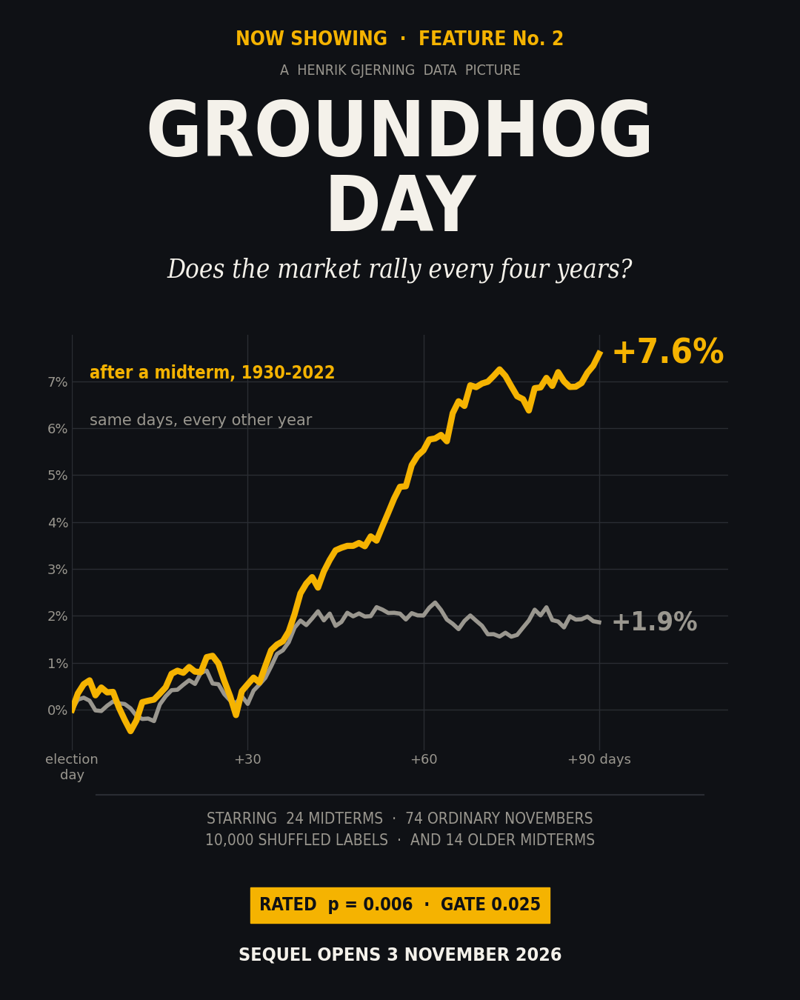
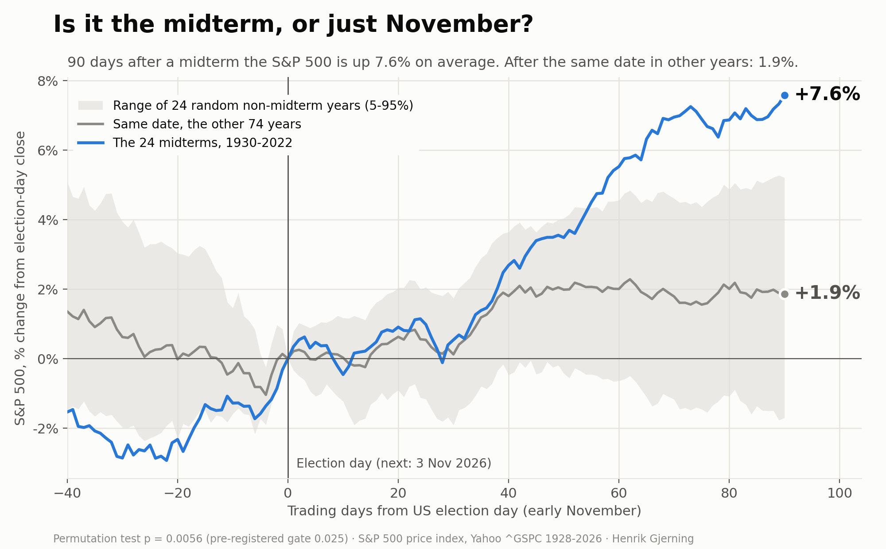
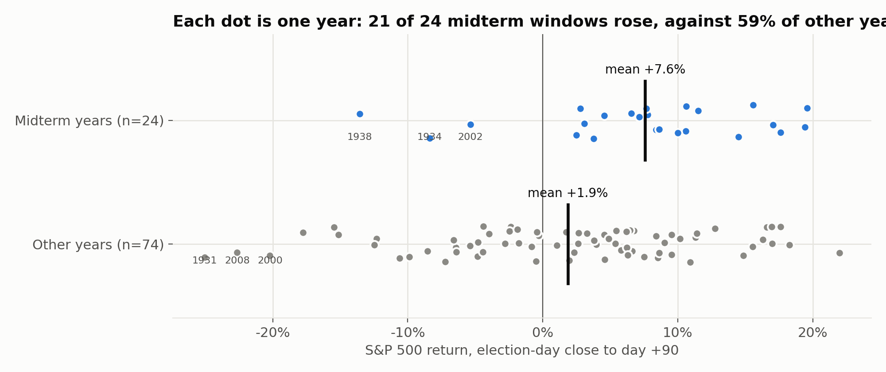
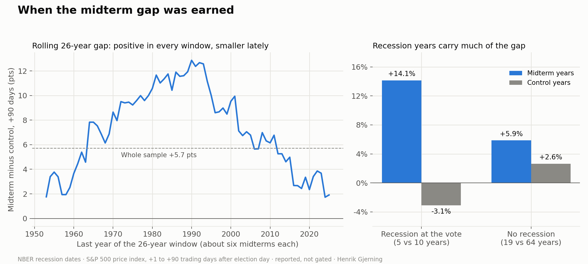
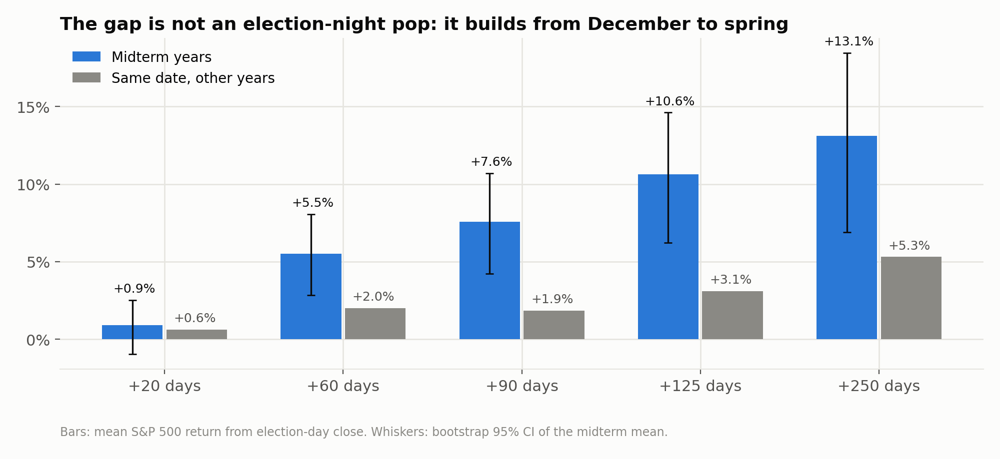
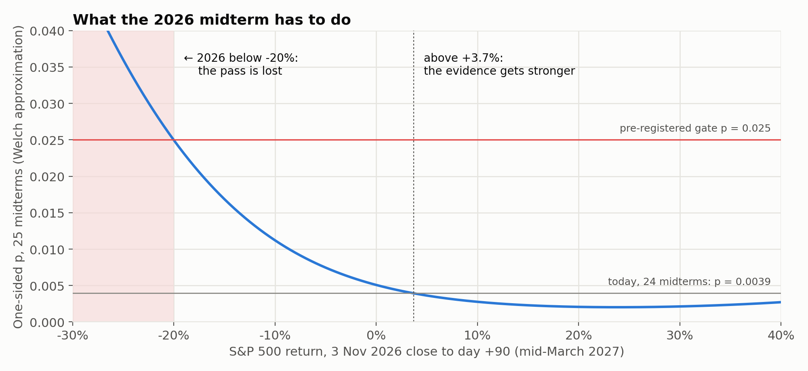

# Groundhog Day: does the market rally every four years?

### Is it the midterm, or just November? A pre-registered test, and a forecast for 3 November 2026



*Henrik Gjerning · Rude Investment Consulting · Project 10, Case 31 · written 25 September 2026, revised 9 October 2026, published 13 October 2026*

> **Summary.** Since 1930 the S&P 500 has risen +7.6% on average in the 90 trading days after a US midterm election. Every one of those windows opens in early November, at the start of the stronger half of the year. So I registered a harder test before running anything: each midterm against **the same 90 days in the other 74 years**. I predicted it would fail. It passed: the control returned +1.9%, the gap was +5.7 pts, permutation p 0.006 against a gate of 0.025, positive in both halves. That rules out "it is just November". It does not establish a midterm effect. About half the gap goes if the five recession-year midterms are left out; it has been +2.6 pts since 2003, on five midterms; and in the 14 midterms before 1928, which this programme had never looked at, the gap is about zero (−0.1 pts). The 3 November 2026 election tests a forecast, registered here, not the history.

**Statistics box.** 24 midterms vs 74 control years, 1930–2022 · gap +5.7 pts, 95% CI [+1.7, +9.6] · permutation p 0.006 (one-sided; Monte Carlo SE ±0.0007; studentized version 0.007) · gate 0.025: **C31-1 passed**, C31-2 failed · Holm within Case 31: C31-1 and C31-4 survive · programme-wide Bonferroni over 19 trials (gate 0.0026): C31-1 **not cleared**, C31-4 cleared · recession-year midterms left out: +3.2 pts, p 0.079 (reported) · C31-4 (macro controls): +7.4 pts, passed · C31-5 (1874–1926): −0.1 pts, 95% CI [−4.7, +4.4], failed · **read as:** evidence against the November explanation, not an established anomaly.



---

## 1. The claim, and the obvious objection

That stocks do well after midterm elections is market folklore, popularised by Yale Hirsch's *Stock Trader's Almanac* (founded 1967, now edited by Jeffrey Hirsch). The academic record goes back to Allvine & O'Neill (1980), who documented the four-year cycle. Booth & Booth (2003) found that the presidential cycle survives controls for business conditions. Santa-Clara & Valkanov (2003) studied the related gap between Democratic and Republican presidencies and found that business-cycle variables do *not* explain it.

My first pass was trial **P3-4** in Project3 (13 September 2026): the 90 days after each midterm against 90-day windows opened on random days. +7.6% against +2.9%, two-sided p 0.039, which missed that family's gate of 0.0083.

A random-day placebo treats every start date as equal. But the post-midterm window always runs from early November to mid-March, inside the "winter half" that beats the summer half in most markets and decades (Bouman & Jacobsen, 2002). The midterm rally could be seasonality with a political label.

The fix is a **same-season control**. Apply the election-day rule (first Tuesday after the first Monday of November) to every year, and compare the 24 midterm windows with the 74 that open on the same date in other years: 25 presidential-election years and 49 odd years. Whatever the calendar explains is now in both groups.

## 2. Pre-registration

Fixed before any number was computed (`PREREGISTRATION_C31_2026-09-25.md`):

- **C31-1:** midterm [+1, +90] mean exceeds the control mean. One-sided label permutation, 10,000 shuffles, seed 42. **Gate:** p < 0.025 (Bonferroni over two trials) **and** a positive gap in both halves (1930–74 and 1978–2022 midterms).
- **C31-2:** the 120 trading days *into* a midterm, [−119, 0], are weaker than the control. Same test and gate.
- **C31-3:** the forward test, run once in March 2027 with 2026 added.
- **Predictions:** C31-1 fails (p 0.03–0.20; I expected the control to return +4% to +5%). C31-2 fails (p > 0.10). Volatility falls more after a midterm than after the same date in other years.

Everything else here is **reported, not gated**. None of it can turn a fail into a pass or the reverse.

## 3. Data and method

- **Prices:** S&P 500 price index (Yahoo `^GSPC`), daily closes 30 December 1927 to 11 September 2026. Before March 1957 this series is the 90-stock S&P Composite, the predecessor of the 500.
- **Also used:** Shiller's `ie_data.xls` (monthly prices, dividends, CAPE, CPI), the NBER recession chronology, and Yahoo `^N225`, `^FTSE` and `^GDAXI` for the placebo markets.
- **Event day:** day 0 is the first trading day on or after election day (the NYSE was closed on election day until 1968 and in 1972–80). [+1, +90] runs from that close to the close 90 trading days later.
- **Inference:** the permutation test shuffles the "midterm" label across 98 years, one observation per year. Because the two groups have different spreads, I also report a studentized permutation test (Chung & Romano, 2013), Welch's t and a Mann–Whitney test. CIs are bootstrap, 10,000 resamples within each group, except the C31-5 and post-2003 intervals (normal approximation, Welch standard error).
- **Code:** `code/run_midterm.py` (trials), `robustness.py`, `v2_checks.py` and `v3_checks.py` (reported checks), `run_c31_4.py` and `run_c31_5.py` (revisited trials), `make_figures.py`.

## 4. Result: the November explanation fails

**Table 1. The pre-registered trials**

| Trial | Window | Midterm (n 24) | Control (n 74) | Gap | 95% CI | Permutation p (one-sided) | Welch t / p (one-sided) | Both halves | Verdict |
|---|---|---:|---:|---:|---|---:|---|---|---|
| **C31-1** | [+1, +90] | +7.6% | +1.9% | **+5.7 pts** | [+1.7, +9.6] | **0.006** | 2.78 / 0.004 | +5.4 / +6.1 pts | **PASS** |
| C31-2 | [−119, 0] | +1.2% | +3.6% | −2.4 pts | [−9.0, +4.2] | 0.21 | −0.71 / 0.24 | −1.9 / −2.9 pts | fail |
| *P3-4 (earlier)* | [+1, +90] | +7.6% | +2.9% (random days) | +4.7 pts | | 0.039 (two-sided) | | | suggestive |

*Gate: one-sided p < 0.025 and the same sign in both halves. Control = the same calendar window in every non-midterm year 1928–2025.*

**C31-1 passed, and my prediction was wrong.** I expected the same November-to-March window in ordinary years to be strong. It was weak: +1.9%, below the +2.9% of a random 90-day window. So the gap widens, from +4.7 pts against random days to +5.7 pts against the same season. It is also specific to the midterm year: against the other three years of the cycle, the midterm gap is +5.7 pts, and each of the other three positions is negative (−1.5 to −2.4 pts).

**C31-2 failed, as predicted.** The run-up into a midterm is weaker than usual, but not reliably.



**Table 2. Every midterm**

| Midterm | President | +90 days | +250 days | Percentile among controls (+90) |
|---|---|---:|---:|---:|
| 1930 | Hoover (R) | +7.2% | −36.8% | 72 |
| 1934 | Roosevelt (D) | −8.4% | +39.4% | 15 |
| 1938 | Roosevelt (D) | −13.6% | −8.3% | 8 |
| 1942 | Roosevelt (D) | +15.6% | +22.8% | 91 |
| 1946 | Truman (D) | +2.8% | +4.6% | 49 |
| 1950 | Truman (D) | +10.6% | +14.9% | 82 |
| 1954 | Eisenhower (R) | +7.8% | +30.6% | 73 |
| 1958 | Eisenhower (R) | +8.4% | +10.3% | 73 |
| 1962 | Kennedy (D) | +11.5% | +25.1% | 86 |
| 1966 | Johnson (D) | +10.6% | +12.4% | 82 |
| 1970 | Nixon (R) | +19.6% | +11.9% | 99 |
| 1974 | Ford (R) | +14.5% | +18.5% | 88 |
| 1978 | Carter (D) | +7.7% | +9.2% | 73 |
| 1982 | Reagan (R) | +10.0% | +19.9% | 81 |
| 1986 | Reagan (R) | +17.1% | +2.3% | 96 |
| 1990 | Bush (R) | +19.4% | +25.6% | 99 |
| 1994 | Clinton (D) | +6.5% | +26.8% | 69 |
| 1998 | Clinton (D) | +17.6% | +21.9% | 96 |
| 2002 | Bush (R) | −5.3% | +15.7% | 22 |
| 2006 | Bush (R) | +3.8% | +9.9% | 50 |
| 2010 | Obama (D) | +8.6% | +7.7% | 77 |
| 2014 | Obama (D) | +3.1% | +4.6% | 49 |
| 2018 | Trump (R) | +2.5% | +11.6% | 46 |
| 2022 | Biden (D) | +4.6% | +14.4% | 55 |

21 of 24 midterm windows rose. The median midterm window (+8.1%) is well above the median control (+3.5%), and the Mann–Whitney test agrees (one-sided p 0.004). Three of the six best (1970, 1974 and 1990) were recession years.

## 5. The hard checks

*Added after review on 7 and 9 October 2026. Not pre-registered, reported, not gated. Several weaken the story.*

**Table 3. Checks on C31-1**

| Check | Midterms | Controls | Gap | p (one-sided, permutation) |
|---|---:|---:|---:|---:|
| Primary (C31-1) | 24 | 74 | +5.7 pts | 0.006 |
| Studentized permutation (Chung & Romano) | 24 | 74 | +5.7 pts | 0.007 |
| *Recessions (NBER)* | | | | |
| Compared within recession / non-recession groups | 24 | 74 | +6.2 pts | 0.007 |
| Years with a recession at the vote left out | 19 | 64 | +3.2 pts | 0.079 |
| Years with a recession anywhere in the window left out | 19 | 57 | +2.1 pts | 0.16 |
| *For comparison:* the five best midterms left out | 19 | 74 | +3.0 pts | |
| *Time* | | | | |
| Labels shuffled only within eras (1928–59, 1960–89, 1990–2025) | 24 | 74 | +5.7 pts | 0.005 |
| Midterms from 1980 | 11 | 35 | +5.2 pts | 0.067 |
| Midterms from 2003 | 5 | 18 | +2.6 pts, 95% CI [−3.5, +8.6] | 0.33 |
| *Outliers and definitions* | | | | |
| Best midterm (1970) left out | 23 | 74 | +5.2 pts | 0.013 |
| Five worst control years left out | 24 | 69 | +4.1 pts | |
| Medians instead of means | 24 | 74 | +4.5 pts | |
| Control = odd years only / presidential years only | 24 | 49 / 25 | +5.5 / +6.1 pts | 0.011 / 0.015 |
| Total return (Shiller dividend yield added) | 24 | 74 | +5.8 pts | 0.005 |
| *Other markets, same US election dates* | | | | |
| Nikkei 225, from 1965 | 15 | 46 | +0.2 pts | 0.48 |
| FTSE 100, from 1984 | 10 | 32 | +1.7 pts | 0.33 |
| DAX, from 1988 | 9 | 29 | −2.2 pts | 0.63 |

*S&P 500 price return, trading days +1 to +90 (other markets: their own index). 10,000 shuffles, seed 42. Recession dates: NBER chronology.*



**Recessions.** Five midterms were held in a recession: 1930, 1970, 1974, 1982 and 1990. Over the next 90 days they averaged +14.1%; the four whose recession ended within six months (all but 1930) averaged +15.9%. The ten control years that opened in recession averaged −3.1%. Three results have to be read together:

- Leaving the recession years out roughly halves the gap (+3.2 pts, p 0.079).
- Leaving out the five *best* midterms instead does about the same (+3.0 pts). With 24 observations, the result leans on a handful of large years, recession or not.
- Controlling for recession in a regression, rather than deleting years, does not shrink the gap (C31-4 in section 7: +7.4 pts).

A fair reading: a good part of the post-1930 rally coincides with recoveries from recessions that happened to end around a midterm. That fits a policy-cycle story and fits coincidence equally well.

**Why the control is weak.** Crashes, partly: the worst control windows include 1931 (−25%), 2008 (−23%), 2000 (−20%) and 2019 (−18%, into the 2020 crash). Leaving out the five worst lifts the control to +3.5% and cuts the gap to +4.1 pts. Breadth, too: 41% of control windows fell, against 12% of midterm windows.

**Eras do not explain it.** Shuffling only within three eras gives the same gap and p 0.005. The gap is positive in each era: +3.2, +10.7 and +4.1 pts.

**It may have faded.** The gap is +6.6 pts for midterms before 2003 and +2.6 pts since, with a 95% CI of −3.5 to +8.6 pts. Five midterms cannot distinguish "faded" from "noise". A fade would fit what McLean & Pontiff (2016) report for published anomalies.

**Other markets.** If this were global winter seasonality it should show up abroad on the same dates. It does not: Nikkei +0.2, FTSE +1.7, DAX −2.2 pts, each smaller than the S&P 500's gap in the same years (+7.3, +4.3, +4.0 pts). With 9 to 15 midterms per market this is weak evidence, but it points the same way: the pattern is mainly American.

## 6. When the gap appears

**Table 4. Horizons (reported, not gated)**

| Window (trading days) | Midterm | Hit rate | Control | Control hit rate | Gap | Welch t | p (two-sided) |
|---|---:|---:|---:|---:|---:|---:|---:|
| +1 to +20 | +0.9% | 71% | +0.6% | 62% | +0.3 pts | 0.27 | 0.79 |
| +1 to +60 | +5.5% | 79% | +2.0% | 66% | +3.5 pts | 2.15 | 0.037 |
| +1 to +90 | +7.6% | 88% | +1.9% | 59% | +5.7 pts | 2.78 | 0.008 |
| +1 to +125 | +10.6% | 88% | +3.1% | 62% | +7.5 pts | 2.95 | 0.005 |
| +1 to +250 | +13.1% | 92% | +5.3% | 66% | +7.8 pts | 2.11 | 0.040 |



**There is no election-night pop.** Over the first 20 trading days the two groups are indistinguishable. The gap opens in December and January and widens into the spring. And the 90 days after a *presidential* election (+1.4%) are no better than after an odd-year November (+2.1%).

**Is it political uncertainty resolving?** Pástor & Veronesi (2012, 2013) model policy uncertainty as a priced risk, and Kelly, Pástor & Veronesi (2016) find that options spanning national elections carry a premium. If the rally were that premium being released, volatility should fall more after midterms. I predicted it would. It falls in both groups, from 19.7% to 16.6% annualised after midterms and from 18.8% to 16.0% in control years. The extra fall is 0.5 pts (Welch t −0.25). **Prediction not supported.** A slow build over four months fits something that accrues, such as a policy cycle or a recovery, better than a one-off release. These data cannot separate the two.

By party (reported): 13 Democratic midterms averaged +5.9%, 11 Republican ones +9.5%. Both groups rally; too few for inference.

## 7. Revisited: two new tests (October 2026)

Registered and signed on 8 October 2026 (`PREREGISTRATION_C31_R_2026-10-08.md`), after the review and before either was computed. I predicted a narrow fail for C31-4 and a fail for C31-5.

| Trial | Question | Result | p (one-sided) | Verdict |
|---|---|---|---|---|
| C31-4 | Does the gap survive macro controls? Regression on 97 years (1928 lacks a prior year) with recession at the vote, prior 250-day return, log CAPE and inflation | midterm coefficient +7.4 pts (HC3 t 3.38) | 0.0002 (Freedman–Lane permutation) | **passed** |
| C31-5 | Does the gap exist before 1928? Shiller monthly prices, November to March, 14 midterms 1874–1926 against 43 other years | −0.1 pts, 95% CI [−4.7, +4.4] | 0.52 | failed |

- **C31-4: inside 1930–2022 the obvious macro variables do not absorb the gap.** Each control on its own leaves the coefficient between +5.8 and +7.4 pts. Two caveats. It reuses the same 24 elections, so it is not out of sample. And the controls were chosen after the version-2 checks had shown that recessions matter, so the test was partly informed by the data.
- **C31-5: in the only sample nobody had examined, there is no gap.** The monthly measure works: on 1930–2022 it gives a +5.4-pt gap (p 0.004) and correlates 0.96 with the daily window. The realised standard error is 2.3 pts, so the test had about 65% power against a +5.4-pt gap, and its confidence interval excludes it. The difference between the eras is z ≈ 1.9: suggestive, not decisive. Nine of the 14 pre-1928 midterms were held in a recession and averaged +1.0% over the window, no rally, which counts *against* reading the modern gap as a recession-recovery effect.

**Multiple testing.** Within Case 31 (four trials, Holm 1979), C31-4 (0.0002 < 0.0125) and C31-1 (0.006 < 0.017) survive; C31-2 and C31-5 do not. Across the whole programme, 19 trials have now been run (Project3 15, Case 31 four), so a one-sided Bonferroni gate is 0.0026. C31-4 clears it. C31-1 does not, and neither does the era-blocked version (0.005). This is the problem Harvey, Liu & Zhu (2016) raise for factor research.

## 8. What this does and does not show

This study does not show that midterm elections cause higher stock returns. It shows something narrower. Since 1930, the 90 trading days after a US midterm beat the same calendar window in other years by +5.7 pts on average. If the rally were just the strong November-to-March season, it should have shrunk against the same season in other years. It grew. That rejects one explanation of a pattern that was already known; the 24 elections are the same ones P3-4 had seen.

| If this happened… | …the midterm reading weakens because | Result here | Status |
|---|---|---|---|
| The gap vanishes when labels are shuffled only within eras | it would reflect differences between eras | +5.7 pts, p 0.005 | not met |
| The gap vanishes once recession years are removed | it would be the business cycle | +3.2 pts, p 0.079; but dropping the five best years does the same | **partly met** |
| Macro controls absorb the gap | it would be the business cycle or valuation | +7.4 pts, p 0.0002 (C31-4) | not met |
| Other markets show the same gap on the same dates | a global seasonal story fits better | Nikkei +0.2, FTSE +1.7, DAX −2.2 pts | not met |
| The gap shrinks once the pattern is widely known | it may have been traded away | from 2003: +2.6 pts, CI [−3.5, +8.6] | **partly met** |
| The gap is absent in an unseen earlier sample | it would be specific to one era, or found by over-searching | 1874–1926: −0.1 pts (C31-5) | **met** |
| The 2026 forecast misses | the pattern would not be useful | scored 16 March 2027 | pending |

**Conclusion.** The data reject the simplest seasonal explanation. They do not identify the right one. Inside the modern sample the gap is not a macro artefact, but it leans on a few large years, may have faded, and was not detectable before 1928. That is what a modern-era pattern looks like, and also what a pattern found by studying the same 24 elections too often looks like. The forward test adds one observation a year.

## 9. The forward test: 3 November 2026



**Table 5. Registered before the vote**

| | Value |
|---|---|
| Election day | Tuesday 3 November 2026 |
| Day +90 (NYSE calendar) | 16 March 2027 |
| Point forecast (midterm mean shrunk halfway to the control mean) | **+4.7%** |
| Of which midterm-specific (above the control mean of +1.9%) | about +2.9 pts |
| 80% interval (control dispersion around the point) | −8.9% to +18.2% |
| Probability of a positive window | 72% |
| 2026 return that lowers the pooled p | above +3.7% (up to about +40%) |
| 2026 return at which C31-3 would fail the gate (p ≥ 0.025, Welch approximation) | about −20% or worse |

**How the forecast will be scored** (`PREREGISTRATION_C31_3_scoring_2026-10-09.md`, signed before publication). A *hit* if the 16 March 2027 return lies inside the 80% interval. A *head-to-head* against the season-only forecast of +1.9%, by squared error: the midterm forecast wins if the return is above +3.3%, the midpoint of the two. One draw cannot tell the two models apart, and I will not claim it does. The score is kept so that the record over several elections can.

Most of the +4.7% is ordinary seasonality, and C31-3 is close to a certain pass: only a fall of about 20% would make it fail the gate. So the re-run in March is a book-keeping step, not a test of the history. The forecast is the test.

## 10. Reproduce

```bash
python code/download_data.py    # Yahoo series -> data/ (hashes in data/SHA256SUMS)
# save Shiller's ie_data.xls by hand into data/, then:
python code/v2_download.py      # derives data/shiller_dividends.csv
python code/run_midterm.py      # C31-1, C31-2, reported statistics -> results/
python code/robustness.py       # reported robustness -> results/robustness*
python code/v2_checks.py        # checks after the first review -> results/v2_checks.json
python code/v3_checks.py        # checks after the stress test -> results/v3_checks.json
python code/run_c31_4.py        # C31-4 (needs data/ie_data.xls) -> results_r/
python code/run_c31_5.py        # C31-5 -> results_r/
python code/make_figures.py     # figures/
python code/build_final.py      # article and teaser HTML
python code/make_pdfs.py        # PDFs
```

The price files are not in the repository (Yahoo and Shiller terms). `code/download_data.py` fetches the Yahoo series; Shiller's `ie_data.xls` is saved by hand and `code/v2_download.py` derives `shiller_dividends.csv` from it; `data/SHA256SUMS` holds the hashes of the files used here. Seeds fixed (42). Python 3.12, pandas, numpy, scipy, statsmodels, matplotlib.

## References

- Allvine, F. C. & O'Neill, D. E. (1980). Stock market returns and the presidential election cycle: implications for market efficiency. *Financial Analysts Journal*, 36(5), 49–56.
- Booth, J. R. & Booth, L. C. (2003). Is presidential cycle in security returns merely a reflection of business conditions? *Review of Financial Economics*, 12(2), 131–159.
- Bouman, S. & Jacobsen, B. (2002). The Halloween indicator, "Sell in May and go away": another puzzle. *American Economic Review*, 92(5), 1618–1635.
- Chung, E. & Romano, J. P. (2013). Exact and asymptotically robust permutation tests. *Annals of Statistics*, 41(2), 484–507.
- Freedman, D. & Lane, D. (1983). A nonstochastic interpretation of reported significance levels. *Journal of Business & Economic Statistics*, 1(4), 292–298.
- Harvey, C. R., Liu, Y. & Zhu, H. (2016). … and the cross-section of expected returns. *Review of Financial Studies*, 29(1), 5–68.
- Hirsch, J. A. (annual). *Stock Trader's Almanac*. Wiley. Founded by Yale Hirsch in 1967.
- Holm, S. (1979). A simple sequentially rejective multiple test procedure. *Scandinavian Journal of Statistics*, 6(2), 65–70.
- Kelly, B., Pástor, Ľ. & Veronesi, P. (2016). The price of political uncertainty: theory and evidence from the option market. *Journal of Finance*, 71(5), 2417–2480.
- McLean, R. D. & Pontiff, J. (2016). Does academic research destroy stock return predictability? *Journal of Finance*, 71(1), 5–32.
- Pástor, Ľ. & Veronesi, P. (2012). Uncertainty about government policy and stock prices. *Journal of Finance*, 67(4), 1219–1264.
- Pástor, Ľ. & Veronesi, P. (2013). Political uncertainty and risk premia. *Journal of Financial Economics*, 110(3), 520–545.
- Santa-Clara, P. & Valkanov, R. (2003). The presidential puzzle: political cycles and the stock market. *Journal of Finance*, 58(5), 1841–1872.

*Not investment advice. A pattern in 24 observations is not a promise about the 25th.*
