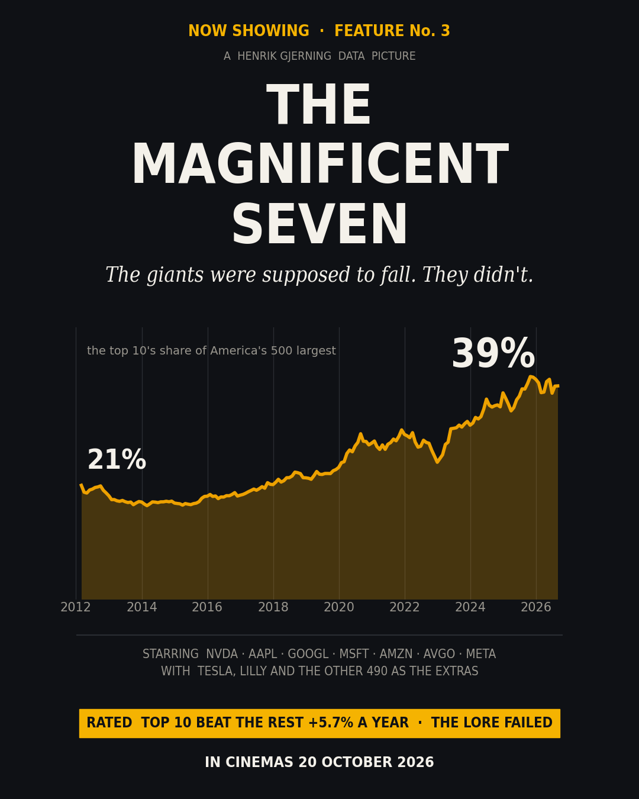
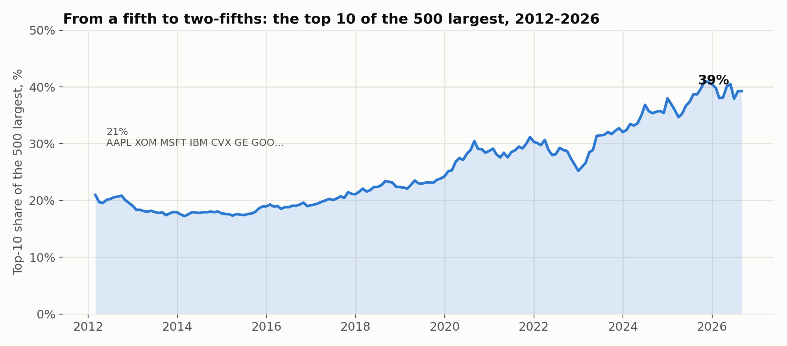
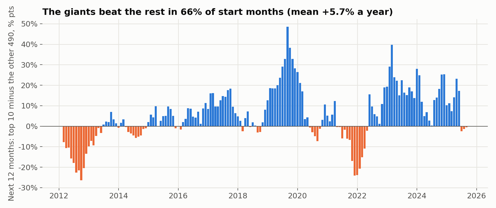
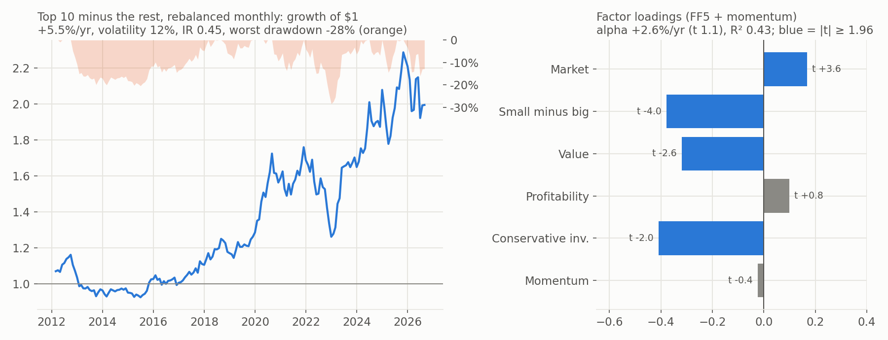
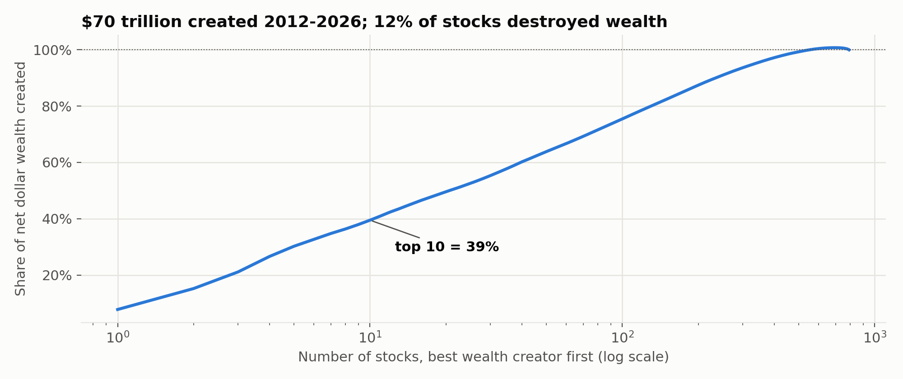

# The Magnificent Seven: does concentration come back to bite?

### Ten stocks, two-fifths of the market, and the lore that the giants always fall



*Henrik Gjerning · Rude Investment Consulting · September 2026 · Project 10, article A03*

<!-- interval:guess -->
> **The Interval · guess before you read on.** Since 2012, did the 10 largest US stocks beat the other 490 over the following year? A) They lagged, as the lore says · B) About even · C) They beat them. *The answer is in the next paragraph.*
<!-- /interval -->

*Revised 8 October 2026 after external review (v2). Version 3, 19 October 2026: year-by-year table restored; factor attribution, an interaction check and the risk of the spread added; the Nifty Fifty and 2000 set beside today. Everything new is reported, not tested: no trials were added.*

> **In one paragraph.** In February 2012 the ten largest US companies made up **21%** of the 500 largest. By August 2026 they made up **39%**, and NVIDIA alone weighed 7.6%. Market lore says this ends badly: the biggest stocks lag, and when concentration peaks the average stock catches up. I pre-registered both claims and tested them on every month since 2012. **Neither showed up.** The then-top-10 *beat* the other 490 by **+5.7%** per 12 months on average (t +2.07), the opposite of the lore, although most of that lead came after 2019. Rising concentration did not predict an equal-weight catch-up (t 0.72), but that test had little power. The lead was a bumpy ride (volatility 12% a year, a -28% drawdown in 2022), and a standard factor model explains about half of it: the top 10 were large, growth-tilted stocks in an era that paid for both. Meanwhile wealth creation was extremely lopsided: of the $70 trillion these stocks added, **39% came from just ten names**, 1.3% of the 792. The evidence argues against using concentration as a timing signal. It does not show that concentration is harmless.

**Statistics box.** Monthly market cap = latest Sharadar filing, scaled by the price move since filing; top 500 each month-end, Feb 2012 → Aug 2026. Twelve-month buy-and-hold, cap-weighted portfolios; 163 overlapping monthly start dates (about 14 independent years); Newey-West (12 lags) and a stationary bootstrap (mean block 12, 10,000 draws). Two trials, one-sided gate p < 0.025. **Both failed.** Version 3 adds descriptive analysis only: a monthly-rebalanced version of the spread (175 months), Fama-French five factors plus momentum (Kenneth French data library, to July 2026; Newey-West 6 lags) and a Fama-MacBeth cross-section. Price returns only (no dividends). US large caps, one market era.

---

## 1. Why this matters now

Index investors now hold a portfolio in which ten names carry nearly two-fifths of the weight: a large bet on a few business models (chips, cloud, advertising, devices). The warnings rest on two ideas. Large firms find it harder to grow (the size effect of Banz 1981; Fama & French 1992), and past episodes of extreme leadership, such as the Nifty Fifty in the 1970s and the tech and telecom leaders of 2000, ended in underperformance. Against that stands Bessembinder (2018): most of the stock market's wealth is created by a handful of stocks, and they are hard to replace.

## 2. How concentrated is it?



The top-10 share hovered around a fifth until 2016 (17% at its low), then roughly doubled, peaking at **41.0% in October 2025**. The line-up changed almost completely:

- **2012:** AAPL, XOM, MSFT, IBM, CVX, GE, GOOGL, BRK.B, PG, T
- **2026:** NVDA, AAPL, GOOGL, MSFT, AMZN, AVGO, META, TSLA, LLY, MU

Month to month, though, the top 10 is sticky: on average 1.4 names change per year.

## 3. Then and now: the Nifty Fifty, 2000 and today

The lore comes from two episodes. My data start in 2012, so the table below uses published figures, not my own calculations, and the sources measure slightly different things. Read it as context, not as a test.

**Table 1. Three episodes of leadership (published figures)**

| | Nifty Fifty, 1972–74 | Dot-com peak, 2000–02 | Today |
|---|---|---|---|
| Top-10 share of the S&P 500 | Among the "extreme" episodes; no exact share found [1] | **27%** at the peak [1][6] | **40.7%** end-2025, a record [6]; 39% of my top 500, Aug 2026 |
| Price of the leaders | Average P/E **41.9** vs 18.9 for the S&P 500 [3] | Top-10 P/E **100%** above the rest of the index [1] | Top-10 forward P/E 25×, a **35%** premium (March 2024) [1] |
| Share of earnings | n/a | n/a | About 41% of the weight, about 32% of the earnings (2025) [6] |
| What came next | Nifty Fifty −19% (1973) and −38% (1974), vs −14% and −26% for the S&P 500 [4] | Nasdaq −78% to Oct 2002 [7]; cap-weight went from leading equal-weight by about 31% to trailing by about 33% (rolling 3 years) [6] | Not known yet |
| The longer view | Equal-weighted Nifty Fifty bought at the 1972 peak earned 12.5% a year to 1998, nearly matching the S&P 500 [3] | The top 10 lagged the S&P 500 at every horizon MFS tested [5] | |

Two things stand out. **Concentration today is well above the 2000 peak** (no comparable figure was found for 1972). **The price is not**: in 1972 and 2000 the leaders cost roughly twice the market's multiple; in 2024 the premium was about a third. Goldman Sachs [1] counts seven extreme concentration peaks in the S&P 500 and finds that only 1973 and 2000 were followed by a bear market and recession; after most of the others stocks kept rising. The lore rests on its two worst cases.

## 4. The pre-registered trials

**Table 2. Results**

| Trial | Hypothesis | Estimate | NW t (12 lags) | p (one-sided) | Bootstrap p | Gate | Verdict |
|---|---|---:|---:|---:|---:|---:|---|
| A03-1 | The ten largest underperform the other 490 over the next 12 months | **+5.7%** per 12m | +2.07 | 0.981 | 0.987 | 0.025 | fail (opposite sign) |
| A03-2 | Rising concentration predicts an equal-weight catch-up | slope **+0.32**, R² 0.03 | 0.72 | 0.237 | 0.251 | 0.025 | fail |

> **Corrected universe (re-run 1 October 2026).** On the actual S&P 500 members at each date, instead of every company that was ever in the index in 2012–2026, the results barely move: A03-1 +6.2% per 12 months, t 2.11; A03-2 slope 0.43, t 0.70. The concentration measures are unchanged to the first decimal. Verdicts as registered: 0 of 2.



**A03-1: the giants did not lag.** The top 10 beat the rest over the following year in **66%** of start months; the average lead was +5.7% per 12 months (median +4.6%). I predicted this test would fail with the opposite sign, and it did. Note what this is and is not. It is clear evidence against the lore *in this sample*. It is not a registered test that the largest stocks outperform, and with about 14 independent years a t of 2.07 should not be read as a law in the other direction.

**The lead was not steady.** Table 3 shows it year by year (reported, not tested). From 2012–2018 the top 10 led by only +1.1% on average and won in 59% of start months; from 2019–2025 they led by +10.5% and won in 74%. Leaving out the two strongest start years, 2019 and 2023, the average lead falls to +2.4%. The result is mostly a story about the platform and AI years.

**Table 3. Year by year (start months in each calendar year; reported, not tested)**

| Start year | Top-10 share at year-end | Top 10 − rest, next 12m (mean) | Start months the top 10 won | Equal − cap weight, next 12m |
|---|---:|---:|---:|---:|
| 2012* | 19.0% | -16.1% | 0% | +3.9% |
| 2013 | 17.9% | -0.8% | 50% | +1.6% |
| 2014 | 17.7% | -1.8% | 25% | +0.7% |
| 2015 | 19.0% | +4.5% | 75% | -0.8% |
| 2016 | 19.2% | +5.5% | 92% | -0.4% |
| 2017 | 21.1% | +12.5% | 100% | -1.8% |
| 2018 | 22.4% | +2.5% | 67% | -0.7% |
| 2019 | 24.3% | +27.9% | 100% | -6.6% |
| 2020 | 28.7% | +3.9% | 58% | +4.4% |
| 2021 | 30.3% | -5.5% | 25% | +2.5% |
| 2022 | 25.2% | +3.1% | 67% | -3.3% |
| 2023 | 32.0% | +21.8% | 100% | -6.7% |
| 2024 | 38.0% | +13.1% | 100% | -4.8% |
| 2025* | 40.5% | +8.6% | 62% | +0.1% |
| 2026 | 39.3% | n/a | n/a | n/a |

*2025: eight start months (the last twelve-month window ends August 2026). 2026: no complete twelve-month window yet. 2012 starts in February.*

**A03-2: no detectable catch-up, which is not the same as no catch-up.** Equal-weight minus cap-weight averaged -0.9% per 12 months, and the prior change in concentration explained 3% of its variation. With about 14 independent years this test was always weak, and I said so in the pre-registration. The fair reading is "no measurable evidence of a catch-up in this sample", not "concentration does not matter".

## 5. What explains the lead, and what did it cost?

Reviewers of version 2 asked the obvious question: is this a size result, or a "best companies" result? To answer it I rebuilt the spread month by month (top 10 minus the other 490, cap-weighted, rebalanced at every month-end) so it can be lined up against standard factor returns. Same idea as A03-1, different holding period; nothing here is a new trial.



**The risk.** Rebalanced monthly, the top 10 led by **+5.5% a year** with **12.1% volatility**: an information ratio of **0.45** (Newey-West t 1.69 on 175 months). It won in 58% of months. The ride was not smooth: from its high to December 2022 the spread lost **28%**, the worst twelve months were **-25%** (2022) and the best **+42%**. An investor who backed the giants had to sit through a year in which the "safe" bet on size lost a quarter against the rest of the market.

**The factors.** Regressing the monthly spread on the Fama-French five factors and momentum (174 months):

**Table 4. Factor attribution of the top-10 lead (reported, not tested)**

| | Loading (NW t) | Reading |
|---|---:|---|
| Market | +0.17 (t +3.6) | The top 10 are a little more market-sensitive than the rest |
| Small minus big | -0.38 (t -4.0) | Strongly "big", as you would expect |
| Value | -0.32 (t -2.6) | Growth stocks, not value stocks |
| Profitability | +0.10 (t +0.8) | No extra tilt beyond the rest of the top 500 |
| Conservative investment | -0.41 (t -2.0) | Heavy investors (capex, acquisitions) |
| Momentum | -0.02 (t -0.4) | None |
| **Alpha** | **+2.6% a year (t 1.1)** | R² 0.43; raw lead +5.5% |

The factor model takes the lead from +5.5% to +2.6% a year, and what is left is indistinguishable from zero. Market and size alone leave +1.2% (t 0.4). So the top 10 did not win by being unusually profitable or by riding momentum, at least not beyond what the rest of the top 500 already had. They won mostly because they were **large, growth-tilted, heavy investors in an era that rewarded exactly that**: small stocks lagged big ones for most of 2012–2026. That is a fair answer to "size or something else?": it was size and growth, priced by a size premium that ran backwards.

**Does size interact with momentum?** A factor regression treats each tilt separately. A natural follow-up question is whether being big *and* rising is what paid, an interaction rather than two separate effects. I ran a Fama-MacBeth cross-section across the top 500 each month: next-month return on size (log market cap), 12-1 month momentum and their product, all standardised (163 months). Per one standard deviation: size -4.5 bp a month (t -1.0), momentum +23.6 bp (t 2.1), size × momentum +2.6 bp (t 0.5). Momentum paid across the top 500; size did not, and the interaction is nowhere near significant. The giants' lead is a property of the very top of the distribution, not a smooth "bigger is better" slope, and not a big-winner interaction. With 163 months and an extreme top decile, this check is coarse; a matched-characteristics benchmark (top 10 against names 11–50 with similar momentum and profitability) would be sharper, and is left for later.

## 6. Where the wealth came from



Following Bessembinder (2018), I summed each stock's monthly dollar gains (last month's market cap × this month's return) from 2012 to 2026 across the 792 names that were in the S&P 500 at some point. Net wealth created: **$70 trillion** (price only). 12% of the names destroyed wealth; the largest losses were in NBL, NOV, CHKAQ, APA and KHC.

**Table 5. How lopsided? Share of net wealth created, 2012–2026 (reported, not tested)**

| Biggest creators | Share of the 792 names | Share of net wealth |
|---|---:|---:|
| Top 1 (NVDA) | 0.1% | 8% |
| Top 5 | 0.6% | 30% |
| Top 10 | 1.3% | **39%** |
| Top 21 | 2.7% | 50% |
| Top 50 | 6.3% | 64% |

**Is 39% a lot?** For scale: Bessembinder (2018) found that about 4% of all US listed stocks accounted for the entire net wealth created by the US market from 1926 to 2016. The numbers are not directly comparable, because his universe holds every listed stock, including thousands of small losers, while this one holds only companies that made it into the S&P 500. Within that already-successful group, half of all the wealth came from 21 names.

**Table 6. The ten biggest wealth creators, 2012–2026**

| Rank | Ticker | Net wealth created, $ tn |
|---:|---|---:|
| 1 | NVDA | 5.42 |
| 2 | AAPL | 5.20 |
| 3 | GOOGL | 4.12 |
| 4 | MSFT | 3.85 |
| 5 | AMZN | 2.53 |
| 6 | AVGO | 1.71 |
| 7 | META | 1.46 |
| 8 | LLY | 1.12 |
| 9 | JPM | 1.10 |
| 10 | MU | 1.07 |

## 7. What this does and does not show

- **One regime, one sample.** 2012–2026 is the era of the platform giants, and the top-10 lead is concentrated in its second half. The lore is built on the 1970s and 2000 (Table 1). Fourteen years cannot overturn it; they show only that it did not work *here*.
- **Ten is a choice.** The cut-off was fixed in advance, but whether the result holds for the top 5, 20 or 50 has not been checked.
- **Size and growth, now measured.** About half of the lead is explained by size, growth and investment tilts; the remaining alpha is not significant. That is attribution, not causation, and the factors themselves were unusually kind to large growth stocks in this period.
- **The comparison is borrowed.** Table 1 uses published figures from different sources and index definitions. It frames the question; it does not test it.
- **Low power for A03-2.** A null result from about 14 independent years says little about whether a catch-up exists.
- **Survivor-list bias, measured.** Re-running on the actual index members at each date moved the spread by half a percentage point (box under Table 2).
- **Price returns only.** The 2012 top 10 paid higher dividends than the 2026 top 10. Including dividends would narrow the spread in the early years.
- **Risk, only partly.** Section 5 measures the volatility and drawdown of the spread. It does not measure how a concentrated index behaves in a sell-off led by its largest names.
- **Two trials, both failed.** Version 3 adds no trials. Programme total unchanged.

<!-- interval:joke -->
> **Interval.** Market lore says the giants always fall. Fourteen years on, the lore is still waiting at the saloon.
<!-- /interval -->

## 8. Verdict

In 2012–2026 the lore that "the biggest stocks always lag" did not hold: the largest companies outperformed the rest, mostly from 2019 onward, and mostly because the era paid for being large and growth-tilted. Rising concentration did not predict a comeback for the average stock, though that test was weak. Wealth creation was concentrated in a handful of names, which is the practical case for owning the index rather than trying to pick around its leaders. None of this makes a two-fifths weight in ten stocks harmless: the spread fell 28% in a single bad stretch, and concentration today is higher than at the 2000 peak, even if the price of the leaders is lower. It argues against using concentration as a timing signal; it says nothing about how large the risk is. Size that exposure deliberately.

**The lore needs a 1973 or a 2000 to come true. Fourteen years have not supplied one, which is not the same as never.**

<!-- research -->
## What I would research next

**Not researched here**

- Other countries with high concentration (e.g. Denmark, Switzerland, Taiwan).
- The Nifty Fifty and 2000 on our own data (version 3 uses published figures only).

**With more or better data**

- Total returns with dividends for the whole period.
- A long history of index weights before 2012.

**With better analysis**

- Test concentration as a risk measure (drawdown, tracking error of the index) instead of a return-timing signal.
- A matched-characteristics benchmark: the top 10 against names 11-50 with similar momentum, profitability and growth.
- Re-run on the actual index members throughout as the main test, not a robustness box.

*Already taken up: version 3 (19 Oct 2026): factor attribution, size x momentum interaction, risk of the spread, published Nifty Fifty and 2000 comparison.*
<!-- /research -->

## Reproduce

```bash
python code/run_concentration.py   # A03-1..2 + reported, results/summary.json
python code/run_v3_extras.py       # v3: monthly spread, risk, FF5 + momentum, Fama-MacBeth, year table -> results/v3_extras.json
python code/make_figures.py && python code/make_fig4_v3.py && python code/build_article_v3.py
```

## References

- Banz, R. W. (1981). The relationship between return and market value of common stocks. *Journal of Financial Economics*, 9(1).
- Bessembinder, H. (2018). Do stocks outperform Treasury bills? *Journal of Financial Economics*, 129(3).
- Bessembinder, H., Chen, T.-F., Choi, G. & Wei, K. C. J. (2023). Long-term shareholder returns: evidence from 64,000 global stocks. *Financial Analysts Journal*, 79(3).
- Carhart, M. M. (1997). On persistence in mutual fund performance. *Journal of Finance*, 52(1).
- Fama, E. F. & French, K. R. (1992). The cross-section of expected stock returns. *Journal of Finance*, 47(2).
- Fama, E. F. & French, K. R. (2015). A five-factor asset pricing model. *Journal of Financial Economics*, 116(1).
- Fama, E. F. & MacBeth, J. D. (1973). Risk, return, and equilibrium: empirical tests. *Journal of Political Economy*, 81(3).
- Newey, W. K. & West, K. D. (1987). A simple, positive semi-definite, heteroskedasticity and autocorrelation consistent covariance matrix. *Econometrica*, 55(3).
- Politis, D. N. & Romano, J. P. (1994). The stationary bootstrap. *Journal of the American Statistical Association*, 89(428).

**Sources for Table 1**

1. Goldman Sachs, "Is the S&P 500 too concentrated?" (21 March 2024). goldmansachs.com/insights/articles/is-the-sp-too-concentrated
2. Dimensional, "Large and in charge: giant firms atop the market is nothing new" (17 June 2020). dimensional.com/insights
3. Siegel, J. J., "Valuing growth stocks: revisiting the Nifty Fifty", *AAII Journal* (October 1998). aaii.com/journal/article/valuing-growth-stocks-revisiting-the-nifty-fifty
4. Bridgeway, "Party like it's 1972: what can the Nifty Fifty teach us about today's market?" (28 December 2021). bridgeway.com/perspectives
5. MFS, "The disappearance of diversification" (December 2024). mfs.com
6. RBC Wealth Management, "The great narrowing: S&P 500 concentration" (22 January 2026). rbcwealthmanagement.com
7. Nasdaq Composite history (peak 5,132.52 on 10 March 2000; trough October 2002). en.wikipedia.org/wiki/Nasdaq_Composite

*Not investment advice. Film title used as a cultural reference only.*
