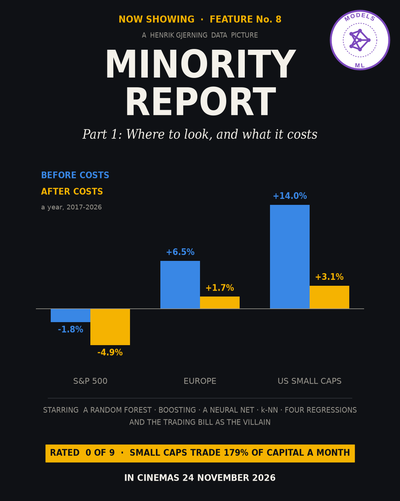
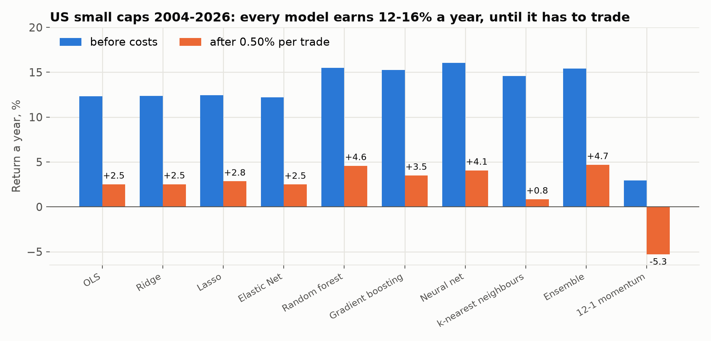
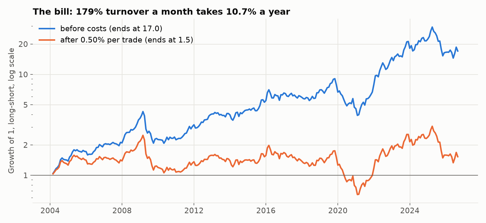
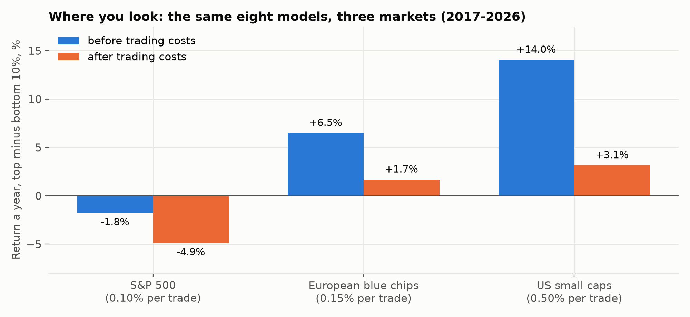
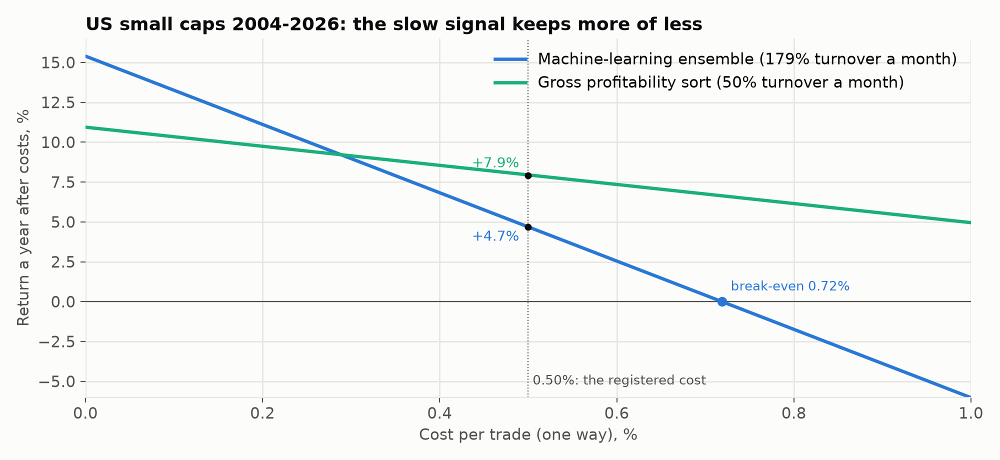

# Minority Report, Part 1: Where to Look

### Eight machine-learning models find nothing in the S&P 500 and a before-cost signal in US small caps that no tested trade keeps after costs.

*Henrik Gjerning · Rude Investment Consulting · November 2026 · Project 10, Now Showing No. 8 · The Machine Learning Road, Episode 1*

<!-- interval:guess -->
> **The teaser asked.** 1) Same eight models, same twelve inputs: where do they find something, the 500 largest US stocks or the 2,000 small ones? 2) How much of a +15% a year signal is left after trading costs? 3) Which one-line rule beat all eight machines after costs? *Answers at the end, before the verdict.*
<!-- /interval -->

> **In one paragraph.** I gave eight standard machine-learning models the same twelve inputs and asked them to rank stocks for next month, with every setting fixed in advance. In the S&P 500 they found nothing: the combined model lost 1.8% a year before costs and 4.9% after them (2017-2026). In US small caps the same models, unchanged, earned **+15.4% a year before costs (t 2.82, 2004-2026; reported, not gated)**, and none of 40 models trained on shuffled data matched them (the best came within 0.03 of Sharpe). But the small-cap book trades 179% of its capital a month (buys plus sells, both legs; about 45% of the positions change), and at 0.50% per trade that leaves at most **+4.7% a year (t 0.86)** before borrowing costs on the short side. **None of the nine pre-registered tests passed.** Three things are worth taking away: in these tests the universe mattered more than the choice among eight models; the cost per trade, not the model, decides whether the signal can be kept; and in small caps one plain characteristic, gross profitability, kept more after costs than any of the eight machines because it trades about a quarter as much (the best of 18 sorts, chosen after looking, and it lost money in the other two markets).

**Statistics box.** Two pre-registered studies, same eight models, twelve features, fixed hyperparameters, walk-forward with a retrain every January, equal-weighted top-minus-bottom deciles held one month. **Large caps (A06):** actual S&P 500 members at each date, formation months Jan 2017 → Jul 2026 (115 months), three trials before costs, gate p < 0.0167. **US small caps (A31-U1):** market-cap ranks 1,001-3,000 at each date, Jan 2004 → Jul 2026 (271 months), three trials after 0.50% one-way costs, gate p < 0.0056 and the same sign in both halves. **European blue chips (A31-U2):** 115 months, three trials after 0.15% costs; three further registered trials (European small and mid caps) are pending. **0 of 9 passed.** Newey-West t (3 lags); deflated Sharpe ratio (Bailey & López de Prado, 2014) with nine candidates. The like-for-like cost comparison, the placebo, the ablation, the simple sorts and the sub-periods are reported, not gated. Programme trial count: 305 trials run (328 all in, 22 November 2026); across the programme the smallest Benjamini-Hochberg q among these nine is 0.26.

---

## 1. Why this matters

Almost every asset manager now claims an AI edge, and most investors have heard of machine learning without ever having built a stock-picking model and watched what costs do to it. The academic evidence is real but specific. Gu, Kelly and Xiu (2020) find that tree models and neural nets predict US stock returns better than linear models. Avramov, Cheng and Metzker (2023) show that the portfolio gains shrink sharply once small, distressed and hard-to-trade stocks are excluded. Blitz, Hanauer, Hoogteijling and Howard (2023) find that machine-learning alpha is short-lived and trading-heavy, but that slower models keep more of it after costs. So Avramov et al. say the gains concentrate in stocks that are expensive to trade, and Blitz et al. say the alpha has to be traded often unless it is slowed down. This episode checks the first claim with one fixed set of models; Part 2 checks the second.

## 2. Design (pre-registered)

- **Models (8):** OLS, Ridge, Lasso, Elastic Net, random forest, gradient boosting, a small neural net and k-nearest neighbours. Every hyperparameter was fixed in the pre-registration. The **ensemble** is the average of the eight models' rankings.
- **Features (12):** 1-month and 3-month return, 12-1 momentum, 60-day volatility, maximum daily return, distance from the 52-week high, beta, size, book/market, earnings/price, gross profitability, asset growth. All ranked within the month.
- **Benchmark:** sorting on 12-1 momentum alone (Jegadeesh & Titman, 1993).
- **Portfolio:** long the top 10%, short the bottom 10%, equal weight, held one month.
- **Universes:** the actual S&P 500 members at each date; US small caps (ranks 1,001-3,000 by market cap at each date, roughly the Russell 2000 range); European blue chips (about 270 names a month).
- **Costs:** 0.10% per trade for S&P 500 members, 0.50% for small caps (signed on 6 October 2026) and 0.15% for European blue chips, charged on the traded weight of both legs.

The large-cap study was first run on a stock list that contained future index members before they joined. That flattered every model (the ensemble showed +3.5% a year instead of -1.8%). The numbers here are from the corrected list throughout.

## 3. Large caps: nothing to find

**Table 1. S&P 500, actual members, formed Jan 2017 - Jul 2026**

| | Before costs, a year | NW t | Turnover a month | After 0.10% costs, a year | NW t |
|---|---:|---:|---:|---:|---:|
| Machine-learning ensemble | -1.8% | -0.37 | 258% | **-4.9%** | -1.00 |
| 12-1 momentum | +3.2% | 0.48 | 120% | +1.8% | 0.26 |

All three registered trials failed: the ensemble did not earn a positive return (p 0.65), it trailed momentum by 5.1% a year (t -0.72), and the best of the nine candidates was momentum itself (Sharpe 0.14, deflated Sharpe 0.48 against the 0.983 required). The cost line is reported, not gated; the trials were registered before costs.

Two details matter for the rest of the series. First, the ensemble trades more than twice as much as momentum (258% against 120% a month), so costs widen the gap. Second, the result was not stable: all eight models made money on portfolios formed up to September 2021 (Sharpe 0.37 to 0.85) and all eight lost money afterwards (-0.47 to -0.74). Anyone who backtested them in 2021 would have been encouraged.

European blue chips gave a weak and different picture: the ensemble earned +6.5% a year before costs (t 1.48) and +1.7% after 0.15% costs (t 0.37), trailed momentum by 4.4% a year, the best of nine was again momentum, and for one model (Ridge) a quarter of the shuffled runs beat the real one. Three more trials, three more fails.

## 4. Small caps: a signal before costs

**Table 2. US small caps, formed Jan 2004 - Jul 2026 (271 months)**

| Model | Before costs, a year | NW t | Turnover a month | After 0.50% costs, a year | NW t |
|---|---:|---:|---:|---:|---:|
| OLS | +12.3% | 2.32 | 164% | +2.5% | 0.47 |
| Ridge | +12.4% | 2.32 | 164% | +2.5% | 0.48 |
| Lasso | +12.5% | 2.30 | 160% | +2.8% | 0.53 |
| Elastic Net | +12.2% | 2.27 | 162% | +2.5% | 0.46 |
| Random forest | +15.5% | 2.78 | 182% | +4.6% | 0.82 |
| Gradient boosting | +15.2% | 2.91 | 196% | +3.5% | 0.67 |
| Neural net | +16.0% | 3.12 | 200% | +4.1% | 0.79 |
| k-nearest neighbours | +14.6% | 3.02 | 229% | +0.8% | 0.17 |
| **Ensemble** | **+15.4%** | **2.82** | **179%** | **+4.7%** | **0.86** |
| 12-1 momentum | +2.9% | 0.53 | 137% | -5.3% | -0.96 |

Before costs, every one of the eight models earns 12% to 16% a year with a t-statistic above 2.2. Three checks say this is not an accident of the method (all reported, not gated):

- **Placebo.** Ridge and gradient boosting were retrained 20 times each on targets shuffled within every month. The real models' Sharpe ratios before costs were 0.54 and 0.66; the shuffled runs averaged 0.01 and -0.05, and none of the 40 reached the real figure. The margin is thin: the best shuffled gradient-boosting run reached 0.63, and with 20 runs per model the smallest chance level this check can show is about 5%.
- **It is not momentum.** Without 12-1 momentum among the inputs the ensemble still earns +14.5% a year before costs (t 2.67). Momentum alone earns +2.9%.
- **The nonlinear models add a little.** The random forest, gradient boosting and the neural net earn about 3 points a year more than the four regressions before costs. They also trade more, so more than half of it is gone after costs (3.3 points before, 1.5 after).

## 5. The bill

The small-cap ensemble trades 179% of its capital a month (buys plus sells across both legs; about 45% of the positions change). At 0.50% per trade that costs 10.7% a year and turns +15.4% into +4.7% (t 0.86). The break-even cost is 0.72% per trade. The three registered trials, all after costs, failed: the ensemble's net return is not significantly positive (p 0.19), its lead over momentum (+10.0% a year, t 1.76, p 0.039) does not reach the gate of 0.0056, and the best of nine after costs (the random forest, Sharpe 0.18) has a deflated Sharpe of 0.50 against 0.9944.

Figure 2 compounds the two monthly series. The gap between the lines is the 10.7% a year. +4.7% a year on average is only +1.9% a year compounded, because the monthly returns swing widely: after costs 1 grows to about 1.5 in 22 years (before costs, +15.4% on average is +13.4% compounded, and 1 grows to 17).

**Table 3. Like for like: the same window (formed Jan 2017 - Jul 2026), each universe at its own cost (reported)**

| | Before costs, a year | Turnover a month | After costs, a year | NW t after costs |
|---|---:|---:|---:|---:|
| S&P 500, ensemble (0.10%) | -1.8% | 258% | -4.9% | -1.00 |
| US small caps, ensemble (0.50%) | +14.0% | 182% | +3.1% | 0.31 |
| US small caps, ensemble (0.40%)* | +14.0% | 182% | +5.3% | 0.52 |

\*0.40% is the level Part 2's cost model implies; the row was added after the 0.50% verdict. This is the table behind the scoreboard on the series page. One tenth of a percentage point in the cost per trade moves the small-cap result by 2.2 points a year. The cost assumption matters more than the choice among the eight models.

## 6. What works instead: one characteristic that trades slowly

**Table 4. Simple one-characteristic sorts in US small caps, 2004-2026, after 0.50% costs (reported, not gated)**

| Sort (top minus bottom 10%) | Before costs, a year | Turnover a month | After costs, a year | NW t after costs |
|---|---:|---:|---:|---:|
| **Gross profitability** | +10.9% | 50% | **+7.9%** | **2.63** |
| Value (book/market) | +6.0% | 74% | +1.6% | 0.45 |
| Low volatility | +8.4% | 129% | +0.6% | 0.10 |
| Earnings yield | +2.1% | 82% | -2.8% | -0.67 |
| Momentum (12-1) | +3.1% | 135% | -5.0% | -0.94 |
| Small size | -0.8% | 128% | -8.5% | -4.36 |

Gross profitability earns less than the machines before costs (+10.9% against +15.4%) and more after them (+7.9% against +4.7%), because it turns over 50% a month where the ensemble turns over 179%. It is one of the ensemble's twelve inputs. The six sorts were registered as reported analyses, but the same six were run in all three markets, and picking the best of 18 afterwards makes its t of 2.63 descriptive, not a test. The same sort lost money in the S&P 500 (-1.9% a year before costs) and in European blue chips (-4.3% a year after costs, t -0.97), so this is one sample agreeing with Novy-Marx (2013), whose own sample overlaps 2004-2010, not a confirmation. The point for the reader is the mechanism: a slower signal with a smaller gross return can be worth more than a faster one with a larger gross return, if there is a return to keep. In Europe there was none.

Figure 4 draws both as straight lines: return before costs minus twelve times monthly turnover times the cost per trade. The two lines cross near 0.29% per trade; above that, the slower sort keeps more.

## 7. Limits

- **The small-cap signal is not steady.** In the window shared with the large-cap study, the small-cap ensemble earned +14.0% a year before costs with a t of only 1.38. Split at the same date as the large-cap results, it earned +2.4% a year before costs on portfolios formed Jan 2017 - Sep 2021 and +25.5% on those formed Oct 2021 - Jul 2026 (2004-2016: +16.4%). That is the mirror image of large caps, where the models worked before autumn 2021 and failed after. This design cannot say why. Split at the registered midpoint (March 2015) the halves look steadier: +15.5% (t 2.49) and +15.3% (t 1.71) before costs. The before-cost signal rests on the full 22 years and is reported, not a passed test.
- **The small-cap book is risky.** After costs its volatility was 23.5% a year, its worst month -27% and its worst fall from peak 74%. From Jan 2017 to Sep 2021 it lost 8.5% a year after costs; most of the gain since then came in Oct 2021 - Dec 2023, and from Jan 2024 it was about flat before costs.
- **One fixed implementation.** Twelve inputs, eight untuned models, monthly rebalancing. Richer inputs and tuned models are later episodes, each pre-registered.
- **Flat costs.** 0.50% per trade is an assumption. Part 2 replaces it with a cost model fitted on real trades.
- **Long-short books.** The short side of a small-cap book is harder and dearer to run than the long side; borrowing costs are not included.
- **Different windows.** Large caps 2017-2026, small caps 2004-2026; Table 3 is the like-for-like comparison.
- **Gradient boosting** ran with scikit-learn's default early stopping in all three universes (registered: 200 fixed iterations), a deviation from the registration.
- **Delistings.** A stock with no next-month return drops out of its leg, so final delisting payouts are not captured; in small caps this probably works against the short leg, but its size cannot be checked here.
- **Multiple testing.** Nine trials here, all failed. The comparison between universes is not a trial: the small-cap study was designed after the large-cap one failed, and in the shared window the gap has a t of about 1.4.

<!-- interval:joke -->
> **The teaser's questions, answered.**
>
> 1. **Same eight models, same twelve inputs: where do they find something, the 500 largest US stocks or the 2,000 small ones?** In small caps. Same models, same inputs: -1.8% a year before costs in the S&P 500 (t -0.37), +15.4% in US small caps (t 2.82) (Tables 1 and 2). The small-cap figure covers 2004-2026; in the window the two studies share, 2017-2026, it is +14.0% (t 1.38) (Table 3, section 7).
> 2. **How much of a +15% a year signal is left after trading costs?** +4.7% a year at 0.50% per trade (t 0.86), because the book replaces 179% of its capital every month. The break-even is 0.72% per trade (section 5).
> 3. **Which one-line rule beat all eight machines after costs?** Gross profitability: +7.9% a year after costs (t 2.63) against +4.7% for the ensemble, on about a quarter of the trading (Table 4; reported, not a tested result).
<!-- /interval -->

## 8. Verdict

| | |
|---|---|
| **Pre-registered trials** | 0 of 9 passed (S&P 500 0 of 3, US small caps 0 of 3, European blue chips 0 of 3) |
| **Where is the signal?** | In US small caps before costs: +15.4% a year, t 2.82 (reported, not gated), not matched by any of 40 shuffled runs (chance level about 5% each). In large caps, nothing |
| **What happens to it?** | Trading at 179% a month and 0.50% per trade leaves +4.7% a year (t 0.86) |
| **What to take away** | Measure your turnover and cost per trade before you believe a backtest. In these tests the universe mattered more than the model. A slow signal can keep more than a fast one after costs, if there is a return to keep: gross profitability did in small caps, not elsewhere |
| **What it is not** | A verdict on machine learning. One fixed set of models and inputs, traded the simplest way |

**Next week, Part 2: The Slow Print.** The signal is there and the trading eats it. With a cost model fitted on a large set of real institutional trades, can the same signal be traded slowly enough to keep it? Three ways to trade less, signed before any of them was computed.

<!-- HENRIK: your last 10% here: what the reader should do. Keep it free of anything that names or describes the former employer's trading. -->

---

<!-- research -->
## What I would research next

**Not researched here**

- Tuned models (each tuning choice is a trial).
- Borrowing costs on the short side of a small-cap book.

**With more or better data**

- A richer feature set, closer to the 94 characteristics in Gu, Kelly & Xiu.
- Trading costs measured per stock instead of one flat rate.

**With better analysis**

- Trading the small-cap signal more slowly: longer holding periods, buffers, a turnover penalty.
- Why the small-cap signal was weak for portfolios formed 2017 to 2021 and strong afterwards.

*Already taken up: Minority Report, Part 2: The Slow Print (No. 9).*
<!-- /research -->

## References

- Avramov, D., Cheng, S. and Metzker, L. (2023). Machine learning vs. economic restrictions: evidence from stock return predictability. *Management Science* 69(5).
- Bailey, D. H. and López de Prado, M. (2014). The deflated Sharpe ratio. *Journal of Portfolio Management* 40(5).
- Blitz, D., Hanauer, M. X., Hoogteijling, T. and Howard, C. (2023). The term structure of machine learning alpha. *Journal of Financial Data Science* 5(4).
- Gu, S., Kelly, B. and Xiu, D. (2020). Empirical asset pricing via machine learning. *Review of Financial Studies* 33(5).
- Jegadeesh, N. and Titman, S. (1993). Returns to buying winners and selling losers. *Journal of Finance* 48(1).
- Newey, W. K. and West, K. D. (1987). A simple, positive semi-definite, heteroskedasticity and autocorrelation consistent covariance matrix. *Econometrica* 55(3).
- Novy-Marx, R. (2013). The other side of value: the gross profitability premium. *Journal of Financial Economics* 108(1).

*Sources of every number: `xx_A06_Minority_Report_ML/results_pit/` (`summary.json`, `scoreboard.csv`, `costs_like_for_like.json`), `xx_A31_Minority_Report_2_Small_Print/results/U1/` (`summary.json`, `scoreboard.csv`, `reported.json`, `simple_sorts.csv`, `placebo.csv`), `results/U2/summary.json` and both `TRIAL_LEDGER.md` files. The small-cap sub-period figures in section 7 were computed on 13 Nov 2026 from `results/U1/gross_monthly.csv`. Momentum in Table 4 is the simple sort from `simple_sorts.csv`; in Table 2 it is the benchmark from `scoreboard.csv`, which differs slightly.*

*Not investment advice. Film title used as a cultural reference only.*
