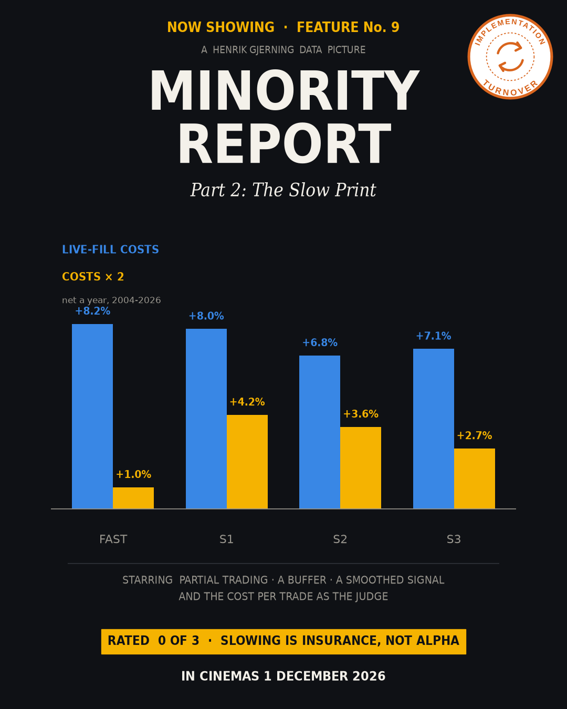
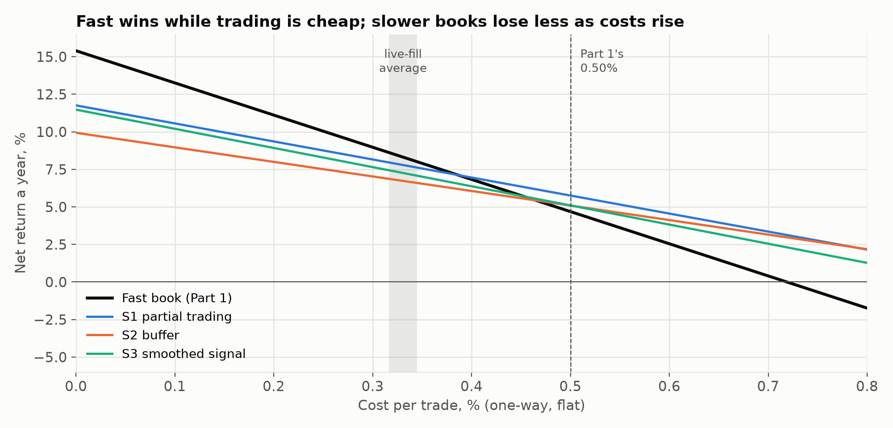
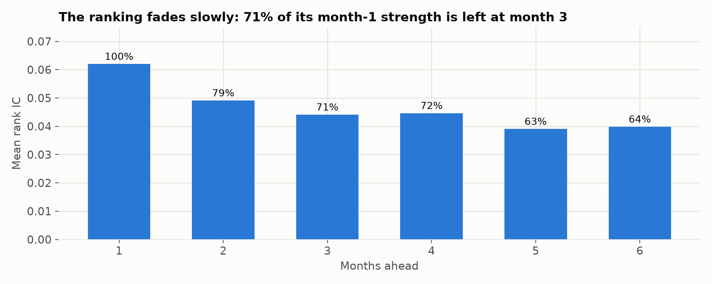
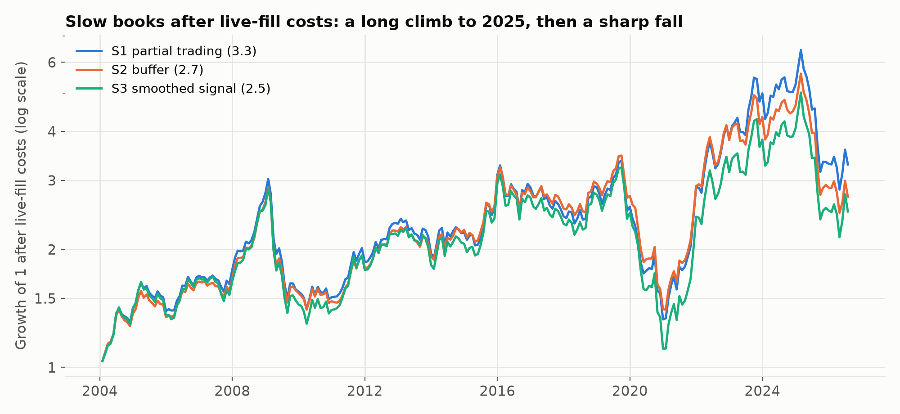

# Minority Report, Part 2: The Slow Print

### The machine's small-cap signal is strong before costs but expensive to trade. Can it be traded slowly enough to keep it?

*Henrik Gjerning · Rude Investment Consulting · December 2026 · Project 10, article A09 · Now Showing No. 9 · The Machine Learning Road, Episode 2*

<!-- interval:guess -->
> **The teaser asked.** 1) Trade halfway, wait for a clear exit, or smooth the signal: which kept the most after costs? 2) Does slowing down beat the plain fast book at costs estimated from live fills? 3) At what cost per trade does slowing start to pay? *Answers at the end, before the verdict.*
<!-- /interval -->

> **Last week, in Part 1.** Eight machine-learning models, trained on twelve features, ranked US small caps (ranks 1,001-3,000) every month from 2004 to 2026. Their ensemble earned **+15.4% a year before costs (t 2.82)**, a strong signal before costs (not itself a tested result). But it traded **179% of its capital a month** (buys plus sells, both legs), and at 0.50% per trade that left +4.7% a year (t 0.86): a fail. The signal is there; the trading eats it.
>
> **This week's question.** Do three standard ways of trading more slowly keep enough of the signal to leave a positive return after costs? All three were specified, and signed, before any of them was computed.

> **In one paragraph.** None of the three slow variants passed. Trading halfway to the target each month, a 10%/30% entry-exit buffer and a three-month average of the signal all cut turnover roughly in half and kept two-thirds to three-quarters of the gross return, and earned **+6.8% to +8.0% a year after costs estimated from live fills (t 1.27 to 1.49)**, short of the bar. The surprise is the comparison: **under the same cost model, the plain fast book did just as well (+8.2% a year, t 1.50; reported, not a trial, and Part 1's fail stands).** What slowing buys is insurance. Above about 0.39-0.47% per trade the slow books come out ahead, and at Part 1's 0.50% all three beat the fast book by 0.4-1.1 points a year, though none of these differences is statistically significant. At twice the estimated cost the fast book is left with +1.0% a year, partial trading with +4.2% and the buffer, which trades least, with +3.6%. So the answer to "should I slow down?" depends on what you pay per trade, and the most important number in this study is not a model setting but your cost per trade.

**Statistics box.** Universe, features, models, hyperparameters, walk-forward and decile book exactly as in Part 1; out-of-sample formation months Jan 2004 → Jul 2026 (271 months). Costs: the live-fill model, stock by stock and month by month (below). Three trials, one-sided, Holm correction at 5% (bars 0.017, 0.025, 0.05; Holm tests the smallest p first and stops at the first fail). This gate differs from Part 1's (p < 0.0056 and the same sign in both halves); it was set in this study's pre-registration. **All three failed.** Newey-West t (3 lags). Pre-registration signed 6 November 2026 18:53, before any slow variant was computed. The integrity check passed: Part 1's saved monthly gross, net and turnover were reproduced to the saved single precision (largest difference 7e-9; the registered 1e-10 is below the files' resolution) before anything new was run. Programme trial count: <!-- HENRIK: fill from PROGRAMME_GATE.md (check it includes S-1 to S-3), as in Part 1 -->.

---

## 1. Why this matters

Machine-learning signals in stock returns are real, but they are fast. Blitz, Hanauer, Hoogteijling and Howard (2023) find that machine-learning alpha is short-lived and comes with high turnover, and that training on longer horizons and efficient portfolio construction restore positive net returns; this study tests the second remedy alone, in small caps. Avramov, Cheng and Metzker (2023) find that much of the alpha sits in stocks that are expensive to trade. Part 1 showed both in one book: a strong signal and a turnover that eats it. The standard practitioner answer is "trade slower": move only part of the way to the target, keep winners until they are clearly no longer winners, or smooth the signal before acting on it. Gârleanu and Pedersen (2013) give the theory: with trading costs, the optimal portfolio trades only part of the way towards an "aim" portfolio that leans on the slower-moving parts of the signal. S1 below is a simple version of the first idea, S3 of the second. This study tests whether that answer works here.

## 2. Design (pre-registered)

Everything from Part 1 is held fixed. Each slow variant starts from the same monthly ensemble scores and is long the chosen long names and short the chosen short names, equal weight within each leg, held one month.

- **S1, partial trading.** Each month the book moves halfway from its drifted current weights to Part 1's decile target.
- **S2, buffer.** A stock enters the long leg in the top 10% and stays until it leaves the top 30%; the short leg mirrors this.
- **S3, smoothed signal.** Each stock's score is the average of its ensemble rank this month and the two before; then Part 1's plain top-minus-bottom decile book.

**Costs, a live-fill model.** The cost model was fitted on a large set of real fills from a systematic equity book I ran earlier in my career. It is an estimate from real trades, not an assumption, but it comes from another book and another period, so applying it to US small caps is itself an untested transfer:

  cost per trade (bp) = 6.2 + 8.9 × √(participation %, capped at 50) + 36.5 × illiquidity + 1.5 fees,

where participation is the trade's one-way size against the stock's 63-day average traded value, and illiquidity runs from 0 for the most-traded to 1 for the least-traded stock, ranked on 63-day traded value among US, European and UK stocks that month. It is applied stock by stock, at a book of DKK 10m. For these small caps it averages **0.32-0.34% per trade**, cheaper than Part 1's flat 0.50%. The model was chosen on 6 November, before the run, knowing it would be cheaper than 0.50% (I expected about 0.37-0.40%).

**Priors, stated before the run** (raised by 5 points when the cheaper cost model was chosen). S-1 pass 35%, S-2 40%, S-3 30%. Most likely outcome: "turnover halves, gross falls by a quarter to a half, net about +7-9% a year with t around 1.5-2: better, but borderline."

## 3. The pre-registered trials

**Table 1. The three trials, net of live-fill costs, 2004-2026**

| Trial | Variant | Net a year | NW t | p (one-sided) | Holm bar | Verdict |
|---|---|---:|---:|---:|---:|---|
| A31-S-1 | S1 partial trading, 50% | +8.0% | 1.49 | 0.068 | 0.017 | fail |
| A31-S-2 | S2 buffer, 10% in / 30% out | +6.8% | 1.33 | 0.092 | 0.025 | fail |
| A31-S-3 | S3 three-month smoothed signal | +7.1% | 1.27 | 0.103 | 0.050 | fail |

The results are consistent with the priors, and the "most likely outcome" was close: turnover fell by 40-55%, gross by 24-35%, net landed at +6.8-8.0%. S2's net and all three t-statistics came in a little under the predicted range.

## 4. What slowing bought, and what it cost

**Table 2. Fast book vs the three slow books, live-fill costs (reported)**

| | Gross a year | Turnover a month | Cost a year | Net a year | NW t | Net Sharpe | Alpha kept | Turnover kept | Break-even cost per trade |
|---|---:|---:|---:|---:|---:|---:|---:|---:|---:|
| Fast book (Part 1) | +15.4% | 179% | 7.2% | **+8.2%** | 1.50 | 0.35 | 100% | 100% | 0.72% |
| S1 partial 50% | +11.8% | 100% | 3.8% | +8.0% | 1.49 | 0.35 | 76% | 56% | 0.98% |
| S2 buffer 10/30 | +9.9% | 81% | 3.2% | +6.8% | 1.33 | 0.32 | 65% | 45% | 1.03% |
| S3 smoothed, 3 months | +11.5% | 106% | 4.4% | +7.1% | 1.27 | 0.29 | 75% | 60% | 0.90% |

Read across a row and the trade-off is plain. S1 saves 3.4 points a year in costs and gives up 3.6 points of signal. S2 and S3 give up more signal than they save. Against the fast book under the same costs, S1 is 0.2 points a year behind (t -0.32), S2 1.4 behind (t -1.42), S3 1.1 behind (t -1.05). None of these differences is significant; at these costs, slowing is a wash.

## 5. Slowing is insurance against costs

The same books under other cost assumptions tell the more useful story.

**Table 3. Net return a year (NW t) under different costs (reported)**

| Cost assumption | Fast book | S1 partial | S2 buffer | S3 smoothed |
|---|---:|---:|---:|---:|
| Live-fill ×0.5 (about 0.17% per trade) | **+11.8% (2.16)** | +9.9% (1.85) | +8.4% (1.64) | +9.3% (1.66) |
| Live-fill, book DKK 1m | **+9.1% (1.67)** | +8.3% (1.55) | +7.1% (1.39) | +7.6% (1.37) |
| **Live-fill, book DKK 10m (the trials)** | **+8.2% (1.50)** | +8.0% (1.49) | +6.8% (1.33) | +7.1% (1.27) |
| Live-fill, book DKK 100m | +5.9% (1.07) | **+7.1% (1.32)** | +5.9% (1.17) | +5.7% (1.02) |
| Flat 0.40% | +6.8% (1.26) | **+6.9% (1.30)** | +6.0% (1.19) | +6.4% (1.14) |
| Flat 0.50% (Part 1) | +4.7% (0.86) | **+5.7% (1.08)** | +5.1% (0.99) | +5.1% (0.91) |
| Live-fill ×2 (about 0.67% per trade) | +1.0% (0.18) | **+4.2% (0.78)** | +3.6% (0.71) | +2.7% (0.48) |

The fast book wins while trading is cheap; the slow books win once it is not. With costs per trade treated as flat, S1 overtakes the fast book at about **0.39% per trade**, S3 at about 0.45% and S2 at about 0.47%. The same happens as the book grows: at DKK 100m the larger trades cost more, and partial trading comes out ahead. None of the slow-minus-fast differences in this table is statistically significant: at a flat 0.50% they are +1.1 (t 1.59), +0.4 (t 0.40) and +0.4 points (t 0.38) for S1, S2 and S3. The crossover points are point estimates, found after looking. The practical reading for an investor: **know your cost per trade before you choose the trading speed.** If you pay 0.4-0.5% or more per trade, or run a larger book, slower trading kept more in this test, with partial trading the most consistent. At those costs no version of the book clears the bar.

## 6. Why didn't slowing do more? The signal decays slowly, but not at the edges

**Table 4. How long the prediction lasts: rank IC of this month's ensemble score against returns h months later (reported)**

| h (months ahead) | 1 | 2 | 3 | 4 | 5 | 6 |
|---|---:|---:|---:|---:|---:|---:|
| Mean rank IC | 0.062 | 0.049 | 0.044 | 0.045 | 0.039 | 0.040 |
| Share of month 1 | 100% | 79% | 71% | 72% | 63% | 64% |

Before the run I wrote that a pass would need the signal to decay slowly, with the month-3 IC at least half of month 1. It did: 71%. Yet no variant passed. A slow-decaying IC turned out to be necessary but not sufficient. The IC measures the ranking across all 2,000 stocks; the book makes its money in the top and bottom 10%, and the names that arrive in those extremes may lose their edge faster than the ranking as a whole. *This is an explanation, not a tested result*; it is a natural hypothesis for a sequel.

**The grids point the same way.** Every dial runs uphill towards the fast book (reported, not gated):

| Partial trading: share moved each month | 25% | 50% | 75% | 100% (fast book) |
|---|---:|---:|---:|---:|
| Net a year (live-fill) | +6.2% | +8.0% | +8.4% | +8.2% |

| Buffer: exit when the stock leaves | top 20% | top 30% | top 40% |
|---|---:|---:|---:|
| Net a year (live-fill) | +7.8% | +6.8% | +5.7% |

| Smoothing: months averaged | 1 (fast book) | 2 | 3 | 6 |
|---|---:|---:|---:|---:|
| Net a year (live-fill) | +8.2% | +7.4% | +7.1% | +6.1% |

The 75% setting's +8.4% is 0.2 points above the fast book: noise, and found after the fact, so it is not a discovery.

## 7. The recent decade is weaker

Over 2017-2026, the window of Part 1's large-cap study, the fast book earned +7.0% a year after live-fill costs (t 0.68) and the slow variants +3.0% to +5.2%. First and second halves of the full period: fast book +8.1% / +8.2%; S1 +8.5% / +7.4%; S2 +8.4% / +5.2%; S3 +8.2% / +6.0%. The slow variants fell further in the second half than the fast book did.

**Momentum, the benchmark, still loses after costs.** Plain 12-1 momentum in these small caps earns +2.9% a year gross and -2.5% a year after live-fill costs (t -0.46); slowing it leaves it between -1.1% and -1.8%. Momentum alone is no substitute: Part 1 showed the ensemble keeps +14.5% a year before costs without momentum among its inputs.

**And the one-line rule from Part 1 still beats every slowed machine.** At Part 1's 0.50%, none of the three slow books catches the gross-profitability sort (+7.9% a year, t 2.63; reported, chosen after looking, and it lost money in the S&P 500 and in Europe). The slowest signal in the study was a single plain characteristic.

## 8. Reproducing Part 1 was harder than it should be

The pre-registration demanded that Part 1's book be rebuilt exactly, every month, before any new variant was run. It took three runs; the first two failed, and both failures are worth knowing about if you build machine-learning portfolios yourself.

1. **k-nearest neighbours depends on the operating system.** With 500 neighbours, many stocks lie at exactly the same distance, and Windows breaks those ties differently from Linux, even with the same library version (scikit-learn 1.9.1). Seven of the eight models gave identical rankings on both machines; kNN did not. The study uses kNN's predictions re-run on Linux, where Part 1 ran, which reproduce Part 1 exactly.
2. **The ensemble's decile book is knife-edge.** The ensemble is the average of eight ranks, so many stocks tie exactly. The last digit of that average depends on how the computer lays the table out in memory, and at the decile cut the last digit decides who is in the book. In 15 of 271 months the book changed because of rounding alone. The study builds the ensemble exactly as Part 1's code did. A rough bound says rounding can move the fast book's return by at most 0.07 points a year, but read the ensemble results as robust only on that assumption; the variants were not re-run on the other rounding.

The positive lesson is that pre-registering an integrity check caught both problems before any result was seen. Without it, the trials would have been run on a book that was slightly different from Part 1's.

## 9. Limits

- **The cost model is a transfer.** Fitted on another book's fills in another period; its fit to US small caps, especially 2004-2008, is untested.
- **No borrowing costs** on the short leg.
- **Rounding at the decile cut** (section 8): not re-tested on the variants.
- **Holm stopped at S-1**, so the bars for S-2 and S-3 were never reached; all three are reported as fails.
- **The fast-book comparison is reported, not a trial.**

<!-- interval:joke -->
> **The teaser's questions, answered.**
>
> 1. **Which kept the most?** Partial trading: +8.0% a year after live-fill costs (t 1.49), against +7.1% for the smoothed signal and +6.8% for the buffer. None passed (Table 1).
> 2. **Does slowing beat the fast book?** No: under the same cost model the fast book earned +8.2% a year (t 1.50; reported, not a trial) (Table 2).
> 3. **When does slowing pay?** Above about 0.39% per trade for partial trading, 0.45% for smoothing and 0.47% for the buffer, and at a larger book; none of the differences is significant (section 5).
<!-- /interval -->

## 10. Verdict

| | |
|---|---|
| **Pre-registered trials** | 0 of 3 passed (S-1 t 1.49, S-2 t 1.33, S-3 t 1.27; Holm bars not reached) |
| **Did slowing help?** | Not at live-fill costs: the fast book earns as much (+8.2% a year, t 1.50; reported, not a trial) |
| **When does it help?** | Above about 0.39-0.47% per trade, or at a larger book, the slow books come out ahead, partial trading most consistently; not significantly |
| **What to take away** | The signal is strong before costs and slow to fade (IC still 64% of its first-month level after six months). The cost per trade, not the trading rule, decides the outcome. Measure your own costs first |
| **What it is not** | A verdict on machine learning in small caps. One fixed set of models and features, trained to predict next month; a model trained for a slower target is a different study |

<!-- HENRIK: your last 10% here: what the reader should do next, and the bridge to the next step in the ML series (hub page). Candidate sequels: (a) train the models on a 3-6 month target instead of slowing a 1-month signal; (b) test whether the extreme deciles decay faster than the cross-section (section 6); (c) European small and mid caps, registered, deadline 31 Dec 2026. Keep this free of anything that names or describes the former employer's trading. -->

---

## References

- Avramov, D., Cheng, S. and Metzker, L. (2023). Machine learning vs. economic restrictions: evidence from stock return predictability. *Management Science* 69(5).
- Blitz, D., Hanauer, M. X., Hoogteijling, T. and Howard, C. (2023). The term structure of machine learning alpha. *Journal of Financial Data Science* 5(4).
- Gârleanu, N. and Pedersen, L. H. (2013). Dynamic trading with predictable returns and transaction costs. *Journal of Finance* 68(6).
- Holm, S. (1979). A simple sequentially rejective multiple test procedure. *Scandinavian Journal of Statistics* 6(2).
- Newey, W. K. and West, K. D. (1987). A simple, positive semi-definite, heteroskedasticity and autocorrelation consistent covariance matrix. *Econometrica* 55(3).

*Sources of every number: the stored results of the pre-registered run of 8 Nov 2026, the pre-registration of 6 Nov 2026, the implementation note and the trial ledger (code and files in the repository). Cost crossovers in section 5 are computed from gross and turnover with a flat cost per trade.*

*Not investment advice. Film title used as a cultural reference only.*
