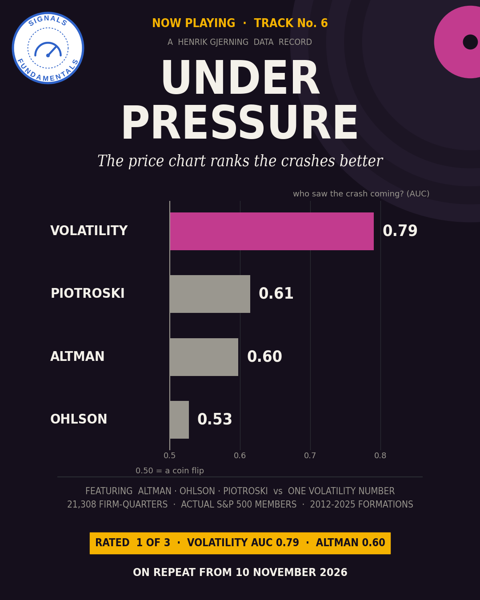
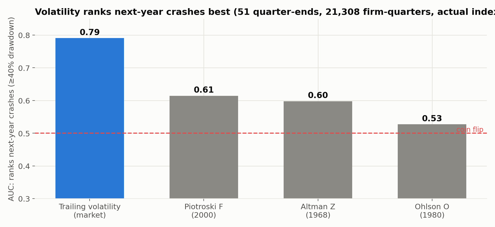
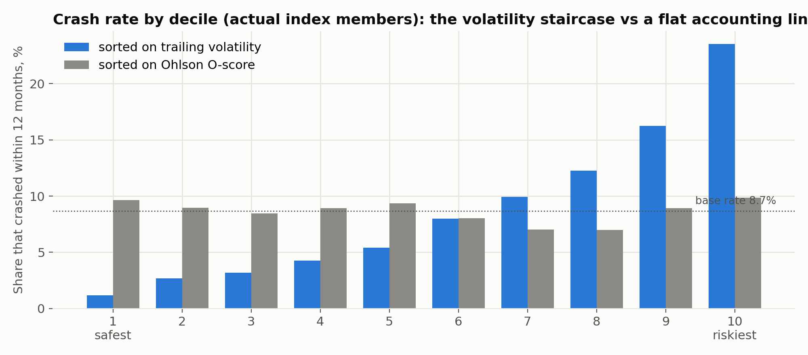
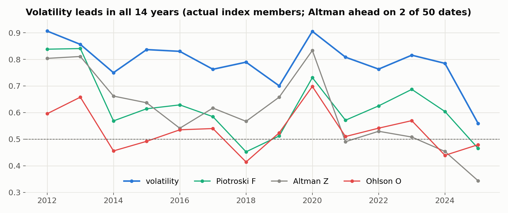

# Under Pressure: which distress score sees the crash coming?

### Altman, Ohlson and Piotroski against one number from the price chart



*Henrik Gjerning · Rude Investment Consulting · Project 10, article A06 (registered as A07) · Revised 8 October 2026; stress-tested 23 October 2026*

<!-- interval:guess -->
> **The teaser asked.** 1) Once you know how much a stock swings, does its balance sheet add anything? 2) Which flaw in my own stock list hid most of Altman's signal? 3) Is it fair to ask a bankruptcy score to spot price crashes? *Answers at the end, before the verdict.*
<!-- /interval -->

> **In one paragraph.** Among America's 500 largest companies, which number best ranks the stocks that will **crash** (fall 40% or more below today's price) within the next year: a classic accounting distress score, or simply how much the price has been swinging? I pre-registered the test and ran it over 51 quarter-ends from 2012 to 2025. **On the actual S&P 500 members of each date, the list of record, trailing volatility ranked crashes with an AUC of 0.79. Piotroski's F reached 0.61, Altman's Z 0.60 and Ohlson's O 0.53, close to a coin.** One of the three pre-registered trials passed: Altman's Z ranks crashes better than chance (p 0.0006). Ohlson's O did not beat volatility, and there was no distress premium. **The corrected list became the record on 23 October 2026, after its numbers were known.** On the list I registered (the top 500 among every company ever in the index, which knew future index members), Altman's Z failed (0.536, p 0.118) and the count was 0 of 3; my registered prediction for Altman was "pass". A follow-up registered on 8 October asked whether the balance sheet adds anything once volatility is known. Out of sample it did not improve the ranking (AUC 0.762 with all three scores against 0.783 for volatility alone); both follow-up trials failed.

**Statistics box.** Outcome: a crash, meaning the lowest close in the 12 months after a quarter-end is at most 60% of the formation close. AUC is computed within each quarter-end, then averaged over quarter-ends with at least one crash (50 on the corrected list, 49 on the registered list). Inference: moving-block bootstrap over formation dates (block 4 quarters, 10,000 draws); A07-3 uses Newey-West (6 lags). Three trials, one-sided gate p < 0.0167. **Verdict of record (corrected list): 1 of 3, A07-1 passes.** Registered list: 0 of 3. The corrected list became the record on 23 October 2026, after its numbers were known (see section 5). Follow-ups A07-4 and A07-5 (registered 8 October; gate p < 0.025 each; family-wide line across the six revisited trials 0.0083): 0 of 2. Two lists: *registered*, the 500 largest each quarter among every name that was in the S&P 500 at any time 2012–2026; *corrected*, the companies actually in the index on each date. Base crash rate 8.7% (corrected), 7.9% (registered). Sharadar as-reported fundamentals, used from their filing date; firms without a classified balance sheet (most banks and insurers) excluded. US large caps only. Every gated statistic was recomputed independently in the 23 October stress test and matched.

---

## 1. Why this matters now

Higher rates have brought distress scores back into fashion. The classic tools are half a century old. Altman (1968) fitted five ratios to 66 manufacturers. Ohlson (1980) used nine items and a logit. Piotroski (2000) built a nine-point quality checklist for cheap stocks; it is not a bankruptcy model, but investors use it the same way. Later work, notably Shumway (2001), Hillegeist, Keating, Cram & Lundstedt (2004), Bharath & Shumway (2008) and Campbell, Hilscher & Szilagyi (2008), found that models using market data beat Z and O at predicting failure. Campbell, Hilscher & Szilagyi's best predictors were accounting ratios measured at market value (profitability and leverage over market equity) plus volatility and past returns. Begley, Ming & Watts (1996) had already found that Z and O lost much of their accuracy out of sample.

This article asks the equity investor's version of that question, in the stocks most investors actually own, with the test written down before it was run.

## 2. Design (pre-registered)

- **Universe:** each quarter-end from Dec 2012 to Jun 2025, about 419 firms per date after excluding firms without current assets or current liabilities. Two lists, described in the statistics box; the corrected list is the record.
- **Scores:** Altman Z (1968 manufacturing coefficients), Ohlson O (1980 model 1 coefficients), Piotroski F (nine signals), and trailing 252-day volatility. Twelve-month flows are summed over four quarters; each filing is used only after its filing date and dropped after 400 days. No coefficients were re-estimated.
- **Outcome:** a crash, meaning the price falls at least 40% below the formation price at some point in the next 12 months (formation close to the 12-month low).
- **Metric:** AUC, the probability that a randomly chosen crasher has a worse score than a randomly chosen survivor (Hanley & McNeil 1982). 0.5 is a coin flip; 1.0 is perfect.

## 3. The pre-registered trials

**Table 1. Verdicts**

| Trial | Hypothesis | Corrected list (record) | Registered list | Gate | Verdict of record |
|---|---|---|---|---:|---|
| A07-1 | Altman Z ranks crashes better than chance | AUC **0.598** [0.541, 0.659], p 0.0006 | 0.536 [0.481, 0.597], p 0.118 | 0.0167 | **pass** (registered list: fail) |
| A07-2 | Ohlson O beats trailing volatility | AUC 0.527 − 0.791 = **-0.264**, p 1.000 | 0.480 − 0.772 = -0.291 | 0.0167 | fail (wrong sign) |
| A07-3 | Safe (low O) out-earn distressed (high O) | **-2.1%** a year, NW t -0.92 | -1.2%, t -0.55 | 0.0167 | fail |

My written predictions were: pass for Altman (about 85%), fail for Ohlson vs volatility, fail for the distress puzzle. On the corrected list all three predictions came out right; on the registered list I was wrong about Altman.

## 4. The main result: the price chart ranks crashes far better

**Table 2. The scoreboard**

| Score | Built from | AUC, corrected list (record) | Registered list | Reading |
|---|---|---:|---:|---|
| Trailing 252-day volatility | prices | **0.791** | 0.772 | ranks a random crasher above a random survivor 79% of the time |
| Piotroski F (2000), reversed | nine accounting signals (a quality checklist) | 0.614 | 0.598 | weak (reported, not gated) |
| Altman Z (1968), reversed | five ratios, one of them market cap | 0.598 | 0.536 | weak but above chance on the record |
| Ohlson O (1980) | nine accounting items | 0.527 | 0.480 | close to a coin |



The gap is not a close call. On the corrected list, volatility's AUC was above 0.5 on all 50 quarter-ends with a crash and above Ohlson's on 50 of 50 (100%). It beat Altman's Z on 48 of 50 (96%) and Piotroski's F on 48 of 50 (96%) (reported, not tested). Altman's Z was above 0.5 on 39 of 50 (78%).

The decile table is the easiest way to see what an AUC of 0.79 means.

**Table 3. Crash rate by decile (corrected list, pooled 2012–2025)**

| Decile (1 = safest) | 1 | 2 | 3 | 4 | 5 | 6 | 7 | 8 | 9 | 10 |
|---|---:|---:|---:|---:|---:|---:|---:|---:|---:|---:|
| Sorted on volatility | 1.2% | 2.7% | 3.2% | 4.3% | 5.4% | 8.0% | 9.9% | 12.3% | 16.2% | 23.5% |
| Sorted on Ohlson O | 9.7% | 8.9% | 8.5% | 8.9% | 9.4% | 8.0% | 7.0% | 7.0% | 8.9% | 9.9% |



Sorted by volatility, the crash rate climbs steadily from 1.2% to 23.5%. Sorted by the O-score it is flat. Treating the deciles as equal in size, the 10% most volatile stocks held about **27%** of all crashes, the 20% most volatile about **46%**, and the calmer half only about **19%** (reported, derived from Table 3, not tested).



Figure 3 shows the year-by-year picture. Volatility's yearly average leads Altman's in all 14 years on the corrected list (13 of 14 on the registered list); by date, Altman was ahead on 2 of 50 (2019-09, 2020-03). Three things limit how far the averages travel. First, crashes cluster: the four 2019 formation dates, whose 12-month windows contain the Covid fall of 2020, hold 568 of the 1,848 crashes, about **31%**. Because AUC is averaged across dates, each date counts once, which limits that cluster's pull, but it also means a date with 1 crash weighs as much as one with 174. Weighted by crashes instead, the AUCs are 0.75 (volatility), 0.55 (Piotroski), 0.58 (Altman) and 0.49 (Ohlson): the same order. Second, the two most recent dates (March and June 2025) are volatility's weakest: AUC 0.54 and 0.58. Third, Altman's signal sits in 2012–2020: its yearly AUC since then is 2021 0.49, 2022 0.53, 2023 0.51, 2024 0.45, 2025 0.34. Two or three years cannot tell a trend from noise, but neither lead is constant.

## 5. What changed when the list was fixed, and which list is the record

The pre-registration named one bias before anything was run: the ticker list holds every company that was in the S&P 500 at any time from 2012 to 2026, and the "500 largest" were picked from that list, so a company that joined the index in 2020 can sit in the 2014 sample. The A07 pre-registration said the same survivorship caveat as A06 applies, and A06 had said the bias affects all models equally. For A07 it did not.

I re-ran everything with one change: on each date, the universe is the companies actually in the S&P 500 that day, from the index provider's add/remove history. Same code, scores and test. A re-run with the original list on today's data reproduces the registered numbers, so the differences below come from the list alone.

**Table 4. Registered list vs corrected list**

| | Registered list (top 500 among every name ever in the S&P 500, 2012–2026) | Corrected list (actual S&P 500 members on each date): **record** |
|---|---:|---:|
| Firm-quarters / crash base rate | 21,350 / 7.9% | 21,308 / 8.7% |
| AUC trailing volatility | 0.772 | **0.791** |
| AUC Piotroski F | 0.598 | 0.614 |
| **A07-1** AUC Altman Z (gate p < 0.0167) | 0.536, p 0.118: fail | **0.598** [0.541, 0.659], **p 0.0006: pass** |
| Altman Z above 0.5 | 30 of 49 (61%) dates | 39 of 50 (78%) dates |
| AUC Ohlson O | 0.480 | 0.527 |
| **A07-2** AUC Ohlson O minus volatility | -0.291: fail | -0.264: fail |
| Volatility beats Ohlson | 49 of 49 (100%) dates | 50 of 50 (100%) dates |
| **A07-3** safe minus distressed, a year | -1.2% (t -0.55): fail | -2.1% (t -0.92): fail |

More crashes enter the sample (7.9% → 8.7%), because the corrected list keeps smaller members that later fell out of the index, exactly the companies the "ever-member" list had dropped. Every score gets better at spotting them, and Altman's Z improves the most: from a coin flip to a result that clears the pre-registered gate and also a programme-wide Bonferroni line (0.05 / 30 ≈ 0.0017).

Why Altman, more than the others? Not because of its market-value term: section 7 tests that, and without it Altman's AUC is unchanged (0.603 against 0.597). The reason is not established.

**Which list counts.** The programme's rule of 1 October was that the registered verdict stays on record and the corrected run is reported beside it. On 23 October 2026, after these numbers were known, I changed that rule: the corrected list is the verdict of record for every article, because it is the list an investor could actually have held. For A07 that turns a 0 of 3 into a 1 of 3. A rule changed after the data were seen deserves suspicion, so both counts are shown everywhere, and the reader can choose. The safer reading is the one that holds on both lists: **volatility ranks large-cap crashes far better than the textbook scores; Altman's Z carries a weak signal that the registered list hid.**

## 6. The distress puzzle (A07-3)

Dichev (1998) and Campbell et al. (2008) found that distressed stocks earn *lower* returns, the "distress puzzle"; Griffin & Lemmon (2002) found the effect concentrated among firms with low book-to-market. Here, a quarterly-rebuilt portfolio of the safest O-quintile minus the most distressed returned -2.1% a year (t -0.92) on the corrected list and -1.2% (t -0.55) on the registered list, 2013–2026. Among the 500 largest there is no puzzle and no premium. The crash rate is also flat across O-quintiles (9.3%, 8.7%, 8.7%, 7.0%, 9.4%), and the mean 12-month price return barely differs (+13.7% safest, +14.0% most distressed).

## 7. Revisited: does the balance sheet add anything? (October 2026)

The first version left one question open, and the review called it the most important. I registered it on 8 October 2026 (`PREREGISTRATION_A07_R_2026-10-08.md`; two trials, gate p < 0.025 each). At each quarter-end from 2015-09 to 2025-06 (39 dates), two logit models are fitted only on earlier quarters whose outcome was already known, and then used to rank the next crashes. One uses volatility alone; the other adds the accounting scores. The test runs on the corrected list. I predicted both trials would fail.

| Trial | Model | AUC with accounts | AUC volatility only | Difference [95% interval] | p | Verdict |
|---|---|---:|---:|---|---:|---|
| A07-4 | volatility + Altman + Ohlson + Piotroski | 0.762 | 0.783 | -0.021 [-0.039, +0.001] | 0.98 | fail |
| A07-5 | volatility + Altman | 0.771 | 0.783 | -0.012 [-0.028, +0.007] | 0.91 | fail |

The accounts did not improve the ranking; the point estimate was slightly lower, and the interval for A07-4 just includes zero. The same holds at 30% and 50% crash thresholds and on the registered list (reported). Fitted on all the data at once (in sample), Altman's Z still carries some information next to volatility (coefficient +0.30, z 2.9, standard errors clustered by firm and date), but that is not enough to improve a ranking made from earlier data only. Altman's signal is not its market-value term: without it, its AUC is unchanged (0.603 against 0.597), and the version without it adds nothing out of sample either.

## 8. What this does and does not show

**Is volatility winning by construction?** Partly, yes. The outcome is a large future price move, and a stock that already moves a lot is mechanically more likely to fall 40% in a year, distressed or not. The result is therefore not evidence that volatility understands the economic causes of distress, nor that it sees trouble earlier: AUC measures how well a score ranks next year's crashes, not who saw them first. It says something narrower: for ranking which large caps will crash, the price already carries far more usable information than the three textbook scores.

- **Incremental value.** Tested in section 7: out of sample, the accounting scores add nothing to volatility for large caps.
- **Crashes are not bankruptcies.** Altman and Ohlson were built to predict legal failure, which is rare in S&P 500 names. In small caps or high-yield issuers they may do much better. This sample says nothing about that.
- **Altman outside its design.** The 1968 Z was fitted on manufacturers. Here it is applied to every non-financial large cap, including utilities, real-estate trusts and carmakers with finance arms, where the sales/assets and working-capital terms mark stable firms as distressed. Altman's Z'' for non-manufacturers was checked afterwards (below).
- **Ohlson as implemented.** Model 1 coefficients as published; cash flow from operations stands in for Ohlson's funds from operations; total liabilities above total assets is common in large caps because of buybacks, not distress. Not tested separately.
- **Piotroski.** A quality checklist for value stocks, not a distress model. In the original code a missing prior-year input scored 0 instead of making F missing; the corrected version changes nothing that matters (below).
- **Reported, not tested (23 Oct 2026).** Run after the stress test from the same Season 1 data on the corrected list, same crash target and AUC procedure; no trial, no gate, and the verdict of record is unchanged (`results_pit/extra_checks_2026-10-23.json`). *Altman's Z'' for non-manufacturers* (6.56·WC/TA + 3.26·RE/TA + 6.72·EBIT/TA + 1.05·book equity/TL; Altman 1983; Altman, Iwanicz-Drozdowska, Laitinen & Suvas 2017) ranks crashes **worse** than the original Z: AUC 0.563 (p 0.014) against 0.598. *Excluding utilities and real-estate trusts* (about 10% of observations, by SIC code and Sharadar sector), the original Z rises to 0.628 and Z'' to 0.588; ranking Z *within sector* gives 0.600. So the design mismatch costs Altman a little, but it does not explain why volatility wins. *Piotroski with the missing-input fix:* AUC 0.614, unchanged from 0.614, and the A07-4 follow-up with the fixed F is unchanged too (−0.021, p 0.98).
- **Possible restatement look-ahead.** Twelve-month sums take the latest version of each quarter, and a restated quarter may carry a later filing date than the score date. The size of this effect is unknown.
- **No refit, one threshold.** Published coefficients only; a refitted model would be a new trial. The 40% cut-off was fixed in advance; section 7 is the same at 30% and 50%.
- **Registered but not delivered.** The follow-up pre-registration listed ROC curves for the four scores; they were not produced.
- **Effective sample.** 51 dates, 50 with crashes, about 31% of all crashes from four 2019 dates. US large caps, 2012–2025, one market era.
- **Multiple testing.** Three trials; Season 1 had 30 original trials plus the two follow-ups, and the programme now counts 279 run trials (302 all in). A07-1 on the corrected list (p 0.0006) clears a Bonferroni line across the 30 Season 1 trials (0.0017) and survives the programme-wide Benjamini–Hochberg correction (q 0.01).

<!-- interval:joke -->
> **The teaser's questions, answered.**
>
> 1. **Once you know how much a stock swings, does its balance sheet add anything?** No. Out of sample (39 quarter-ends, actual index members), volatility alone ranked crashes with an AUC of 0.783; adding Altman, Ohlson and Piotroski gave 0.762, and volatility plus Altman 0.771. Both follow-up trials failed, and the result is the same at 30% and 50% crash cut-offs (section 7).
> 2. **Which flaw in my own stock list hid most of Altman's signal?** The list held every company ever in the S&P 500, so it already knew which firms would later join. On the actual members of each date, the list of record since 23 October 2026, Altman's AUC rose from 0.536 (p 0.118, fail) to 0.598 (p 0.0006, pass) and the crash rate from 7.9% to 8.7%. That makes the verdict 1 of 3 on the record, 0 of 3 on the registered list (section 5, Table 4).
> 3. **Is it fair to ask a bankruptcy score to spot price crashes?** Only partly. A stock that already swings a lot reaches -40% more easily, and crashes are not bankruptcies; Altman's 1968 Z was also built for manufacturers, not utilities or property trusts. Even so, the crash rate climbs from about 1% in the calmest tenth to about 23% in the jumpiest, while it stays flat across Ohlson's deciles; and Altman's edge sits in 2012-2020 (yearly AUC 0.34 in 2025) (sections 4 and 8, Table 3).
<!-- /interval -->

## 9. Verdict

In this large-cap sample, a single market number, how much the price has been swinging over the past year, ranked next year's 40% crashes far better than Altman's Z, Ohlson's O or Piotroski's F, on both lists. On the list of record Altman's Z carries a weak but real signal (1 of 3 trials passed); on the registered list it did not (0 of 3). Ohlson's O stays close to a coin. That does not make accounting information useless: much of what these scores were built to capture already shows up in the price, and in an out-of-sample test the balance sheet added nothing beyond it. For a large-cap screen, the price chart is the better first warning; the balance sheet is better used to explain what it flags.

<!-- research -->
## What I would research next

**Not researched here**

- Small caps and high-yield issuers, where bankruptcy prediction is the real use.
- Actual bankruptcies and delistings as the outcome.

**With more or better data**

- A bankruptcy and delisting database.
- Credit spreads and CDS prices for the same firms.

**With better analysis**

- Refit the scores on old data and test on new data, out of sample.
- Combine accounting and market signals (Campbell, Hilscher & Szilagyi style).
<!-- /research -->

## Reproduce

```bash
python code/run_distress.py      # A07-1..3 + reported, results/summary.json (P10_UNIVERSE for the corrected list: results_pit/)
python code/run_a07r.py          # A07-4/5 follow-up, results_a07r/ (run_a07r_rep.py: reported extras)
python code/make_figures.py && python code/make_teaser_drawing.py && python code/build_article.py
```

## References

- Altman, E. I. (1968). Financial ratios, discriminant analysis and the prediction of corporate bankruptcy. *Journal of Finance*, 23(4).
- Altman, E. I. (1983). *Corporate Financial Distress*. New York: Wiley (the Z'' model for non-manufacturers).
- Altman, E. I., Iwanicz-Drozdowska, M., Laitinen, E. K. & Suvas, A. (2017). Financial distress prediction in an international context: a review and empirical analysis of Altman's Z-score model. *Journal of International Financial Management & Accounting*, 28(2).
- Begley, J., Ming, J. & Watts, S. (1996). Bankruptcy classification errors in the 1980s: an empirical analysis of Altman's and Ohlson's models. *Review of Accounting Studies*, 1(4).
- Bharath, S. T. & Shumway, T. (2008). Forecasting default with the Merton distance to default model. *Review of Financial Studies*, 21(3).
- Campbell, J. Y., Hilscher, J. & Szilagyi, J. (2008). In search of distress risk. *Journal of Finance*, 63(6).
- Chen, J., Hong, H. & Stein, J. C. (2001). Forecasting crashes: trading volume, past returns, and conditional skewness in stock prices. *Journal of Financial Economics*, 61(3).
- Dichev, I. D. (1998). Is the risk of bankruptcy a systematic risk? *Journal of Finance*, 53(3).
- Griffin, J. M. & Lemmon, M. L. (2002). Book-to-market equity, distress risk, and stock returns. *Journal of Finance*, 57(5).
- Hanley, J. A. & McNeil, B. J. (1982). The meaning and use of the area under a receiver operating characteristic (ROC) curve. *Radiology*, 143(1).
- Hillegeist, S. A., Keating, E. K., Cram, D. P. & Lundstedt, K. G. (2004). Assessing the probability of bankruptcy. *Review of Accounting Studies*, 9(1).
- Künsch, H. R. (1989). The jackknife and the bootstrap for general stationary observations. *Annals of Statistics*, 17(3).
- Newey, W. K. & West, K. D. (1987). A simple, positive semi-definite, heteroskedasticity and autocorrelation consistent covariance matrix. *Econometrica*, 55(3).
- Ohlson, J. A. (1980). Financial ratios and the probabilistic prediction of bankruptcy. *Journal of Accounting Research*, 18(1).
- Piotroski, J. D. (2000). Value investing: the use of historical financial statement information to separate winners from losers. *Journal of Accounting Research*, 38 (Supplement).
- Shumway, T. (2001). Forecasting bankruptcy more accurately: a simple hazard model. *Journal of Business*, 74(1).

*Not investment advice. Song title used as a cultural reference only; no lyrics are quoted.*
