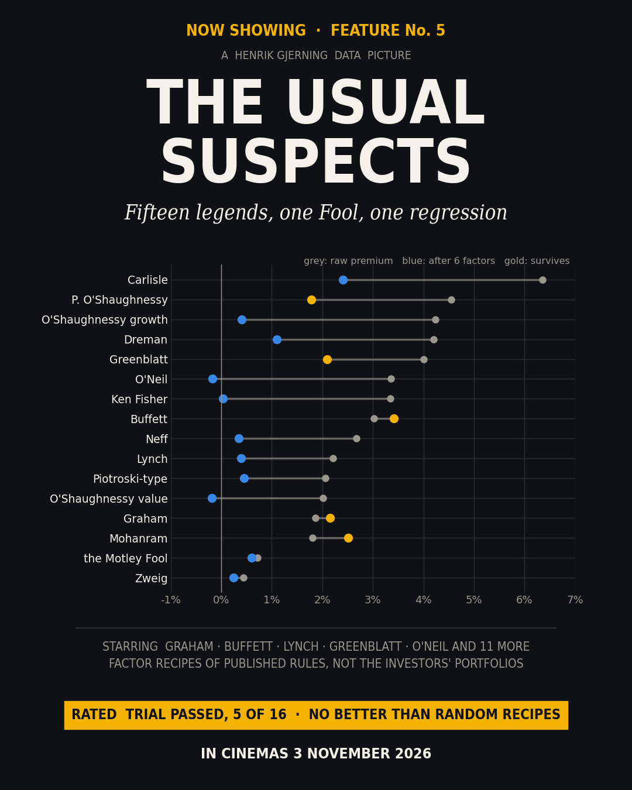
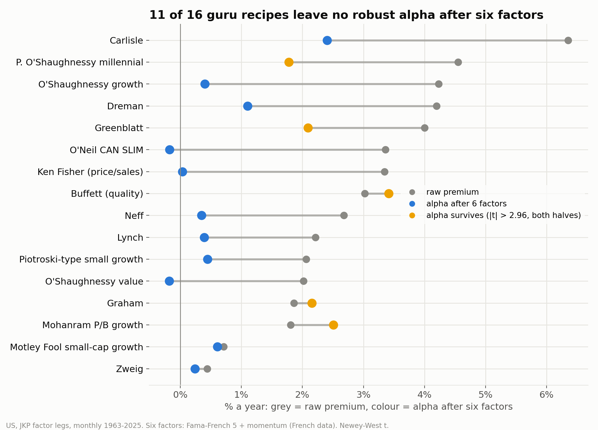
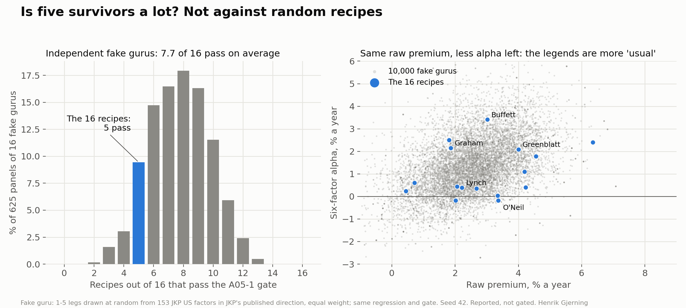
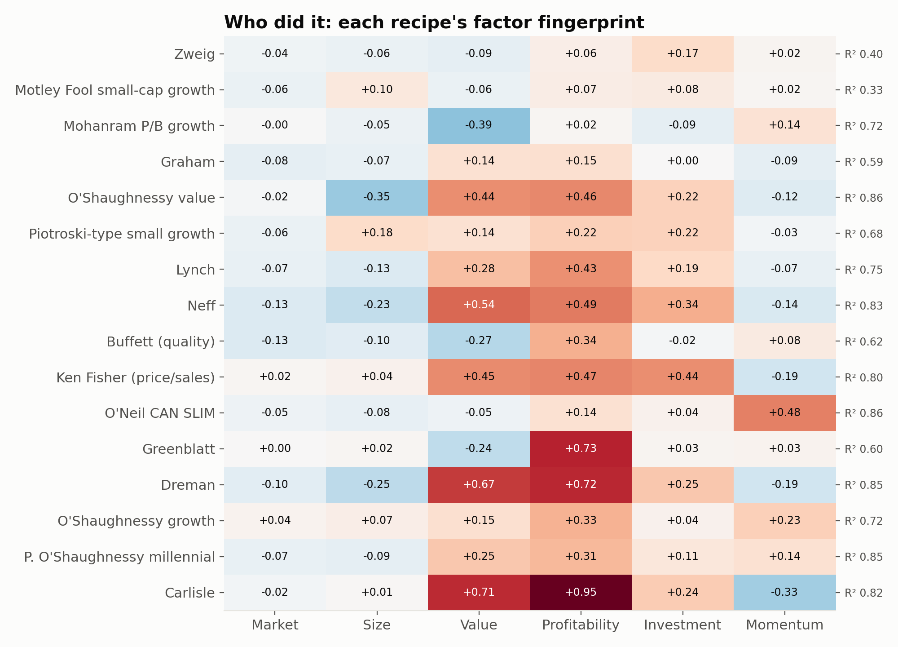
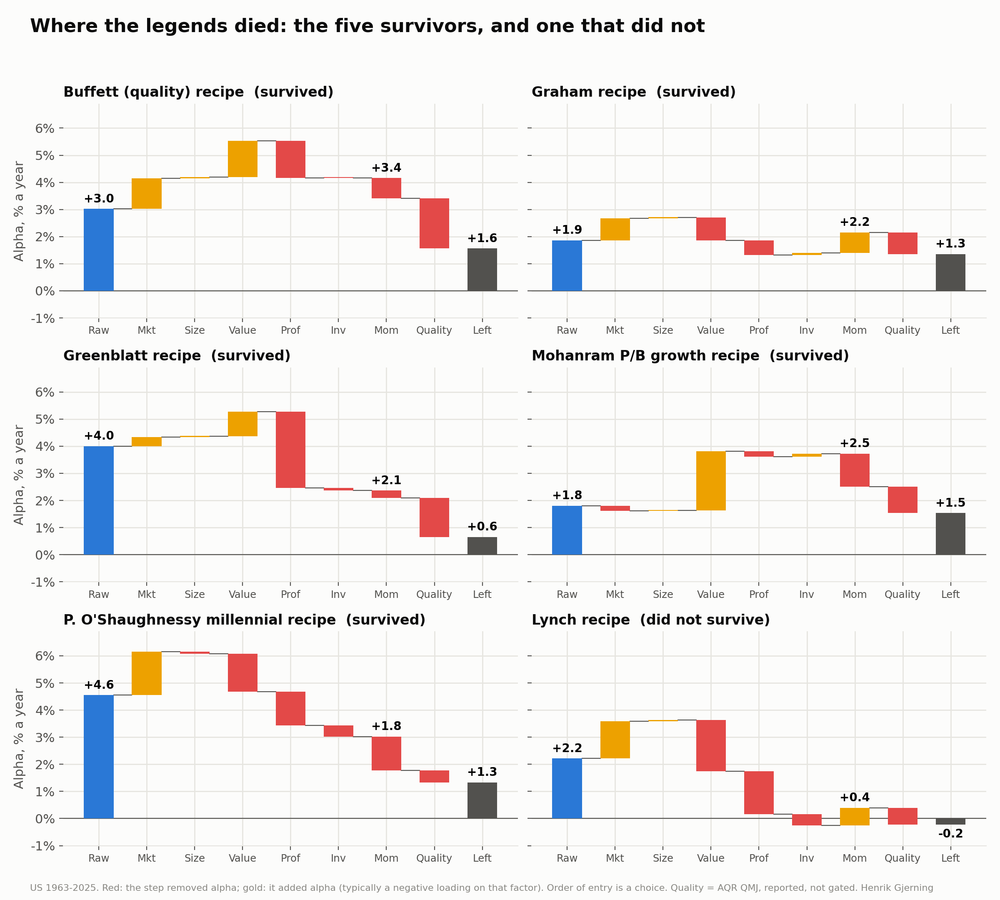
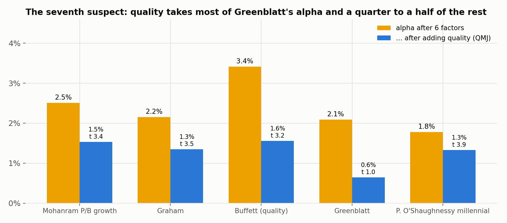

# The Usual Suspects: fifteen legends, one Fool, one regression

### Are the published rules of Graham, Buffett, Lynch, Greenblatt and friends anything more than value, momentum and quality in disguise?



*Henrik Gjerning · Rude Investment Consulting · September 2026, revised 8 October and 23 October 2026 · Project 10, article A05*

<!-- interval:guess -->
> **The teaser asked.** 1) How much of the legends' premium is left after six textbook factors, and which famous recipes turn out to be plain momentum or value? 2) Five recipes survive. Is that a lot, next to fake gurus built from random academic factors? 3) Who is the seventh suspect behind most of what the survivors keep? *Answers at the end, before the verdict.*
<!-- /interval -->

*Revised after an external review (8 Oct) and a stress test with three referees (23 Oct). The pre-registered result is unchanged.*

> **In one paragraph.** I rebuilt sixteen famous stock-picking rule sets as factor recipes: twelve practitioners (one of them with two recipes), two academics' published screens and the Motley Fool. Each recipe is a small portfolio of academic factor legs that approximates the *published* rules. It is not anyone's portfolio. I ran each recipe through one regression on six standard factors: market, size, value, profitability, investment and momentum. **The median raw premium of 2.8% a year falls to a median alpha of 0.5%.** The pre-registered trial asked whether at least one recipe keeps a robust alpha. **It passed: five recipes did** (the Buffett-quality, Graham, Mohanram, Greenblatt and Patrick O'Shaughnessy recipes), more than the one to three I predicted. **But five is not many.** Fake gurus built from published academic factors and put through exactly the same test pass about half the time, about 8 of 16 on average; with the real recipes' overlaps kept, five or fewer happens in 20–33% of fake panels. So surviving six factors is ordinary for a factor recipe. Quality accounts for much of what the survivors keep, though not all of it. All of this is about the rules that were written down, not the people.

**Statistics box.** Headline: median raw premium 2.8%/yr → median six-factor alpha 0.5%/yr (medians of absolute values, across recipes). 16 recipes, US, monthly 1963–2025 (650–750 months each). Factors: Fama–French 5 + momentum (Kenneth French data, built independently of the JKP recipe legs; daily returns compounded to months). Newey–West t, 6 lags. Trial A05-1 (pre-registered): a recipe passes if |t(α)| > 2.955 (Bonferroni over 16, two-sided 5%) **and** α has the same sign in 1963–94 and 1995–2025. **Result: 5 of 16 pass; trial PASSED.** My pre-registered prediction (1–3 pass) was wrong. Median R² 0.74. Programme trial count: 21. Reported, not gated: fake-guru placebos (independent fakes: pass rate 48%, mean 7.7 of 16 per panel; keeping the real recipes' shared legs: mean 6.7–7.8, P(5 or fewer) = 0.20–0.33); a seventh factor (quality); developed markets 1990-11 to 2025-12 (4 of 16 with |t| > 2.955).

---

## 1. The line-up

Every famous investor has a book, and most books contain rules: low P/E, high earnings yield, strong balance sheet, rising earnings, relative strength. Services such as Validea turn those rules into screens and sell the portfolios. The academic question is older: are those rules *new* information, or combinations of factors we already know?

Project1 translated each rule set into **factor legs** from Jensen, Kelly & Pedersen's (2023) global factor database. The Graham recipe, for instance, is book-to-market, earnings yield, dividend yield, Altman Z and low debt. Each recipe is the equal-weight average of its long-short legs. The appendix lists every recipe, its legs and where the rules come from. The sixteen recipes come from twelve practitioners (James O'Shaughnessy has two), two academics (Piotroski and Mohanram) and the Motley Fool; "fifteen legends" in the title is a film-title pun for the fifteen recipes with a named author. One recipe needs a special note: Buffett never published screening rules, so the "Buffett" recipe is quality-minus-junk, following Frazzini, Kabiller & Pedersen's (2018) reading of his record.

> **What exactly is being tested?** Not Warren Buffett, Benjamin Graham, Peter Lynch or Joel Greenblatt. The test is of factor proxies built to approximate the rules published under their names. When this article says "the Graham recipe passes", it means the factor recipe inspired by Graham's published rules, not Graham. A poor proxy can overstate or understate what the rules contain, and the investors' actual portfolios, judgement and stock selection are not in the data.

A sceptic can put the design in one line: *you built factor portfolios and found that factor models explain them.* That is fair, and it sets the scope. The recipes are made of academic factor legs, so overlap with a factor model is expected. The test can show how much of the written-down rules decomposes into known factors. It cannot show whether the investors had skill.

## 2. The regression

For each recipe, monthly return = α + six factor loadings + noise. The six factors come from Kenneth French's library (Fama & French, 2015; Carhart, 1997), built independently of the JKP legs. The pre-registration (`PREREGISTRATION_A05_2026-09-25.md`) fixed the gate before the run and recorded my prediction: one to three recipes survive.



**Table 1. Sixteen recipes, one regression (sorted by alpha t-statistic)**

| Recipe (JKP legs) | Since | Raw premium /yr (t) | 6-factor alpha /yr (t) | R² | α 1963–94 | α 1995–2025 | α since 2012 (t) | Verdict |
|---|---|---:|---:|---:|---:|---:|---:|---|
| Buffett (quality) | 1963-07 | +3.0% (3.29) | **+3.4%** (5.85) | 0.62 | +3.6% | +2.8% | +0.9% (0.94) | **passes** |
| Graham | 1963-07 | +1.9% (3.10) | **+2.2%** (5.46) | 0.59 | +2.7% | +1.1% | +0.4% (0.63) | **passes** |
| P. O'Shaughnessy millennial | 1971-11 | +4.6% (4.82) | **+1.8%** (5.40) | 0.85 | +2.2% | +1.4% | +1.7% (3.30) | **passes** |
| Mohanram P/B growth | 1963-07 | +1.8% (2.04) | **+2.5%** (4.96) | 0.72 | +2.0% | +2.8% | +1.5% (2.18) | **passes** |
| Greenblatt | 1963-07 | +4.0% (3.73) | **+2.1%** (3.22) | 0.60 | +2.1% | +2.7% | +1.8% (1.33) | **passes** |
| Carlisle | 1963-07 | +6.4% (2.93) | **+2.4%** (2.70) | 0.82 | +2.9% | +2.8% | +2.0% (1.17) | no robust alpha |
| Motley Fool small-cap growth | 1963-07 | +0.7% (1.80) | **+0.6%** (1.85) | 0.33 | +0.4% | +1.2% | +0.7% (1.25) | no robust alpha |
| Dreman | 1963-07 | +4.2% (2.19) | **+1.1%** (1.50) | 0.85 | +3.1% | +1.1% | +1.5% (1.31) | no robust alpha |
| Piotroski-type small growth | 1963-07 | +2.1% (2.99) | **+0.4%** (1.28) | 0.68 | +0.3% | +1.0% | +0.9% (1.71) | no robust alpha |
| O'Shaughnessy growth | 1965-05 | +4.2% (5.83) | **+0.4%** (1.10) | 0.72 | +1.1% | +0.3% | +0.8% (1.12) | no robust alpha |
| Lynch | 1965-05 | +2.2% (2.00) | **+0.4%** (0.83) | 0.75 | +1.8% | +0.4% | +0.2% (0.32) | no robust alpha |
| Zweig | 1965-05 | +0.4% (1.11) | **+0.2%** (0.82) | 0.40 | +0.2% | +0.4% | +0.4% (0.89) | no robust alpha |
| Neff | 1963-07 | +2.7% (1.64) | **+0.3%** (0.54) | 0.83 | +2.0% | +0.1% | +1.1% (1.15) | no robust alpha |
| Ken Fisher (price/sales) | 1963-07 | +3.3% (2.37) | **+0.0%** (0.06) | 0.80 | +1.1% | +0.5% | +2.1% (2.11) | no robust alpha |
| O'Shaughnessy value | 1963-07 | +2.0% (1.52) | **-0.2%** (-0.31) | 0.86 | +1.5% | -0.4% | +1.2% (1.54) | no robust alpha |
| O'Neil CAN SLIM | 1965-05 | +3.4% (3.15) | **-0.2%** (-0.43) | 0.86 | -0.1% | +0.6% | +1.4% (1.83) | no robust alpha |

*The since-2012 column is reported, not tested.*

**The pre-registered trial passed: five recipes clear the bar, not the one to three I predicted.** They are the recipes with **quality, safety or cash-flow content**. The Greenblatt recipe is return on capital plus earnings yield. The Graham recipe includes the Altman Z-score and low debt. The Buffett recipe is literally quality-minus-junk. The Mohanram recipe is cash flow and R&D. The Patrick O'Shaughnessy recipe combines payout, value, momentum and QMJ.

The other eleven leave no robust alpha (median R² 0.80, median |alpha| 0.4% a year). For four of them there was little to explain: the Zweig, Neff, O'Shaughnessy value and Motley Fool recipes had no significant raw premium to begin with. One is a borderline miss: the **Carlisle recipe keeps +2.4% a year (t 2.70)**, with the same sign in both halves, larger than the Graham or Greenblatt recipes' alpha; it misses the Bonferroni bar, and with 24 Newey–West lags instead of 6 its t reaches 3.06 and it would have passed (reported; the six-lag choice was pre-registered). The pure momentum and the other pure value recipes (O'Neil, Neff, Dreman, Ken Fisher, Lynch, O'Shaughnessy value and growth) are well explained, with R² between 0.72 and 0.86.

**Since 2012** every passer's alpha is smaller than its full-sample alpha, but the P. O'Shaughnessy recipe's barely (+1.8% to +1.7%, t 3.30), and the Buffett and Graham recipes, the two strongest over the full sample, have since-2012 t-statistics of 0.94 and 0.63. For the eleven others the since-2012 alpha *rose* for nine; none of them reaches the bar. My pre-registered expectation that the since-2012 alpha would be smaller "for almost every recipe" was wrong: 7 of 16.

## 3. Fake gurus: is five a lot?

Five passes out of sixteen needs a benchmark. If random combinations of published academic factors pass the same regression as often, the five say little about the legends' rules.

So I built fake gurus. Each draws one to five legs (the same mix of sizes as the real recipes) at random from the 153 US factors in the JKP database, takes each leg in the direction the literature says it pays, and averages them. Every fake goes through exactly the A05-1 procedure: six factors, Newey–West t, the 2.955 bar and the same-sign test in both halves. A harder version uses only the legends' own 29 signed legs (27 distinct factors), recombined. These checks were added after the first review; they are reported, not gated, and do not count as trials.

The stress test added one more version. The real recipes share legs (earnings yield appears in four, dividend yield in four, quality in two), and recipes that share legs pass or fail together. Independent fakes miss that, so they understate how much a panel's pass count can vary. The **structure-preserving placebo** keeps the real overlaps: in each of 1,000 panels, every one of the 27 distinct legs is swapped for a different random factor, and all sixteen recipes are rebuilt with the same sharing. It keeps exactly shared legs, not the correlation among related legs (the three QMJ legs, the various value ratios), so it may still understate the spread.



**Table 2. The legends' recipes against fake gurus**

| | Pass rate | Passes out of 16 | Chance of 5 or fewer out of 16 |
|---|---:|---:|---:|
| The 16 legends' recipes | 31% | 5 (actual) | |
| Independent fakes, any of 153 factors (10,000) | 48% | 7.7 on average; 95th percentile 11 | 0.14 (±0.01) |
| Independent fakes, the legends' own factors (2,000) | 46% | 7.3 on average | 0.17 |
| Real overlaps kept, legs in their published direction (1,000 panels) | 49% | 7.8 on average (SD 2.6) | 0.20 (±0.01) |
| Real overlaps kept, the real recipes' signs (1,000 panels) | 42% | 6.7 on average (SD 2.5) | 0.33 (±0.01) |

*± is the Monte Carlo standard error. Independent fakes: seed 42, panels of 16 (625); overlap-preserving: seeds 5051 and 5052.*

**The legends' recipes do no better than random recipes built from published academic factors.** A random recipe passes about half the time, and a panel of sixteen typically produces six to eight passes. With the real overlaps kept, five or fewer happens in 20–33% of panels: five is ordinary. The reading is narrow: passing six factors is not a mark of distinction for a factor recipe, and five passes is about what sixteen random recipes from the published-anomaly zoo give. The right panel of Figure 4 adds one detail: for a similar raw premium, the legends' recipes leave less alpha than the fakes. They are more "usual", not less.

The benchmark is demanding in one way. The fakes take each factor in the direction its academic paper found, and most of those papers were published after 1963, so they are well-informed gurus; Jensen, Kelly & Pedersen (2023) find that most published factors replicate, which is why random draws from that pool pass so often. Some real recipes hold legs against the published direction (low debt, large size, low book-to-market), which the "real signs" row reproduces.

## 4. Fingerprints: who did it

**Table 3. Factor loadings**

| Recipe | Mkt | Size | Value | Prof | Inv | Mom |
|---|---:|---:|---:|---:|---:|---:|
| Buffett (quality) | -0.13* | -0.10* | -0.27* | +0.34* | -0.02 | +0.08* |
| Graham | -0.08* | -0.07* | +0.14* | +0.15* | +0.00 | -0.09* |
| P. O'Shaughnessy millennial | -0.07* | -0.09* | +0.25* | +0.31* | +0.11* | +0.14* |
| Mohanram P/B growth | -0.00 | -0.05* | -0.39* | +0.02 | -0.09* | +0.14* |
| Greenblatt | +0.00 | +0.02 | -0.24* | +0.73* | +0.03 | +0.03 |
| Carlisle | -0.02 | +0.01 | +0.71* | +0.95* | +0.24* | -0.33* |
| Motley Fool small-cap growth | -0.06* | +0.10* | -0.06* | +0.07* | +0.08* | +0.02* |
| Dreman | -0.10* | -0.25* | +0.67* | +0.72* | +0.25* | -0.19* |
| Piotroski-type small growth | -0.06* | +0.18* | +0.14* | +0.22* | +0.22* | -0.03 |
| O'Shaughnessy growth | +0.04* | +0.07* | +0.15* | +0.33* | +0.04 | +0.23* |
| Lynch | -0.07* | -0.13* | +0.28* | +0.43* | +0.19* | -0.07* |
| Zweig | -0.04* | -0.06* | -0.09* | +0.06* | +0.17* | +0.02* |
| Neff | -0.13* | -0.23* | +0.54* | +0.49* | +0.34* | -0.14* |
| Ken Fisher (price/sales) | +0.02 | +0.04 | +0.45* | +0.47* | +0.44* | -0.19* |
| O'Shaughnessy value | -0.02 | -0.35* | +0.44* | +0.46* | +0.22* | -0.12* |
| O'Neil CAN SLIM | -0.05* | -0.08* | -0.05 | +0.14* | +0.04 | +0.48* |

*\* |t| > 2 (Newey–West, 6 lags).*



The fingerprints read like the books. The O'Neil (CAN SLIM) recipe is mostly momentum. The Dreman and Neff recipes are value with a profitability tilt. The Motley Fool recipe earns little to explain (+0.7% a year), tilts to small caps, and is the least explained of the group (R² 0.33).



**Where the legends died.** Figure 5 lets the suspects in one at a time. The Lynch recipe starts at +2.2% a year; the market factor lifts it to +3.6% (its market loading is negative), value cuts it to +1.7% and profitability to +0.2%. The Greenblatt recipe dies mostly at profitability (+5.3% to +2.5%) and then at quality. The Buffett and Graham recipes lose little to the six factors; the Buffett recipe even gains at first, because its negative market and value loadings mean the raw premium understates it. Quality then takes about half of the Buffett recipe's alpha and a third of the Graham recipe's. The two survivors not discussed so far follow the same pattern. The Mohanram recipe gains when value enters (+1.6% to +3.8%, a negative value loading: it holds growth stocks), then loses most at momentum and quality, ending at +1.5%. The P. O'Shaughnessy recipe is lifted by the market factor to +6.1%, then worn down step by step by value, profitability and momentum to +1.8%, and quality takes it to +1.3%. The Lynch panel is the contrast: a recipe that did not survive, where value and profitability take everything. The order of entry is a choice: a different order moves the steps, not the end points.

## 5. The seventh suspect: quality (explanatory, not confirmatory)

The quality regression was not part of the pre-registered decision rule. It was added after the primary result to ask one question: do the passers share a common omitted exposure? It is also partly circular, because the Buffett and P. O'Shaughnessy recipes contain JKP's own QMJ legs. Read it as interpretation, not as a test. Asness, Frazzini & Pedersen (2019) show that quality-minus-junk carries alpha against the three-factor and Carhart models (against the five-factor model much of it is absorbed by profitability); here it still loads strongly after the five factors and momentum (Table 4), so I added their US QMJ factor as a seventh regressor.

**Table 4. The five passing recipes, before and after quality**

| Recipe | α, 6 factors (t) | α, + quality (t) | QMJ loading (t) | Share of alpha taken by quality |
|---|---:|---:|---:|---:|
| Greenblatt | +2.1% (3.22) | +0.6% (0.97) | +0.44 (9.1) | 69% |
| P. O'Shaughnessy millennial | +1.8% (5.40) | +1.3% (3.85) | +0.14 (4.6) | 25% |
| Buffett (quality) | +3.4% (5.85) | +1.6% (3.18) | +0.57 (16.2) | 54% |
| Graham | +2.2% (5.46) | +1.3% (3.54) | +0.25 (8.3) | 37% |
| Mohanram P/B growth | +2.5% (4.96) | +1.5% (3.45) | +0.30 (9.0) | 39% |



With quality added, the Greenblatt recipe's alpha falls to +0.6% (t 0.97): on this evidence the magic-formula recipe is quality plus value. For the other four, quality takes 25–54% of the alpha, and they keep 1.3% to 1.6% a year, still with |t| above 3. All four combine safety (low leverage, Altman Z) or cash flow with value, a known academic cluster; but six factors plus quality do not explain all of what they keep.

## 6. Other published screens as real portfolios (Project1, reported)

Factor recipes are long-short, rebalanced monthly, cost-free and spread across thousands of stocks. A real screen is a long-only list of names. Project1 built **four other published rule sets, not among the sixteen** (Gray, van Vliet, Thorp and Faber), as real stock portfolios on two kinds of universe: point-in-time historical data (ART, 2003–2013, in-sample on ART's own universe) and today's index members (live, 2015–2026; survivor-biased, price returns only). These are our reconstructions of the published screens, not the managers' funds. The live Thorp rows use an earnings-surprise proxy, not earnings revisions. The numbers are copied from Project1 (aggregates only), not re-estimated.

**Table 5. Four other screens against their own universe (Project1, reported)**

| Screen (our reconstruction) | Universe | Weeks | Excess vs equal-weight universe /yr (t) | Alpha after own ingredients + 13 JKP themes /yr (t) |
|---|---|---:|---:|---:|
| Gray, quant momentum | ART Global Developed 2003-13 | 537 | -0.5% (-0.14) | +3.3% (1.39) |
| van Vliet, low-vol multifactor | ART Global Developed 2003-13 | 537 | -0.6% (-0.18) | +2.6% (1.29) |
| Thorp, earnings revisions (IBES) | ART Global Developed 2003-13 | 537 | -2.1% (-0.76) | +1.0% (0.40) |
| Faber, shareholder yield (core) | ART Global Developed 2003-13 | 537 | +3.7% (2.61) | +2.4% (1.79) |
| Gray, quant momentum | EUROPE live | 575 | -1.0% (-0.37) | -3.3% (-1.50) |
| Faber, shareholder yield (core) | EUROPE live | 575 | -1.6% (-0.99) | -2.1% (-1.74) |
| van Vliet, low-vol multifactor | EUROPE live | 575 | -4.3% (-2.03) | -7.4% (-3.50) |
| Thorp, earnings-surprise proxy | EUROPE live | 243 | +3.0% (1.25) | +0.5% (0.23) |
| Gray, quant momentum | US live | 575 | -5.1% (-1.94) | -6.1% (-4.42) |
| Faber, shareholder yield (core) | US live | 574 | -0.9% (-0.40) | -1.6% (-1.55) |
| van Vliet, low-vol multifactor | US live | 575 | -6.2% (-3.09) | -6.6% (-7.10) |
| Thorp, earnings-surprise proxy | US live | 242 | +3.6% (1.38) | +1.5% (0.87) |

9 of the 12 rows trail their universe; 2 do so significantly (t below −2). On the point-in-time data only Faber's shareholder yield beat its universe, and after its ingredients its t falls below 2. On the live universes, Gray's momentum and van Vliet's low-vol screens trailed by 5–6% a year in the US. Among Project1's pre-registered stock-level recipes on the point-in-time data, a **Greenblatt-type** value-plus-profitability recipe passed (Sharpe 0.74 vs 0.56, P = 0.0066), in-sample on ART's own universe; the **Millennial (P. O'Shaughnessy-type)** recipe did not (Sharpe difference +0.07, P = 0.27).

## 7. Beyond the US (reported, not gated)

**Table 6. The same recipes in developed markets**

| Recipe | US α (t) | Developed-markets α (t), 1990-11 to 2025-12 |
|---|---:|---:|
| Buffett (quality) | +3.4% (5.85) | +2.3% (4.90) |
| Graham | +2.2% (5.46) | +1.6% (5.37) |
| P. O'Shaughnessy millennial | +1.8% (5.40) | +1.0% (3.00) |
| Mohanram P/B growth | +2.5% (4.96) | +2.5% (4.82) |
| Greenblatt | +2.1% (3.22) | +1.8% (2.87) |
| Carlisle | +2.4% (2.70) | +1.8% (2.21) |
| Motley Fool small-cap growth | +0.6% (1.85) | +0.8% (2.84) |
| Dreman | +1.1% (1.50) | +0.6% (0.96) |
| Piotroski-type small growth | +0.4% (1.28) | +0.6% (2.38) |
| O'Shaughnessy growth | +0.4% (1.10) | +0.4% (0.82) |
| Lynch | +0.4% (0.83) | -0.2% (-0.44) |
| Zweig | +0.2% (0.82) | -0.2% (-0.50) |
| Neff | +0.3% (0.54) | -0.3% (-0.56) |
| Ken Fisher (price/sales) | +0.0% (0.06) | -0.1% (-0.12) |
| O'Shaughnessy value | -0.2% (-0.31) | -0.7% (-1.37) |
| O'Neil CAN SLIM | -0.2% (-0.43) | -0.2% (-0.35) |

Outside the US four of the five US passers (Graham, Buffett, Mohanram and P. O'Shaughnessy) are the only ones with |t| above 2.955; the Greenblatt (2.87) and Motley Fool (2.84) recipes just miss. By size of alpha, the Greenblatt and Carlisle recipes are larger than the P. O'Shaughnessy recipe. No half-split is applied here, and the sample starts in 1990-11 (French's developed momentum starts then; the pre-registration said 1990-07). These tests were not part of the decision rule.

## 8. Limits, and what would change my mind

- **Factor portfolios explained by factor models.** Overlap is expected by construction. The result establishes how much of the written rules decomposes into known factors, not absence of skill.
- **Rules, not people.** A better proxy could do better or worse. Frazzini, Kabiller & Pedersen (2018) decompose Buffett's *actual* record and find it largely explained by leveraged low-risk and quality exposure, but that is their study of his record, not this one.
- **Post hoc pieces.** The quality regression, the placebos and the decomposition were all added after the primary result. They interpret A05-1; they do not re-test it.
- **Gross of costs.** Long-short factor returns ignore trading costs and shorting constraints (Novy-Marx & Velikov, 2016). A residual of 1.5% a year gross is fragile.
- **Publication.** Most legs were published during the sample; McLean & Pontiff (2016) predict decay. The passers' alphas are smaller since 2012 (one only slightly), but the other recipes' alphas rose, so this is not general decay.
- **Multiple testing.** The Bonferroni gate controls error within the sixteen recipes, but the programme has now run 21 trials. Effect sizes and the placebo deserve more weight than any single t-statistic. The verdict does not depend on the lag choice: 0, 3, 6 or 12 lags give five passes, 24 lags six (Carlisle).
- **US-centred.** The gate is US only; other markets are reported.

**My pre-registered expectations, scored.** (1) "R² above 0.6 for the value-type recipes and O'Neil": right except the Graham recipe (0.59). (2) "One to three pass, the rest with |α| below 2% a year": wrong, five passed, and the Carlisle recipe kept +2.4%. (3) "Alpha since 2012 smaller for almost every recipe": wrong, 7 of 16.

**What would falsify the factor reading?** Three findings would. (1) Real recipes passing clearly more often than fake gurus, say in the top 5% of fake panels (more than 12 of 16). (2) Passers whose alpha holds up after 2012 and after quality, rather than shrinking. (3) Stock-level screens of the same rules beating their universes after costs on point-in-time data. (2) shows up only for the P. O'Shaughnessy recipe, which itself contains QMJ as a leg; (3) only for the Greenblatt-type recipe, in-sample on ART's universe and before costs.

<!-- interval:joke -->
> **The teaser's questions, answered.**
>
> 1. **How much of the legends' premium is left after six textbook factors, and which famous recipes turn out to be plain momentum or value?** Very little. The median premium of 2.8% a year shrinks to 0.5%, and 11 of 16 recipes leave no robust alpha. The O'Neil recipe is mostly momentum; the Dreman and Neff recipes are value with a profitability tilt (section 2, Table 3).
> 2. **Five recipes survive. Is that a lot, next to fake gurus built from random academic factors?** No. A random recipe built from published academic factors passes about half the time, 7 to 8 of 16 on average. With the real overlaps between the recipes kept, five or fewer happens in 20-33% of fake panels. The legends' recipes do no better (section 3, Table 2, Figure 4).
> 3. **Who is the seventh suspect behind most of what the survivors keep?** Quality (quality-minus-junk). Added after the main test, it takes 69% of the Greenblatt recipe's alpha and 25-54% of the other four's; four still keep 1.3-1.6% a year. Read it as interpretation, not a test: the Buffett and P. O'Shaughnessy recipes already contain quality (section 5, Table 4).
<!-- /interval -->

## 9. Verdict

The published rules of famous investors decompose largely into value, momentum, profitability, investment and quality. **The median premium falls from 2.8% to 0.5% a year after six standard factors.** The pre-registered trial passed: five recipes keep a robust alpha, more than I expected. But five is about what random recipes from published academic factors produce. Quality accounts for much of what remains (most of the Greenblatt recipe's alpha and 25–54% of the other four), but four recipes keep 1.3–1.6% a year that six factors plus quality do not explain. None of this says the legends lacked skill. It says the part of their method they wrote down contains less information beyond known factors than is often assumed, and is now measurable with standard factor models and available in cheap funds. Whether the small residuals of the Graham, Buffett-quality, Mohanram and P. O'Shaughnessy recipes reflect omitted risk, imperfect factor measurement or real insight remains open.

## Appendix. The sixteen recipes, their legs and sources

| Recipe | Rules published by | Source of the rules | JKP legs (− = short) |
|---|---|---|---|
| Graham | Benjamin Graham | *The Intelligent Investor* (1949), defensive-investor criteria | `be_me ni_me div12m_me z_score -debt_me` |
| Greenblatt | Joel Greenblatt | *The Little Book That Beats the Market* (2006), the magic formula | `ebit_bev op_at` |
| Buffett (quality) | Warren Buffett | no rule book: the recipe is quality-minus-junk, following Frazzini, Kabiller & Pedersen (2018) | `qmj qmj_prof qmj_safety` |
| Lynch | Peter Lynch | *One Up on Wall Street* (1989), PEG approximation | `ni_me ni_inc8q sale_gr3` |
| O'Neil CAN SLIM | William O'Neil | *How to Make Money in Stocks* (1988), CAN SLIM | `niq_su ni_inc8q ret_12_1 prc_highprc_252d` |
| Dreman | David Dreman | *Contrarian Investment Strategies* (1998) | `ni_me ocf_me div12m_me` |
| Neff | John Neff | *John Neff on Investing* (1999) | `ni_me div12m_me sale_gr3` |
| Zweig | Martin Zweig | *Winning on Wall Street* (1986) | `ni_inc8q saleq_gr1 sale_gr3 -debt_me` |
| Ken Fisher (price/sales) | Kenneth Fisher | *Super Stocks* (1984), price/sales | `sale_me sale_gr3` |
| Carlisle | Tobias Carlisle | *The Acquirer's Multiple* (2017) | `ebitda_mev` |
| O'Shaughnessy growth | James O'Shaughnessy | *What Works on Wall Street* (1996 and later editions) | `sale_me ret_12_1 ni_inc8q` |
| O'Shaughnessy value | James O'Shaughnessy | *What Works on Wall Street* | `div12m_me sale_me -market_equity` |
| P. O'Shaughnessy millennial | Patrick O'Shaughnessy | *Millennial Money* (2014) | `eqnpo_me be_me ret_12_1 qmj` |
| Piotroski-type small growth | Joseph Piotroski (academic) | Piotroski (2000), F-score | `f_score market_equity sale_gr1` |
| Mohanram P/B growth | Partha Mohanram (academic) | Mohanram (2005), G-score | `-be_me ocf_at ni_be rd_sale` |
| Motley Fool small-cap growth | The Motley Fool | small-cap growth criteria as summarised in Project1 (no single book) | `market_equity sale_gr1 ebit_sale -debt_me` |

*Sources are the books or papers the rule summaries come from, as mapped by Project1; the legs are proxies chosen by Project1, not the authors' own definitions.*

<!-- research -->
## What I would research next

**Not researched here**

- The investors' actual holdings and track records, as opposed to their published rules.
- Costs and shorting constraints.

**With more or better data**

- 13F holdings for the investors who file them.
- Fund returns where a manager runs public money.

**With better analysis**

- Compare rule-based recipes with real holdings for the same investor.
- Net-of-cost recipes with realistic turnover.
<!-- /research -->

## Reproduce

```bash
python code/run_suspects.py      # A05-1: 16 recipes x FF5+Mom, US; developed markets reported
python code/seventh_suspect.py   # reported: + AQR QMJ
python code/fake_gurus.py        # added after review, reported: fake-guru placebo, where the legends died
python code/a05_stress_checks.py # added after the stress test, reported: overlap-preserving placebo, lag sensitivity, scorecard
python code/make_figures_review.py
python code/make_figures.py && python code/build_article.py && python code/make_pdfs.py
```

Factor data: JKP (jkpfactors.com), Kenneth French data library, AQR data sets. Download the files from the providers; `data/` is excluded from the public repository (provider terms; the two Project1 summary files are licensed ART aggregates), and the results files hold only the outputs.

## References

- Asness, C. S., Frazzini, A. & Pedersen, L. H. (2019). Quality minus junk. *Review of Accounting Studies*, 24(1), 34–112.
- Carhart, M. M. (1997). On persistence in mutual fund performance. *Journal of Finance*, 52(1), 57–82.
- Fama, E. F. & French, K. R. (2015). A five-factor asset pricing model. *Journal of Financial Economics*, 116(1), 1–22.
- Frazzini, A., Kabiller, D. & Pedersen, L. H. (2018). Buffett's alpha. *Financial Analysts Journal*, 74(4), 35–55.
- Jensen, T. I., Kelly, B. & Pedersen, L. H. (2023). Is there a replication crisis in finance? *Journal of Finance*, 78(5), 2465–2518.
- McLean, R. D. & Pontiff, J. (2016). Does academic research destroy stock return predictability? *Journal of Finance*, 71(1), 5–32.
- Mohanram, P. S. (2005). Separating winners from losers among low book-to-market stocks using financial statement analysis. *Review of Accounting Studies*, 10(2–3), 133–170.
- Novy-Marx, R. & Velikov, M. (2016). A taxonomy of anomalies and their trading costs. *Review of Financial Studies*, 29(1), 104–147.
- Piotroski, J. D. (2000). Value investing: the use of historical financial statement information to separate winners from losers. *Journal of Accounting Research*, 38 (Supplement), 1–41.
- Practitioner books the recipes draw on: Graham (1949) *The Intelligent Investor*; Greenblatt (2006) *The Little Book That Beats the Market*; Lynch (1989) *One Up on Wall Street*; O'Neil (1988) *How to Make Money in Stocks*; Dreman (1998) *Contrarian Investment Strategies*; Neff (1999) *John Neff on Investing*; Zweig (1986) *Winning on Wall Street*; K. Fisher (1984) *Super Stocks*; Carlisle (2017) *The Acquirer's Multiple*; J. O'Shaughnessy (1996) *What Works on Wall Street*; P. O'Shaughnessy (2014) *Millennial Money*.

*Not investment advice.*
