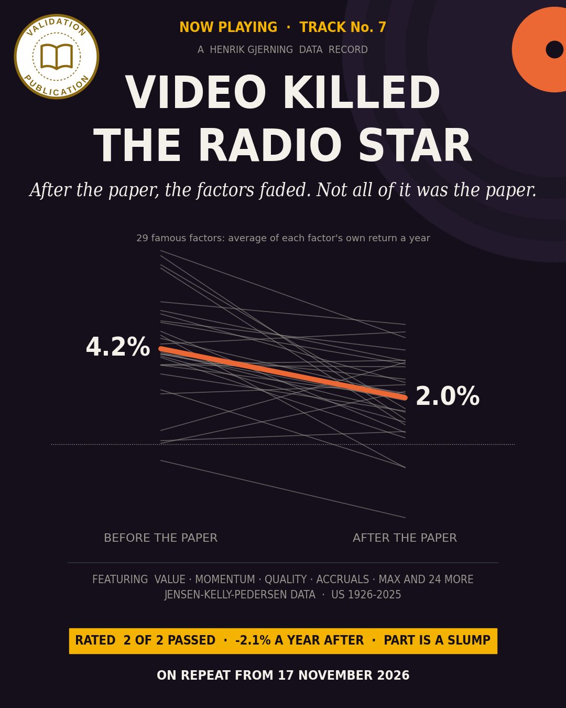
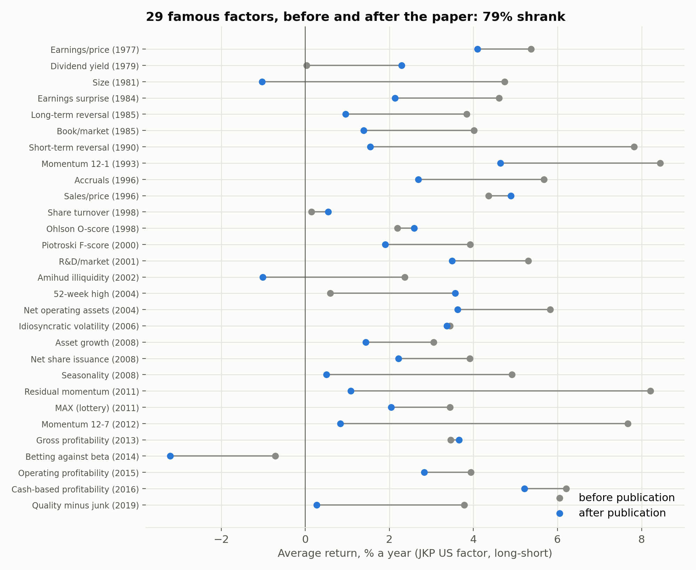
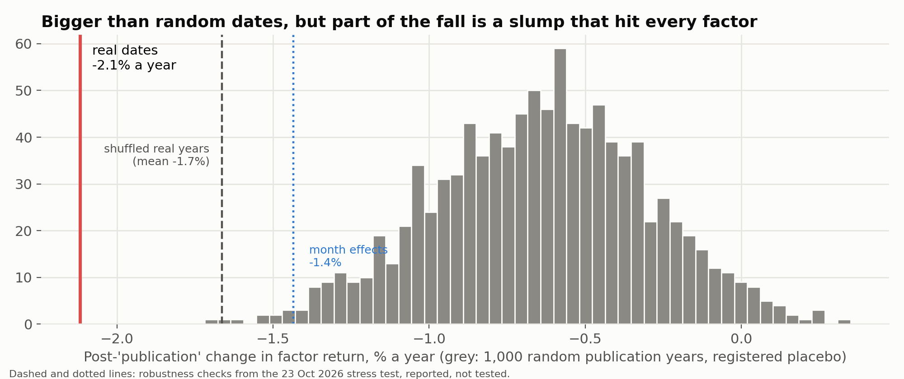

# Video Killed the Radio Star: does publication kill a factor?

### 29 famous factors, before and after the paper that made them famous



*Henrik Gjerning · Rude Investment Consulting · Revised 23 October 2026 (stress test); publishes 17 November 2026 · Project 10, article A07 (registered as A08)*

<!-- interval:guess -->
> **The teaser asked.** 1) Is it the paper, or just the calendar? 2) Which stars faded, and which kept singing? 3) Is what's left worth paying for? *Answers at the end, before the verdict.*
<!-- /interval -->

> **In one paragraph.** Every factor has a birthday: the year a paper made it famous. McLean & Pontiff (2016) found that returns on 97 anomalies were 26% lower after the original sample ended and 58% lower after publication. I repeated the test on 29 of the best-known US factors (value, momentum, profitability, accruals, low volatility, MAX and more), using Jensen, Kelly & Pedersen's (2023) public factor data to 2025. **After publication, returns fell by 2.1% a year, 51% of the pre-publication average** (t -2.70), and they **stayed positive: +2.5% a year** on average (t 2.31), before costs. Both pre-registered trials passed, as predicted. How much of the fall the papers *caused* is less clear. Random publication years produce a much smaller fall (0.6%), but the real years cluster around 2000, just before a slump that hit every factor. Shuffling the real years between factors already produces a fall of 1.7%, and allowing for swings common to all factors leaves 1.4% (t -1.4). Net of that slump, between about 11% and 36% of the old premium went with publication (reported, not tested).

**Statistics box.** JKP US factors: capped value-weighted tercile long-short, signed as the original paper predicts. Pre-publication = first month → December of the publication year; post = the following January → Dec 2025. A08-1: pooled regression of monthly returns on a post-publication dummy with factor fixed effects, standard errors clustered by month. A08-2: equal-weighted average of the factors in their post-publication months, NW t (6 lags). Registered placebo: 1,000 sets of random publication years (at least 10 years into each factor's data, no later than 2015). Two trials, gate 0.025. **Both passed.** Programme-wide (302 trials, Benjamini–Hochberg): A08-1 q 0.045 (passes at a 5% false discovery rate), A08-2 q 0.102 (fails at both 5% and 10%); neither survives Holm at 5%. Robustness checks added in the 23 October stress test (shuffled real years, month fixed effects) are reported, not tested.

---

## 1. Why this matters now

Factor funds and ETFs sell published factors, and almost every product is marketed on a backtest that includes the years before the factor was published. Harvey, Liu & Zhu (2016) argued that many published factors are false discoveries; Hou, Xue & Zhang (2020) found that most fail to replicate once microcaps are handled carefully; Jensen, Kelly & Pedersen (2023) replied that most do replicate. McLean & Pontiff (2016) separated two effects: returns were 26% lower in the years after the original sample ended but before publication (a sign of data mining) and 58% lower after publication (data mining plus investors trading on the paper). Falck, Rej & Thesmar (2022) put out-of-sample performance at about half of in-sample. For anyone buying a factor fund, the number that matters is the post-publication return, not the backtest.

This design does not have each paper's sample-end date, so its "before" period pools the original sample, earlier data (JKP go back to 1926) and the post-sample years. It cannot separate data mining from arbitrage; its 51% is the counterpart of McLean & Pontiff's 58%, not of their 26%.

## 2. Results

**Table 1. The pre-registered trials**

| Trial | Hypothesis | Estimate | t | p (one-sided) | Gate | Programme q (BH) | Verdict |
|---|---|---:|---:|---:|---:|---:|---|
| A08-1 | Factor returns fall after publication | **-2.1%** a year (51% of the pre-publication average of 4.2%) | -2.70 | 0.0034 | 0.025 | 0.045 | **PASS** |
| A08-2 | Factors still earn a positive return after publication | **+2.5%** a year (before costs) | 2.31 | 0.0104 | 0.025 | 0.102 | **PASS** |



**Is it the paper, or just the calendar?** The registered placebo draws random publication years from each factor's own history. They produce an average fall of only 0.6% a year, and none of 1,000 sets is as low as the real 2.1% (the lowest is -1.7%). That rules out a fall of this size by chance placement. It does not rule out the calendar. The real publication years average 2000, so most "after" months fall in the 2010s and early 2020s, when factor returns were weak across the board. Two checks added in the stress test (reported, not tested) take that into account:

- **Shuffled real years.** Giving each factor another factor's publication year (2,000 shuffles) produces an average fall of 1.7% a year; 3.8% of shuffles are as low as the real fall.
- **Month effects.** Adding a separate effect for every month, which absorbs swings common to all factors, leaves a fall of 1.4% a year (t -1.40), which would not pass the gate.

So most of the fall lines up with publication, but part of it is the post-2010 slump that hit every factor. Net of the slump, between about 11% (shuffled years) and 36% (registered placebo, month effects) of the old premium went with publication.



**After publication.** A08-2 averages, month by month, the factors that are past their publication year: +2.5% a year. Its early years rest on few factors: one in 1978, six by 1990, ten by 1997. The simpler average of the 29 factors' own post-publication returns is 2.0% a year, which is the number on the poster. Both are before costs.

## 3. Factor by factor

**Table 2. All 29 factors (reported)**

| Factor | Paper | Data from | Before, % a year | After, % a year | t after | Decay |
|---|---|---|---:|---:|---:|---:|
| Earnings/price | Basu (1977) | 1950 | +5.4 | +4.1 | 1.5 | +24% |
| Dividend yield | Litzenberger & Ramaswamy (1979) | 1926 | +0.0 | +2.3 | 1.0 | n/a |
| Size | Banz (1981) | 1926 | +4.7 | -1.0 | -0.7 | +122% |
| Earnings surprise | Foster, Olsen & Shevlin (1984) | 1964 | +4.6 | +2.1 | 3.1 | +54% |
| Long-term reversal | De Bondt & Thaler (1985) | 1931 | +3.8 | +1.0 | 0.6 | +75% |
| Book/market | Rosenberg, Reid & Lanstein (1985) | 1950 | +4.0 | +1.4 | 0.6 | +65% |
| Short-term reversal | Jegadeesh (1990) | 1926 | +7.8 | +1.5 | 0.9 | +80% |
| Momentum 12-1 | Jegadeesh & Titman (1993) | 1927 | +8.4 | +4.6 | 1.6 | +45% |
| Accruals | Sloan (1996) | 1951 | +5.7 | +2.7 | 1.8 | +53% |
| Sales/price | Barbee, Mukherji & Raines (1996) | 1950 | +4.4 | +4.9 | 1.3 | -12% |
| Share turnover | Datar, Naik & Radcliffe (1998) | 1926 | +0.1 | +0.5 | 0.2 | n/a |
| Ohlson O-score | Dichev (1998) | 1951 | +2.2 | +2.6 | 1.5 | -18% |
| Piotroski F-score | Piotroski (2000) | 1952 | +3.9 | +1.9 | 1.0 | +51% |
| R&D/market | Chan, Lakonishok & Sougiannis (2001) | 1951 | +5.3 | +3.5 | 1.6 | +34% |
| Amihud illiquidity | Amihud (2002) | 1926 | +2.4 | -1.0 | -0.6 | +143% |
| 52-week high | George & Hwang (2004) | 1926 | +0.6 | +3.6 | 0.9 | n/a |
| Net operating assets | Hirshleifer et al. (2004) | 1951 | +5.8 | +3.6 | 2.4 | +38% |
| Idiosyncratic volatility | Ang et al. (2006) | 1951 | +3.4 | +3.4 | 1.0 | +2% |
| Asset growth | Cooper, Gulen & Schill (2008) | 1951 | +3.1 | +1.4 | 0.6 | +53% |
| Net share issuance | Pontiff & Woodgate (2008) | 1927 | +3.9 | +2.2 | 0.9 | +43% |
| Seasonality | Heston & Sadka (2008) | 1927 | +4.9 | +0.5 | 0.3 | +90% |
| Residual momentum | Blitz, Huij & Martens (2011) | 1953 | +8.2 | +1.1 | 0.7 | +87% |
| MAX (lottery) | Bali, Cakici & Whitelaw (2011) | 1926 | +3.4 | +2.0 | 0.5 | +41% |
| Momentum 12-7 | Novy-Marx (2012) | 1927 | +7.7 | +0.8 | 0.3 | +89% |
| Gross profitability | Novy-Marx (2013) | 1950 | +3.5 | +3.7 | 1.3 | -6% |
| Betting against beta | Frazzini & Pedersen (2014) | 1928 | -0.7 | -3.2 | -0.7 | n/a |
| Operating profitability | Fama & French (2015) | 1950 | +3.9 | +2.8 | 0.8 | +28% |
| Cash-based profitability | Ball et al. (2016) | 1951 | +6.2 | +5.2 | 2.1 | +16% |
| Quality minus junk | Asness, Frazzini & Pedersen (2019) | 1955 | +3.8 | +0.3 | 0.1 | +93% |

*Decay = 1 − after/before. "n/a" where the pre-publication average is below 1% a year, where the ratio means little. Decays above 100% mean the factor turned negative after publication.*

The price-based signals faded most: short-term reversal, residual and intermediate momentum, seasonality. The profitability factors barely moved, and the other accounting-based factors (accruals, net operating assets, asset growth) lost about half, close to the average. Quality minus junk (an accounting-based factor) fell to almost nothing, but it has only 72 months after its paper (t 0.06). It is tempting to read this as "cheap-to-copy signals are arbitraged faster", but that was not tested, and the faders include the factors that are most expensive to trade because of their turnover (short-term reversal, momentum); McLean & Pontiff's "low arbitrage cost" refers to liquid, low-risk stocks, not to cheap data. Size and illiquidity turned negative after publication. Low beta (betting against beta) was negative both before and after in this unlevered, value-weighted form.

**Positive is not the same as reliable.** 26 of 29 factors stayed positive after publication, but only 3 are significant on their own: earnings surprise (t 3.1), net operating assets (t 2.4), cash-based profitability (t 2.1). Many have short post-publication histories.

## 4. What this does and does not show

- **Verdict of record.** A08 uses JKP's published factor returns, not a stock list, so the 23 October rule (the corrected point-in-time list is the record) does not apply: the registered run is the record.
- **Correlation, not cause.** The tests show that returns fell after publication; they do not show that the papers caused it. The arbitrage explanation is McLean & Pontiff's, and the robustness checks above show that part of the fall is a common slump.
- **Publication years are the journal years** of the papers listed. Working-paper versions often circulated earlier, which would move the break forward.
- **Years checked against JKP's own factor-details table** (Jensen, Kelly & Pedersen, `Factor Details.xlsx`, bkelly-lab/ReplicationCrisis). 26 of 29 match. Three differ for a stated reason: for earnings/price JKP cite Basu's 1983 paper, I use his 1977 paper; for quality-minus-junk JKP give 2018 (online), the journal year is 2019; for cash-based profitability JKP give no citation (Ball et al., 2016). Re-run with JKP's years: fall -2.1% a year (t -2.62) and post-publication return 2.7% (t 2.51); the factor-by-factor shares are unchanged. Both verdicts unchanged; reported, not a trial.
- **Before costs.** All returns are gross; no trading costs are modelled.
- **Unlevered, value-weighted terciles.** Factors built on small caps or with leverage (like the original BAB) behave differently.
- **29 factors, not 97 or 153.** I chose factors whose founding paper I could name with confidence. The full open-source library of Chen & Zimmermann (2022) would allow a broader test.
- **US only.** Jacobs & Müller (2020) find little post-publication decline outside the US. Linnainmaa & Roberts (2018) show that many accounting anomalies are also weak in the years *before* their original samples, another sign of data mining.
- **Programme count.** Two trials here; 302 in the programme-wide gate (23 October 2026).

<!-- interval:joke -->
> **The teaser's questions, answered.**
>
> 1. **Is it the paper, or just the calendar?** Partly the calendar. With 1,000 sets of random publication years the drop averages only 0.6% a year against the real 2.1%, and none is as low (the lowest is -1.7%). But the real years cluster around 2000, just before a slump that hit every factor. Shuffling the 29 real years between the factors gives an average drop of 1.7% a year (3.8% of 2,000 shuffles reach the real figure), and allowing for month-by-month swings common to all factors leaves a drop of 1.4% a year (t -1.4, not significant). Net of the slump, publication accounts for between about a tenth and about a third of the old premium (section 2, Figure 2; reported, not tested).
> 2. **Which stars faded, and which kept singing?** The price-based signals faded most: short-term reversal 7.8% to 1.5% a year, momentum 12-7 7.7% to 0.8%, residual momentum 8.2% to 1.1%, quality minus junk 3.8% to 0.3% (only six years after its paper). Profitability barely moved: gross profitability 3.5% to 3.7%, cash-based profitability 6.2% to 5.2%. Size went from +4.7% to -1.0% (section 3, Table 2).
> 3. **Is what's left worth paying for?** Some of it. After publication the average factor still earned +2.5% a year (A08-2, t 2.31), and 26 of 29 stayed positive, but only 3 are significant on their own: earnings surprise, net operating assets and cash-based profitability. These are returns before costs: a 1% fee would take about 40% of what is left (section 3, Table 1).
<!-- /interval -->

## 5. Verdict

Both registered tests passed. After publication the average factor's return fell by about half, from 4.2% to roughly 2% a year, and it stayed positive, before costs. What this study cannot say is how much of the fall the papers caused: the real publication years sit just before a slump that hit every factor, and net of that slump between about 11% and 36% of the old premium went with publication. For an investor the practical lesson survives either way: when you read a factor backtest, expect roughly half of the pre-publication return, and then ask whether the fee eats the rest.

<!-- research -->
## What I would research next

**Not researched here**

- The other 70 or so anomalies in the full factor libraries.
- Non-US markets (Jacobs & Müller, 2020, find little post-publication decline outside the US).

**With more or better data**

- Working-paper dates (SSRN) and each paper's sample-end date, to split data-mining from post-publication decay as McLean & Pontiff do.
- Stock-level data to build factors with small caps and leverage.

**With better analysis**

- Decay by factor family (value, momentum, quality).
- Whether decay was faster for factors that are cheap to arbitrage (liquid, low idiosyncratic risk).
- A registered test that controls for the common post-2010 slump (month effects, shuffled years).
<!-- /research -->

## Reproduce

```bash
# data: download the JKP US factor returns (jkpfactors.com) and Factor Details.xlsx (github.com/bkelly-lab/ReplicationCrisis)
# into data/ (see data/README.md); they are not redistributed here.
python code/run_decay.py                  # A08-1..2 + placebo, results/summary.json
python code/check_pubyears.py             # publication years vs JKP's table
python code/robustness_2026-10-23.py      # shuffled years, month effects (reported, not tested)
python code/make_teaser_drawing.py && python code/make_figures.py && python code/build_article.py
```

## References

- Chen, A. Y. & Zimmermann, T. (2022). Open source cross-sectional asset pricing. *Critical Finance Review*, 11(2).
- Falck, A., Rej, A. & Thesmar, D. (2022). When systematic strategies decay. *Quantitative Finance*, 22(11).
- Harvey, C. R., Liu, Y. & Zhu, H. (2016). … and the cross-section of expected returns. *Review of Financial Studies*, 29(1).
- Hou, K., Xue, C. & Zhang, L. (2020). Replicating anomalies. *Review of Financial Studies*, 33(5).
- Jacobs, H. & Müller, S. (2020). Anomalies across the globe: once public, no longer existent? *Journal of Financial Economics*, 135(1).
- Jensen, T. I., Kelly, B. & Pedersen, L. H. (2023). Is there a replication crisis in finance? *Journal of Finance*, 78(5).
- Linnainmaa, J. T. & Roberts, M. R. (2018). The history of the cross-section of stock returns. *Review of Financial Studies*, 31(7).
- McLean, R. D. & Pontiff, J. (2016). Does academic research destroy stock return predictability? *Journal of Finance*, 71(1).
- The 29 founding papers are listed in Table 2 and in `PREREGISTRATION_A08_2026-09-25.md`.

*Not investment advice. Song title used as a cultural reference only; no lyrics are quoted.*
