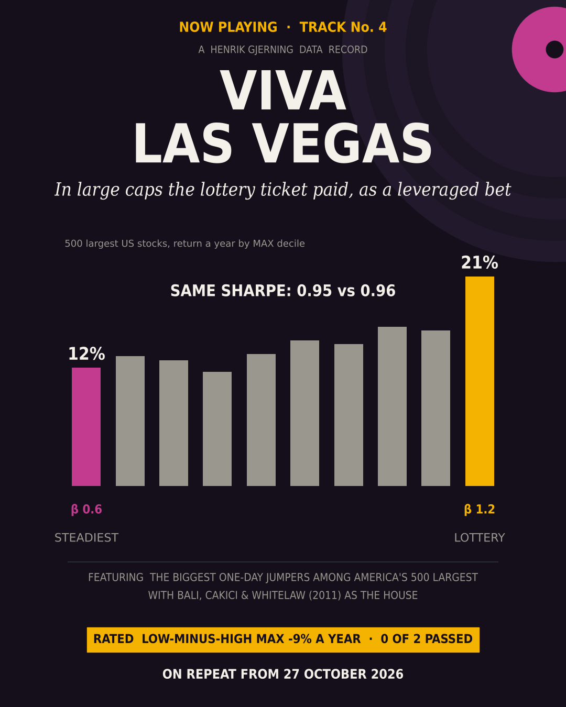
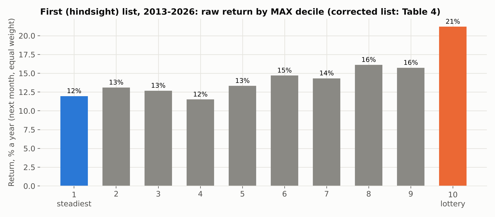
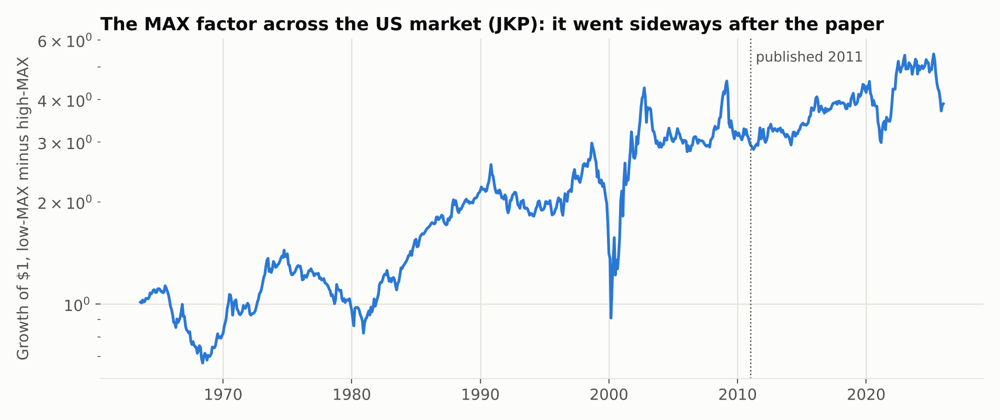
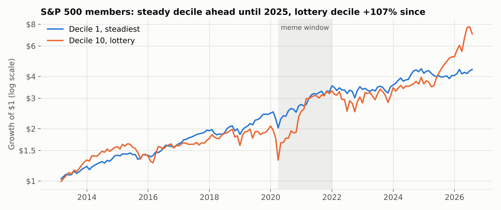
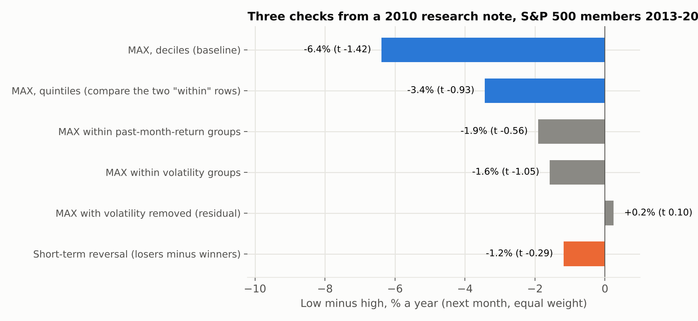

# Viva Las Vegas: do lottery stocks still lose?

### The MAX effect after publication, and in the stocks most people own



*Henrik Gjerning · Rude Investment Consulting · September 2026, updated October 2026 · Project 10, article A04*

<!-- interval:guess -->
> **The teaser asked.** 1) Did the gamblers win, or did they just carry more risk? 2) Which flaw in my own stock list was worth 3% a year, and which way did it push the result? 3) How much of 13 years comes down to the last 20 months? *Answers at the end, before the verdict.*
<!-- /interval -->

> **In one paragraph.** Bali, Cakici & Whitelaw (2011) found that stocks with the biggest one-day jumps in the past month ("lottery stocks") go on to underperform. Investors overpay for the chance of another jackpot. I pre-registered two tests. **Across the whole US market (JKP data), after the paper:** low-MAX minus high-MAX earned +2.0% a year (t 0.55). That is positive, but not distinguishable from zero. **In the 500 largest US stocks, 2013–2026:** the lottery decile *beat* the steadiest decile by 9% a year. The catch: per unit of risk they were level (Sharpe ratios 0.82 and 0.86), and the lottery decile had twice the beta (1.2 vs 0.6) during one of the strongest bull markets on record. In large caps, a lottery ticket was a leveraged bet on the market. Both trials failed. **Then I fixed a flaw flagged in advance** (in the pre-registration of the stock list A04 borrowed): the list knew which companies would later join the S&P 500. On the actual members of each date, the lottery decile's lead shrinks to 6% a year, and the steady names come out ahead per unit of risk (0.79 against 0.67), though not by a margin the data can confirm. **A factor model absorbs the rest:** lottery stocks are high-beta and low-profitability, and once market, size, value, profitability, investment and momentum are priced, low-MAX minus high-MAX is -1.7% a year (t -0.58, 95% interval roughly -7% to +4%). Nothing detectable is left for MAX to explain, but a moderate discount cannot be ruled out. One caution: the tests could only have detected effects of about 10% a year or more, so “not detected” is not the same as “gone”.

**Statistics box.** A04-1: JKP US `rmax1_21d` factor (capped value-weighted terciles), Jan 2012 → Dec 2025, NW t (6 lags). A04-2: the top 500 by market cap among every name ever in the S&P 500 (a hindsight list, corrected in section 3); MAX = largest daily return in the formation month; equal-weighted deciles held one month; D1 − D10, NW t (3 lags). Two trials, one-sided gate 0.025. **Both failed**, also on the corrected universe in section 3. Reported, not gated (section 4): CAPM, Fama–French five-factor and five-factor-plus-momentum alphas (Ken French data, NW t, 3 lags), 95% confidence intervals, excess-return Sharpe ratios with block-bootstrap intervals, up- vs down-market months; (section 5) three checks from a 2010 bank research note: short-term reversal, volatility-neutral MAX, long vs short leg.

---

## 1. Why this matters now

Zero-commission apps, options on single stocks and the 2020–21 meme-stock wave made lottery-style trading more popular than ever. The behavioural theory is well established: investors with a taste for positive skewness overpay for it (Barberis & Huang 2008), and retail gamblers concentrate in lottery-like stocks (Kumar 2009). The question is whether the resulting underperformance survives outside the small-cap corner where it was found.

## 2. Results

**Table 1. The pre-registered trials**

| Trial | Hypothesis | Window | Mean, % a year | 95% CI | NW t | p (one-sided) | Gate | Verdict |
|---|---|---|---:|---:|---:|---:|---:|---|
| A04-1 | Low-MAX beats high-MAX, whole US market (JKP) | 2012–2025 | **+2.0** | -5.2 to +9.3 | 0.55 | 0.291 | 0.025 | fail |
| A04-2 | Low-MAX beats high-MAX, 500 largest (first, hindsight list; verdict of record) | 2013-02 → 2026-08 | **-9.2** | -18.6 to +0.1 | -1.93 | 0.973 | 0.025 | fail (opposite sign) |



**Table 2. Returns by MAX decile, 500 largest, 2013–2026 (first, hindsight list)**

| Decile (1 = steadiest, 10 = lottery) | 1 | 2 | 3 | 4 | 5 | 6 | 7 | 8 | 9 | 10 |
|---|---:|---:|---:|---:|---:|---:|---:|---:|---:|---:|
| Return, % a year | 12.0 | 13.1 | 12.7 | 11.5 | 13.3 | 14.7 | 14.3 | 16.1 | 15.7 | 21.2 |

**Table 3. What the lottery decile really was (first, hindsight list)**

| | Decile 1 (steadiest) | Decile 10 (lottery) |
|---|---:|---:|
| Average MAX (biggest daily gain in the month) | 1.5% | 9.1% |
| Volatility (60-day, annualised) | 20% | 44% |
| Beta | 0.64 | 1.22 |
| Sharpe ratio (excess of T-bills) | 0.82 | 0.86 |



In the original sample period (1963–2005) the JKP MAX factor earned +4.0% a year (t 1.48). This value-weighted, tercile-based version is milder than Bali et al.'s decile sort. After publication it earned about half of that. During the meme window (April 2020 → December 2021), low-minus-high MAX in the 500 largest stocks lost 21% a year (23% on the corrected universe): the lottery tickets won. But the window starts at the Covid low, and the market then rose 92% above T-bills in 21 months; after allowing for market risk the loss is about 3% a year on either list. The meme window was mostly a high-beta rebound.

## 3. What changed when the universe was fixed

The pre-registration of A06, whose stock list A04 adopted, named one bias before anything was run (A04's own pre-registration did not repeat the warning, and called the list "point-in-time", which it was not): the ticker list holds every company that was in the S&P 500 at any time from 2012 to 2026, and the "500 largest" were picked from that list. A company whose stock jumped in 2015 and joined the index in 2019 can sit in the 2015 sample, as a lottery stock that is known to have won. The mechanism is simple: companies join the S&P 500 because their market value has grown, so a list built with hindsight is full of firms whose prices later went up. The steady names in decile 1 are mostly long-standing members, so hindsight changes little there. The jumpy, fast-growing names in decile 10 are where the future joiners sit, and that is where the bias lands. Table 4 shows it: decile 1's return barely moves (12.0% → 11.6%), while decile 10 loses almost 4 points (21.2% → 17.5%). I re-ran A04-2 with one change (1 October 2026, after the results; a robustness check, not a new trial, and Table 1 keeps the verdict of record): on each date, the universe is the companies actually in the S&P 500 that day, from the index provider's own add/remove history. Same code, same deciles. On the 1 October data files a re-run with the original list reproduced the published numbers, so the differences below come from the universe. Later data updates move both versions by 0.2–0.4 points and leave the gap near 3 points. The corrected universe is also not quite "the 500 largest": S&P adds companies only after they have been profitable, so part of the change is a different list, not only the removal of hindsight. A04-1 uses JKP factor data and does not change.

**Table 4. Published universe vs corrected universe**

| 500 largest, 2013–2026 (A04-2) | Published universe (top 500 among every name ever in the S&P 500) | Corrected universe (actual S&P 500 members on each date) |
|---|---:|---:|
| Low-MAX minus high-MAX, % a year (NW t) | -9.2 (-1.93) | **-5.9** (-1.30) |
| Return, steadiest decile / lottery decile, % a year | 12.0 / 21.2 | 11.6 / 17.5 |
| Sharpe ratio (excess of T-bills), steadiest / lottery | 0.82 / 0.86 | **0.79 / 0.67** |
| 95% interval for the difference in Sharpe ratios (block bootstrap) | -0.56 to +0.40 | -0.35 to +0.53 |
| Beta, steadiest / lottery | 0.64 / 1.22 | 0.64 / 1.23 |
| 95% confidence interval, low minus high, % a year | -18.6 to +0.1 | -14.8 to +3.0 |
| Low minus high after allowing for market risk (CAPM alpha), % a year (t) | -0.0 (-0.01) | +3.4 (0.94) |
| Verdict (gate p < 0.025) | fail, opposite sign | fail, opposite sign |

The verdict does not move: the lottery decile still out-earned the steadiest one in raw return. But two things change. The gap shrinks from 9% to 6% a year, and per unit of risk the order flips: on the first list the lottery decile was marginally ahead (0.86 against 0.82), on the corrected one the steady decile is (0.79 against 0.67). Neither difference is one the data can confirm (Table 4). Allowing for market risk (a CAPM regression), low-MAX minus high-MAX moves to +3.4% a year: the direction Bali, Cakici & Whitelaw found, though well within noise (t 0.94). The adjusted figures are reported, not tested.

## 4. Beta, profitability and the bull market (reported, not gated)

These analyses were added after review. They help explain the verdict; they cannot change it. All use the corrected universe unless marked.

**Table 5. Factor-adjusted returns, actual S&P 500 members, 2013-02 → 2026-07**

| Alpha, % a year (NW t) | Market only (CAPM) | Fama–French 5 factors | 5 factors + momentum |
|---|---:|---:|---:|
| Decile 1, steadiest | +1.1 (0.53) | +0.3 (0.18) | -0.6 (-0.35) |
| Decile 10, lottery | -2.3 (-0.73) | -0.2 (-0.09) | +1.1 (0.51) |
| **Low-MAX minus high-MAX** | +3.4 (0.94) | +0.5 (0.17) | -1.7 (-0.58) |
| *Low minus high, published universe* | *-0.0 (-0.01)* | *-2.9 (-0.87)* | *-4.1 (-1.29)* |

Against the market alone, the lottery tickets' extra return disappears and the gap turns slightly positive. Add the Fama–French factors and it shrinks towards zero. Add momentum and it changes sign. In the full model, low-MAX minus high-MAX loads -0.51 on the market and **+0.87 on profitability** (RMW): the lottery decile behaves like a basket of low-profitability companies, the steady decile like a basket of profitable ones. Buying low MAX in large caps is mostly a short-beta, long-profitability bet. None of the alphas comes near significance.

**Table 6. Up and down markets**

| Actual S&P 500 members | Up-market months (107) | Down-market months (55) | 2022 (calendar year) |
|---|---:|---:|---:|
| Market, % (excess return in up/down months; total return in 2022) | +41 a year | -41 a year | -19.9 |
| Steadiest decile, % | +30 a year | -24 a year | -4.6 |
| Lottery decile, % | +52 a year | -51 a year | -14.8 |
| **Low-MAX minus high-MAX**, % | **-22** a year | **+27** a year | +10.3 |

Up and down months show the average month × 12; 2022 is the actual calendar-year return. The pattern is roughly what a higher beta predicts: the lottery decile rose faster in up months and fell faster in down months (2022 is the exception: it fell less than its beta implies). In the 55 months the market fell, low-MAX minus high-MAX earned +27% a year. In 2022, the one bear year in the sample, the steady decile lost 4.6% and the lottery decile 14.8%. With 107 up months against 55 down months, the raw result is mostly a statement about the market.



Figure 3 shows how much rests on the last stretch. On the actual S&P 500 members, after 143 of the 163 months (to the end of 2024), $1 in the steady decile had grown to $4.17, against $3.63 in the lottery decile. Then, from January 2025, the lottery decile rose 107% in 20 months while the steady decile rose 3%. The raw A04-2 result is largely a story about those 20 months.

**How small an effect could these tests see?** Given the noise in the data, A04-1 had an 80% chance of passing only if the true effect was at least 10% a year. That is far more than the 4.0% the JKP factor earned before publication. For A04-2 the bar is 13% a year. So A04-1 could not have detected an effect the size of the JKP factor's pre-publication premium; A04-2's bar is about the size of Bali, Cakici & Whitelaw's original decile spread (about 1% a month), so only an effect at least that large would reliably have shown. “Not detected” here means small or absent, not shown to be zero. The 95% intervals in Tables 1 and 4 give the range the data allow.

## 5. Three more questions (reported, not gated)

In December 2010, just before Bali, Cakici & Whitelaw's paper appeared in print, a research note from Deutsche Bank's quantitative strategy team (*DB Quant Handbook*) put the lottery factor through three questions: is it just short-term reversal, is it just volatility, and which side of the trade pays? On US and Canadian stocks up to 2010 their answers were (DB Quant Handbook, pp. 678–683): not reversal (a rank IC of 4.6% for MAX against 2.3% for one-month reversal in the US, and far more persistent, so far less turnover); volatility-neutralising helped in the most recent years; and the payoff came mostly from the short side. I asked the same three questions of the A04-2 universe. They are added after the trials and cannot change the verdict. One note: on today's data files the baseline spread is -6.4% a year rather than the -5.9% in Table 4 (the data files have been updated since 1 October); every number in this section is measured against that same-run baseline (deciles here are formed by rank, which moves the baseline by 0.06 points against the code of record). Alphas in this section are on today's files, so they differ slightly from Table 5.

**Table 7. The lottery spread with reversal and volatility held fixed, and by leg**

| Actual S&P 500 members, 2013-02 → 2026-08 | Low minus high, % a year (NW t) |
|---|---:|
| MAX, deciles (baseline, today's data files) | -6.4 (-1.42) |
| MAX, quintiles | -3.4 (-0.93) |
| MAX quintiles within last month's return quintiles (reversal held fixed) | -1.9 (-0.56) |
| MAX quintiles within 60-day volatility quintiles (volatility held fixed) | -1.6 (-1.05) |
| MAX with volatility removed (residual MAX, deciles) | +0.2 (0.10) |
| Short-term reversal itself (last month's losers minus winners, deciles) | -1.2 (-0.29) |
| Long leg: steadiest decile minus all members | -1.7 (-0.91) |
| Short leg: all members minus lottery decile | -4.7 (-1.55) |



- **Is it reversal? The data cannot say either.** Holding last month's return fixed cuts the quintile spread from -3.4% to -1.9% a year, almost as much as holding volatility fixed (below). But reversal itself did not work in large caps after 2012 (-1.2% a year, t -0.29), and the two spreads are unrelated (correlation -0.08). Unlike in the 2010 note, reversal's rank IC (0.91%) is larger than MAX's (0.04%). Both double sorts also shrink spreads mechanically, because MAX varies less inside each group, and both changes are well inside one standard error of the baseline. As the 2010 note found, MAX is a persistent signal and last month's return is not: the month-to-month rank correlation of the MAX scores is 0.35, of past returns -0.01. Adding the reversal spread to the factor model moves the MAX alpha only from -2.2% (t -0.76) to -1.7% (t -0.61).
- **Is it volatility? Perhaps, but the data cannot say.** With volatility held fixed, the lottery stocks' lead shrinks from -3.4% to -1.6% a year (quintiles), and after the factor model to -0.7% (t -0.44). The part of MAX that volatility does not explain earns +0.2% a year (t 0.10). Every one of these numbers is well inside one standard error of the baseline, so neither control changes the spread detectably.
- **Which side pays? As in the 2010 note, the action is in the lottery decile, but here it earned more than the rest rather than less.** Deciles 1 to 9 earned between 11% and 14% a year; decile 10 earned 18%. About three quarters of the spread is the lottery decile against the rest (-4.7% a year, t -1.55); the steady decile against the rest adds -1.7% (t -0.91). In the 2010 note the lottery decile was where the losses were; in large caps after 2012 it is where the gains were, and the factor model cuts the lottery decile's edge over the rest to 2.3% a year (t 1.12), within noise.
- **The signal itself.** The 2010 note's US rank IC for MAX was 4.6% a month. In the actual S&P 500 members 2013–2026 it is 0.04%, and of the right sign: across the whole cross-section MAX points weakly in Bali, Cakici & Whitelaw's direction; the raw gap against it comes from the extreme decile.

None of the three changes the verdict. In modern large caps the MAX spread is too noisy to separate from reversal or volatility; what there is sits in the lottery decile, and factor exposures absorb it.

## 6. What this does and does not show

- **In large caps, MAX is mostly beta and low profitability.** Once you allow for market exposure, the high-MAX stocks earned about what their risk implied, or slightly less on the corrected universe; once profitability and momentum are added, nothing detectable is left (Table 5). This is the same measurement problem as betting against beta (Frazzini & Pedersen 2014; Baker, Bradley & Wurgler 2011): a test that ignores beta rewards leverage in a bull market.
- **2013–2026 is mostly one bull market, and the raw result leans on its last 20 months.** Table 6 shows the raw gap flips sign in falling months; Figure 3 shows the steady decile ahead until 2025. A sample with more bear markets would likely show low MAX ahead in raw return; the factor-adjusted result in Table 5 should depend much less on the cycle.
- **Hindsight-list bias, now measured.** Section 3 corrects it. It tilted the result towards the lottery decile, by about 3 percentage points a year, enough to put the lottery decile marginally ahead per unit of risk.
- **Low power.** The tests could only see large effects (section 4). They rule out a big lottery discount in large caps after 2012, not a small one.
- **Two trials, programme now at 48.** Sections 4 and 5 add no trials.

<!-- interval:joke -->
> **The teaser's questions, answered.**
>
> 1. **Did the gamblers win, or did they just carry more risk?** More risk. The lottery decile had twice the beta (1.2 vs 0.6). After market, size, value, profitability, investment and momentum, nothing detectable is left (-1.7% a year, t -0.58). On the actual S&P 500 members the steady stocks were somewhat ahead per unit of risk (Sharpe 0.79 vs 0.67), but not by a margin the data can confirm (Tables 4 and 5).
> 2. **Which flaw in my own stock list was worth 3% a year, and which way did it push the result?** The list knew which companies would later join the S&P 500. Future joiners sit in the lottery decile, so hindsight flattered it: on the actual members of each date its lead falls from 9% to 6% a year (section 3).
> 3. **How much of 13 years comes down to the last 20 months?** Most of it. At the end of 2024, $1 in the steady decile had grown to $4.17 against $3.63 in the lottery decile. From January 2025 the lottery decile rose 107% in 20 months, the steady one 3% (Figure 3).
<!-- /interval -->

## 7. Verdict

The pre-registered tests find no reliable evidence that lottery stocks have underperformed since Bali, Cakici & Whitelaw (2011): not across the US market, and not in the 500 largest stocks. In large caps the lottery tickets earned more in raw terms, but they carried twice the market risk through a long bull market. On the actual S&P 500 members the steady names did somewhat better per unit of risk, and a standard factor model absorbs the gap: lottery stocks are high-beta, low-profitability companies. The tests were too small to rule out a modest discount, so the honest summary is that the MAX effect in modern large caps is weak or absent, not robust. If you want lottery-like upside in large caps, you are buying beta and weak profitability. Price it as that.

<!-- research -->
## What I would research next

**Not researched here**

- Small caps and microcaps, where lottery demand was originally found.
- Lottery trading through options rather than stocks.

**With more or better data**

- Retail ownership and options volume, to test whether lottery demand moved to options.
- A longer stock-level history with more bear markets.

**With better analysis**

- Better lottery measures: MAX5, MAX scaled by volatility, idiosyncratic skewness, beta-matched MAX.
- Size buckets with the same method.

*Already taken up: A51 Luck Be a Lady (better lottery measures).*
<!-- /research -->

## Reproduce

```bash
python code/run_max.py          # A04-1..2 + reported, results/summary.json (first list)
P10_UNIVERSE=sp500_pit P10_RESULTS=results_pit python code/run_max.py   # corrected universe, results_pit/
python code/reported_stress.py  # excess-return Sharpe ratios, bootstrap, meme-window alpha (added after the stress test)
python code/reported_factor.py  # section 4 (reported, not gated), results_pit/reported_factor.json
P10_UNIVERSE=sp500_pit python code/reported_db2010.py   # section 5 (reported, not gated), results_pit/reported_db2010.json
python code/make_figures.py && python code/build_article.py
```

The data files are updated over time; results of record are from the 1 October 2026 files (section 3).

## References

- Baker, M., Bradley, B. & Wurgler, J. (2011). Benchmarks as limits to arbitrage: understanding the low-volatility anomaly. *Financial Analysts Journal*, 67(1).
- Bali, T. G., Cakici, N. & Whitelaw, R. F. (2011). Maxing out: stocks as lotteries and the cross-section of expected returns. *Journal of Financial Economics*, 99(2).
- Barberis, N. & Huang, M. (2008). Stocks as lotteries: the implications of probability weighting for security prices. *American Economic Review*, 98(5).
- Deutsche Bank Quantitative Strategy (2010). Lottery factor with new faces. *DB Quant Handbook*, 10 December 2010, 678–683.
- Fama, E. F. & French, K. R. (2015). A five-factor asset pricing model. *Journal of Financial Economics*, 116(1).
- Frazzini, A. & Pedersen, L. H. (2014). Betting against beta. *Journal of Financial Economics*, 111(1).
- Jensen, T. I., Kelly, B. & Pedersen, L. H. (2023). Is there a replication crisis in finance? *Journal of Finance*, 78(5).
- Kumar, A. (2009). Who gambles in the stock market? *Journal of Finance*, 64(4).

*Not investment advice. Song title used as a cultural reference only; no lyrics are quoted.*
